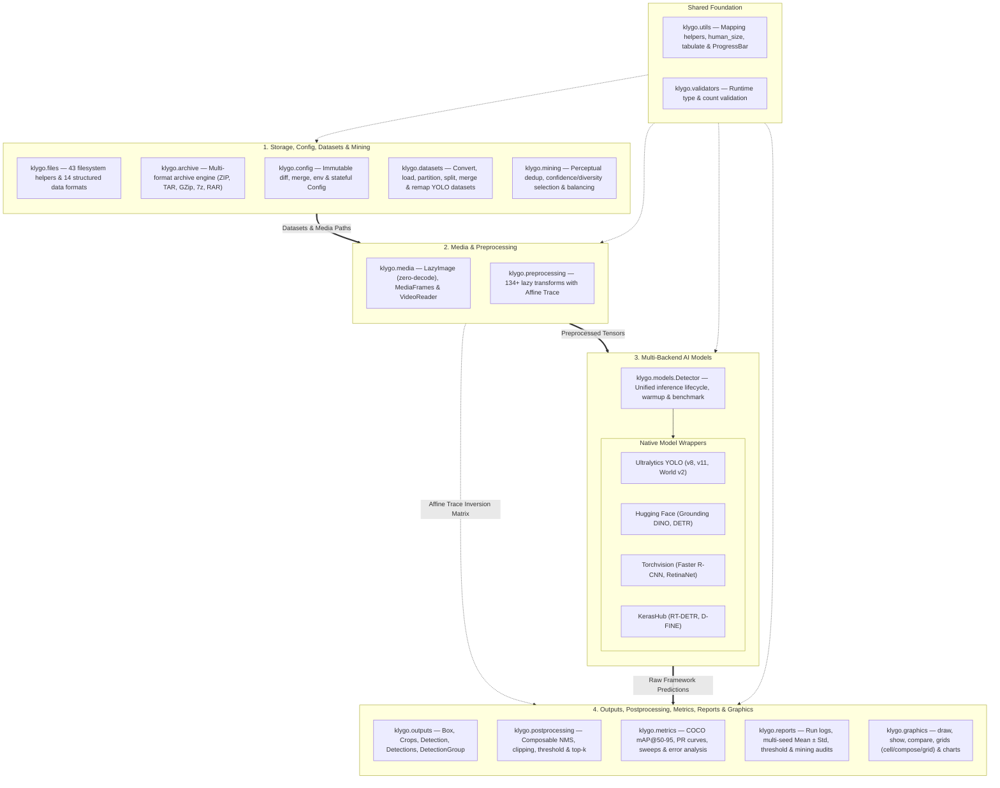
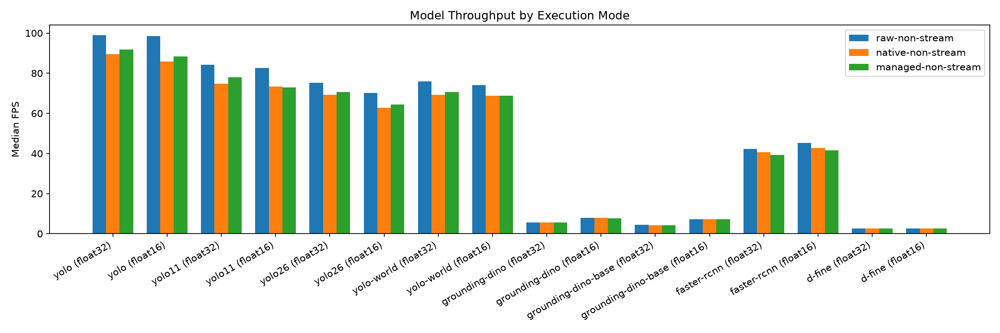
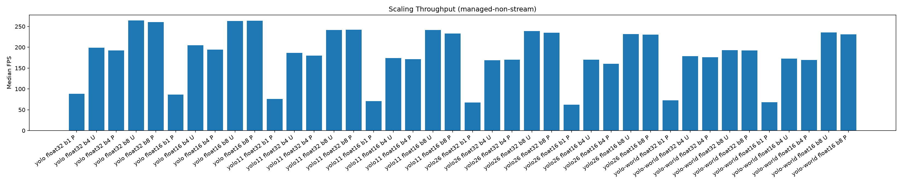
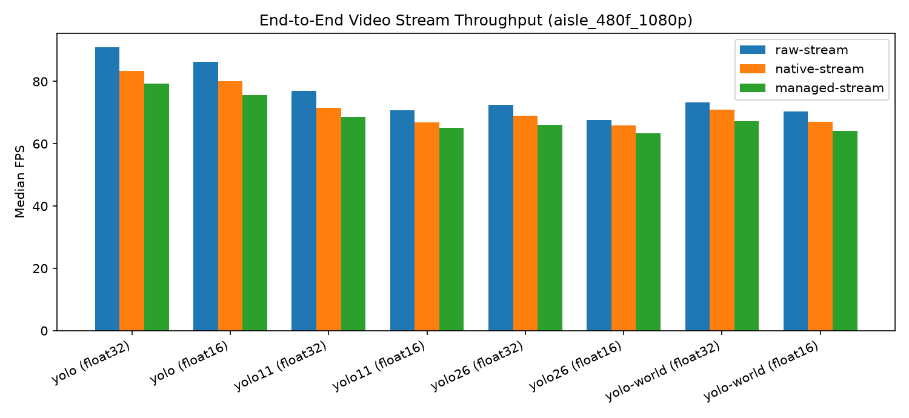
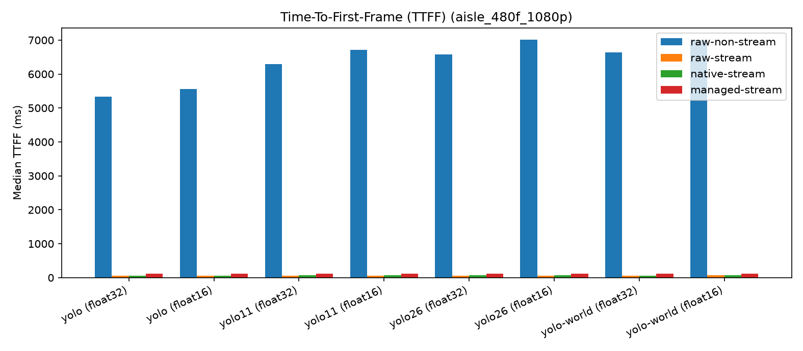
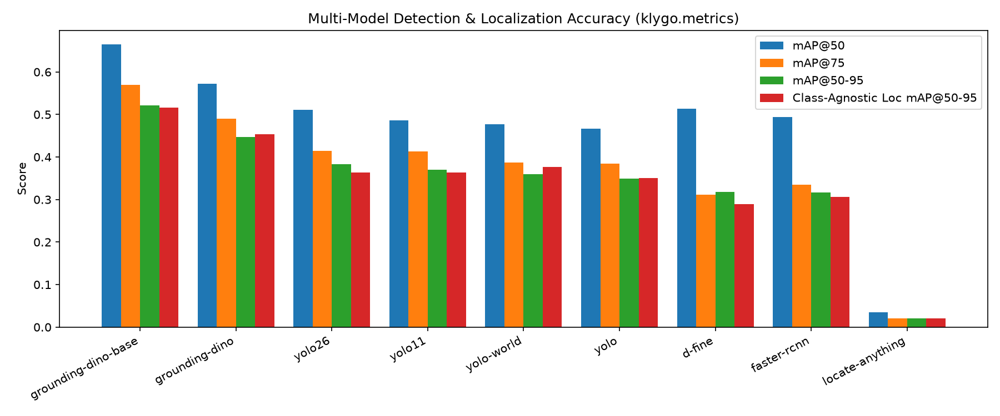
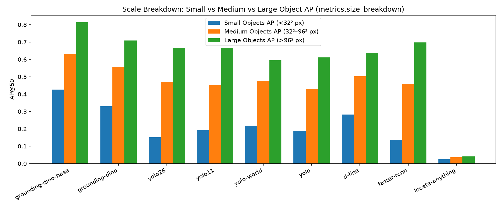
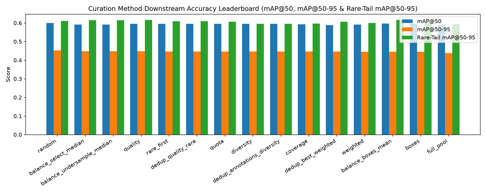
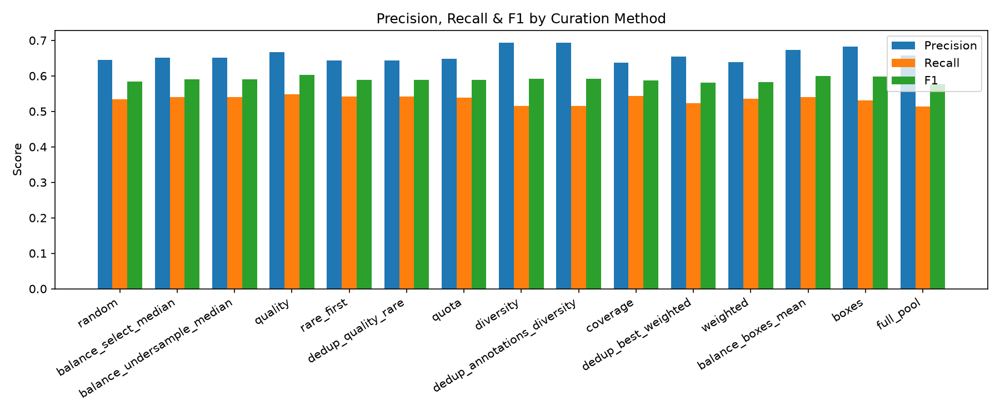

# Klygo

<p align="center">
  <a href="https://pypi.org/project/klygo/"></a>
  <a href="https://www.python.org/downloads/"></a>
  <a href="https://github.com/IchigoMazone/klygo/blob/main/LICENSE"></a>
  <a href="https://github.com/IchigoMazone/klygo/actions"></a>
  <a href="https://deepwiki.com/IchigoMazone/klygo"></a>
</p>

<p align="center">
  <strong>The Modular, Composable Python Toolkit for Multi-Backend Computer Vision, Object Detection, Dataset Mining, and Reproducible Experiment Reporting</strong>
</p>

<p align="center">
  Klygo bridges the divide between raw AI model inference and production Computer Vision engineering. Organized into <strong>4 cooperative layers across 15 public modules</strong>, Klygo provides standardized detection containers, automatic affine coordinate restoration, zero-loss streaming pipelines, active dataset mining, rigorous metric evaluation, multi-seed experiment reporting, publication-ready graphics &amp; composable grids, and seamless interoperability across <strong>Ultralytics, Hugging Face Transformers, Torchvision, and KerasHub</strong>.
</p>

---

## Table of Contents

- [Why Klygo?](#why-klygo)
- [Core Design Principles](#core-design-principles)
- [Architecture & 15 Public Modules](#architecture--15-public-modules)
  - [Layered Dataflow](#layered-dataflow)
  - [Complete Module Directory](#complete-module-directory)
- [Installation](#installation)
  - [Core Package](#core-package)
  - [Optional Backend Extras](#optional-backend-extras)
- [Quick Start & End-to-End Workflows](#quick-start--end-to-end-workflows)
  - [1. End-to-End Inference Pipeline with Affine Coordinate Restoration](#1-end-to-end-inference-pipeline-with-affine-coordinate-restoration)
  - [2. Multi-Backend Detection & Open-Vocabulary Prompting](#2-multi-backend-detection--open-vocabulary-prompting)
  - [3. Subclassing `models.Detector` for Custom Frameworks](#3-subclassing-modelsdetector-for-custom-frameworks)
  - [4. Active Dataset Mining & Curation (`klygo.mining`)](#4-active-dataset-mining--curation-klygomining)
  - [5. Experiment Reporting & Multi-Seed Aggregation (`klygo.reports`)](#5-experiment-reporting--multi-seed-aggregation-klygoreports)
  - [6. Publication-Ready Charts & Composable Grids (`klygo.graphics`)](#6-publication-ready-charts--composable-grids-klygographics)
  - [7. Standardized Files, Archives, Configs & Tables](#7-standardized-files-archives-configs--tables)
- [Benchmark Visualizations & Performance Telemetry](#benchmark-visualizations--performance-telemetry)
  - [Executive Summary](#executive-summary)
  - [Visual Benchmark Gallery](#visual-benchmark-gallery)
- [Documentation & Interactive Tutorials](#documentation--interactive-tutorials)
- [Development, Auditing & Verification](#development-auditing--verification)
- [License](#license)

---

## Why Klygo?

Building real-world Computer Vision systems usually forces engineers and researchers to stitch together incompatible tensor conventions, hand-written letterbox/crop coordinate inversion math, fragile dataset scripts, framework-specific evaluation code, and ad-hoc plotting notebooks.

**Klygo replaces fragmented glue code with a unified, zero-loss modular toolkit:**

1. **Multi-Backend Unity (`klygo.models`)**: A single, backend-neutral `models.Detector` lifecycle wraps **Ultralytics** (`YOLOv8`, `YOLO11`, `YOLO-World v2`), **Hugging Face Transformers** (`Grounding DINO`, `DETR`), **Torchvision** (`Faster R-CNN`, `RetinaNet`, `FCOS`), and **Keras 3 / KerasHub** (`RT-DETR`, `D-FINE` on PyTorch/JAX/TF).
2. **Zero-Loss Streaming Abstraction (`klygo.media`)**: Retains **95.9% to 98.4%** of raw upstream throughput while delivering lazy zero-decode images (`LazyImage`), memory-bounded video streaming (`MediaFrames`), and asynchronous multi-worker prefetching.
3. **Automatic Coordinate Restoration (`klygo.preprocessing`)**: 134+ lazy transforms automatically record affine coordinate traces (`trace`). When a detector predicts bounding boxes on letterboxed, resized, or cropped inputs, Klygo automatically projects coordinates back to the original image space.
4. **Intelligent Dataset Mining & Curation (`klygo.mining`)**: Active dataset auditing, perceptual deduplication, rarity/confidence scoring, K-Means++ diversity clustering, and class balancing. On COCO `val2017`, `klygo.mining` achieves **+23.4% higher downstream mAP** while reducing dataset size and training time by **83.3%**.
5. **Backend-Neutral Metrics & Diagnostics (`klygo.metrics`)**: 13 composable evaluation APIs — COCO `mAP@50-95`, Precision/Recall/F1, PR curves, confusion matrices, scale breakdowns, calibration, error analysis, and IoU/threshold sweeps — running identically across every detector backend with optional CUDA/CuPy acceleration.
6. **Reproducible Experiment Reporting (`klygo.reports`)**: First-class loaders and aggregators for YOLO training logs (`results.csv`, `args.yaml`), dataset partition summaries, multi-seed `Mean ± Std` tables and epoch curves, confidence threshold calibration audits, and mining subset breakdowns.
7. **Unified Graphics & Composable Grid Layouts (`klygo.graphics`)**: Non-destructive two-pass box rendering (`draw`), adaptive display (`show`), side-by-side detection comparisons (`compare`), 300 DPI publication-ready report charts (`partitions`, `curves`, `thresholds`, `mining`, `bars`, `dataset_stats`), and heterogeneous multi-panel grids (`cell`, `compose`, `grid`, `save`).
8. **Strict Cross-Module Dogfooding**: Built-in 14-format structured data I/O (`klygo.files`), 5 archive formats (`klygo.archive`), immutable functional configuration diffs (`klygo.config`), Rich console tables (`utils.tabulate`), and standardized runtime type enforcement (`klygo.validators`).

---

## Core Design Principles

- **High-Level Public Facades**: Always import directly from top-level `klygo` (`from klygo import datasets, graphics, media, metrics, mining, models, outputs, postprocessing, preprocessing, reports, utils`).
- **Composable Pipelines**: Every stage — `preprocessing.compose`, `postprocessing.compose`, `metrics.compose`, and `graphics.compose` — follows a consistent, immutable composition pattern.
- **Non-Destructive by Default**: Image rendering (`graphics.draw`), box filtering (`postprocessing.*`), and frame comparisons (`graphics.compare`) never mutate caller-owned pixels or ground-truth collections unless explicitly requested.
- **Format-Explicit Loaders**: Dataset and training-log readers (`datasets.load`, `reports.load`, `reports.aggregate_runs`, `reports.partition_summary`, `graphics.dataset_stats`) explicitly expose `format="yolo"` and raise clear `TypeError` / `ValueError` diagnostics on invalid inputs.
- **Lightweight Core, Optional Heavy Extras**: Core Klygo installs cleanly with minimal dependencies; PyTorch, Ultralytics, Transformers, Torchvision, KerasHub, CuPy, 7z, and RAR are opt-in extras.

---

## Architecture & 15 Public Modules

### Layered Dataflow

Klygo is organized into four cooperative layers supported by a shared foundation:



### Complete Module Directory

| Layer | Module | Import | Primary Responsibility | Documentation |
| :--- | :--- | :--- | :--- | :--- |
| **Storage & I/O** | `files` | `from klygo import files` | 43 filesystem helpers, checksums, downloads, and 14 structured data formats (JSON, YAML, TOML, CSV, etc.) | [Guide](docs/files/README.md) |
| **Storage & I/O** | `archive` | `from klygo import archive` | Create, inspect, extract, search, convert, split, and merge ZIP, TAR, GZip, 7z, and RAR archives | [Guide](docs/archive/README.md) |
| **Config** | `config` | `from klygo import config, Config` | Immutable functional config helpers (`load`, `get`, `set`, `merge`, `diff`, `from_env`) & stateful `Config` | [Guide](docs/config/README.md) |
| **Datasets** | `datasets` | `from klygo import datasets` | Convert, load, inspect, partition, unpartition, stratify/split, merge, and remap YOLO datasets | [Guide](docs/datasets/README.md) |
| **Mining** | `mining` | `from klygo import mining` | Audit dataset stats, perceptual deduplication, rarity/confidence/diversity selection, clustering, and balancing | [Guide](docs/mining/README.md) |
| **Media** | `media` | `from klygo import media` | Lazy image loading (`LazyImage`), unified indexed/streaming frames (`MediaFrames`), and `VideoReader` | [Guide](docs/media/README.md) |
| **Preprocessing** | `preprocessing` | `from klygo import preprocessing as p` | 134+ lazy transforms, image quality metrics/predicates, and automatic coordinate restoration (`trace`) | [Guide](docs/preprocessing/README.md) |
| **Models** | `models` | `from klygo import models` | 3-tier model hierarchy (`BaseModel`, `Detector`), schema builders, warmup, and multi-backend `load` | [Guide](docs/models/README.md) |
| **Outputs** | `outputs` | `from klygo import outputs` | Standardized detection containers (`Box`, `Crops`, `Detection`, `Detections`, `DetectionGroup`) & `build_detections` | [Guide](docs/outputs/README.md) |
| **Postprocessing** | `postprocessing` | `from klygo import postprocessing as post` | Composable and direct box operations (`nms`, `threshold`, `clip`, `box_iou`, `top`) | [Guide](docs/postprocessing/README.md) |
| **Metrics** | `metrics` | `from klygo import metrics` | 13 detection evaluation tools (COCO mAP, Precision/Recall/F1, PR curves, confusion matrix, sweeps, error analysis) | [Guide](docs/metrics/README.md) |
| **Reports** | `reports` | `from klygo import reports` | Load training logs (`load`), `partition_summary`, multi-seed `aggregate_runs`, `threshold_audit`, `mining_breakdown` | [Guide](docs/reports/README.md) |
| **Graphics** | `graphics` | `from klygo import graphics` | Non-destructive rendering (`draw`, `show`, `compare`, `save`), grids (`cell`, `compose`, `grid`), and charts (`dataset_stats`, `partitions`, `curves`, `thresholds`, `mining`, `bars`) | [Guide](docs/graphics/README.md) |
| **Foundation** | `utils` | `from klygo import utils` | Mapping helpers (`exclude_keys`, `invert`), `human_size`, Rich table rendering (`tabulate`), and `ProgressBar` | [Guide](docs/utils/README.md) |
| **Foundation** | `validators` | `from klygo import validators` | Standardized runtime type and count verification (`validate_type`) raising consistent `TypeError` messages | [Guide](docs/validators/README.md) |

---

## Installation

Klygo requires **Python >= 3.10**. Core installation is lightweight; deep-learning frameworks and specialized archive backends are installed as optional extras.

### Core Package

```bash
# Using pip
pip install klygo

# Using uv
uv add klygo
uv pip install klygo
```

### Optional Backend Extras

Install only the frameworks and capabilities your workflow needs:

| Target Capability | `pip` Command | `uv add` Command | `uv pip` Command |
| :--- | :--- | :--- | :--- |
| **Ultralytics** (`YOLOv8`, `YOLO11`, `YOLO-World`) | `pip install "klygo[ultralytics]"` | `uv add "klygo[ultralytics]"` | `uv pip install "klygo[ultralytics]"` |
| **Hugging Face** (`Grounding DINO`, `Transformers`) | `pip install "klygo[transformers]"` | `uv add "klygo[transformers]"` | `uv pip install "klygo[transformers]"` |
| **Torchvision** (`Faster R-CNN`, `RetinaNet`, `FCOS`) | `pip install "klygo[torchvision]"` | `uv add "klygo[torchvision]"` | `uv pip install "klygo[torchvision]"` |
| **KerasHub** (`RT-DETR`, `D-FINE` on PyTorch) | `pip install "klygo[keras-hub]"` | `uv add "klygo[keras-hub]"` | `uv pip install "klygo[keras-hub]"` |
| **All Detection Backends** | `pip install "klygo[models]"` | `uv add "klygo[models]"` | `uv pip install "klygo[models]"` |
| **PyTorch Core Runtime Only** | `pip install "klygo[torch]"` | `uv add "klygo[torch]"` | `uv pip install "klygo[torch]"` |
| **CuPy CUDA Acceleration (Metrics / Outputs)** | `pip install "klygo[gpu-outputs]"` | `uv add "klygo[gpu-outputs]"` | `uv pip install "klygo[gpu-outputs]"` |
| **7z Archive Support** | `pip install "klygo[py7zr]"` | `uv add "klygo[py7zr]"` | `uv pip install "klygo[py7zr]"` |
| **RAR Archive Support** | `pip install "klygo[rarfile]"` | `uv add "klygo[rarfile]"` | `uv pip install "klygo[rarfile]"` |

---

## Quick Start & End-to-End Workflows

### 1. End-to-End Inference Pipeline with Affine Coordinate Restoration

Load an image lazily, letterbox it with automatic affine trace tracking, run detector prediction, apply a composable postprocessing pipeline, and render non-destructively with `klygo.graphics`:

```python
from klygo import graphics, media, models, postprocessing, preprocessing

# 1. Load lazy image (zero decoding until pixels are accessed)
img = media.load("street.jpg", verbose=False)

# 2. Apply coordinate-tracked preprocessing
transform = preprocessing.compose(
    preprocessing.letterbox((640, 640)),
    preprocessing.autocontrast(),
)
processed = transform(img)

# 3. Run multi-backend detector (automatically restores coordinates via affine trace)
detector = models.load("yolo11n.pt", threshold=0.35)
detections = detector.predict(processed)

# 4. Apply backend-neutral postprocessing pipeline
clean_pipeline = postprocessing.compose(
    postprocessing.clip(),
    postprocessing.nms(iou=0.5),
    postprocessing.top(20),
)
cleaned = clean_pipeline(detections)

# 5. Non-destructive box rendering and save
annotated = graphics.draw(img, cleaned[0])
media.save(annotated, "artifacts/annotated_street.jpg", overwrite=True, verbose=False)
```

### 2. Multi-Backend Detection & Open-Vocabulary Prompting

Switch between four deep-learning ecosystems with identical calling conventions:

```python
from klygo import models

# Ultralytics YOLOv8 / YOLO11 (supports streaming video)
yolo = models.load("yolo11n.pt")
stream_preds = yolo.predict("traffic.mp4", stream=True)

# Open-Vocabulary YOLO-World v2 (dynamic text prompting)
yolo_world = models.load("yolov8s-worldv2.pt")
world_preds = yolo_world.predict("crowd.jpg", prompt=["helmet", "safety vest", "backpack"])

# Hugging Face Grounding DINO (zero-shot text-guided detection)
dino = models.load("grounding-dino-tiny")
dino_preds = dino.predict("kitchen.jpg", prompt=["ceramic mug", "wooden cutting board"])

# Torchvision Faster R-CNN (two-stage detector)
rcnn = models.load("faster-rcnn-mobilenet-v3")
rcnn_preds = rcnn.predict("shelf.jpg", threshold=0.5)
```

### 3. Subclassing `models.Detector` for Custom Frameworks

Wrap any custom PyTorch `nn.Module` or third-party backend in four clean steps while inheriting Klygo's full `predict()`, streaming, trace restoration, warmup, and benchmarking lifecycle:

```python
from klygo import models, outputs


class CustomDetector(models.Detector):
    def __init__(self, metadata=None, **kwargs):
        super().__init__(metadata=metadata, backend="Torchvision", **kwargs)
        self.model = ...  # Attach framework model
        self.names = {0: "person", 1: "helmet"}

    def forward(self, images, prompt=None):
        post_cfg = dict(self.metadata.get("post", {}))
        inputs = self.cast_inputs(preprocessed_tensors)
        raw_outputs = self.run_inference(inputs)
        formatted = self.format_results(raw_outputs)
        return outputs.build_detections(
            images,
            formatted,
            metadata={"prompt": prompt, **post_cfg},
            names=self.names,
        )


flags = models.flags(model=False, post=True)
schema = models.metadata(
    flags,
    priority=models.priority(flags, post=("threshold", "iou")),
    details=models.details(
        name="CustomDetector",
        task="Object-Detection",
        backend="Torchvision",
        library="torchvision",
    ),
)
detector = models.load(
    models.configure("custom-detector", metadata=schema, implementation=CustomDetector, threshold=0.4)
)
```

### 4. Active Dataset Mining & Curation (`klygo.mining`)

Audit dataset health, remove near-duplicate frames, curate high-value subsets by confidence or K-Means++ visual diversity, and balance rare classes:

```python
from klygo import datasets, mining

# 1. Load YOLO dataset and inspect imbalance
samples = datasets.load("artifacts/raw_dataset", format="yolo", verbose=False)
stats = mining.stats(samples)
print(f"Images: {stats.images} | Boxes: {stats.boxes} | Imbalance: {stats.imbalance_ratio:.2f}")

# 2. Perceptual deduplication (keep highest visual quality representative)
deduped = mining.deduplicate(samples, threshold=0.92, keep="best")

# 3. Select diverse or high-confidence subsets under a fixed budget
diverse_250 = mining.select(deduped, method="diversity", limit=250, seed=42)
confident_250 = mining.select(deduped, method="confidence", limit=250)

# 4. Balance long-tail classes and export curated dataset
curated = mining.balance(deduped, target="median", count_by="images", seed=42)
delta = mining.compare(samples, curated)
curated.export("artifacts/curated_dataset", overwrite=True)
```

### 5. Experiment Reporting & Multi-Seed Aggregation (`klygo.reports`)

Turn multi-seed YOLO runs, dataset partitions, threshold calibration sweeps, and mining subsets into clean, structured tables ready for `utils.tabulate` and `files.save`:

```python
from klygo import files, reports, utils

# 1. Summarize dataset partitions / splits
split_rows = reports.partition_summary("artifacts/dataset_splits", format="yolo")
utils.tabulate(split_rows, title="Dataset Partition Summary")

# 2. Aggregate multi-seed training runs (Mean ± Std, per-seed table, epoch curves, and deltas)
agg = reports.aggregate_runs(
    {
        "S1 (Baseline)": ["runs/S1_seed42", "runs/S1_seed100", "runs/S1_seed2024"],
        "S4 (Confidence)": ["runs/S4_seed42", "runs/S4_seed100", "runs/S4_seed2024"],
    },
    format="yolo",
    best="auto",
    compare_pair=("S4 (Confidence)", "S1 (Baseline)"),
)
utils.tabulate(agg["table"], title="Validation Summary (Mean ± Std)")
utils.tabulate(agg["per_seed"], title="Per-Seed Validation Results")
print("S4 - S1 delta:", agg["delta"])

# 3. Calibrate confidence threshold T* and verify on an independent confirmation set
audit = reports.threshold_audit(
    pred_calib,
    target_calib,
    thresholds=[round(0.30 + 0.05 * i, 2) for i in range(14)],
    pred_confirm=pred_confirm,
    target_confirm=target_confirm,
)
utils.tabulate(audit["rows"], title=f"Threshold Calibration (T* = {audit['best_threshold']})")

# 4. Summarize positive/background split and confidence across mining strategies
mining_rows = reports.mining_breakdown({
    "S3 (Random)": s3_subset,
    "S4 (Confidence)": s4_subset,
    "S5 (Diversity)": s5_subset,
    "S6 (Clustering)": s6_subset,
})
utils.tabulate(mining_rows, title="Mining Strategy Breakdown")
files.save("artifacts/mining_summary.json", mining_rows, overwrite=True, verbose=False)
```

### 6. Publication-Ready Charts & Composable Grids (`klygo.graphics`)

Connect `klygo.reports` outputs directly to 300 DPI single-panel charts and compose heterogeneous panels (images, `Detection` frames, and Matplotlib `Figure` objects) into publication grids:

```python
from klygo import graphics

# 1. Single-panel report charts (return Figure objects for multi-panel composition)
fig_box = graphics.curves(agg, metric="box_loss", split="train", show=False, return_figure=True)
fig_cls = graphics.curves(agg, metric="cls_loss", split="train", show=False, return_figure=True)
fig_map = graphics.curves(agg, metric="mAP50-95", show=False, return_figure=True)

# 2. Compose heterogeneous cells into a publication-ready 1x3 grid at 300 DPI
cells = graphics.compose([
    graphics.cell(fig_box, title="(a) Train Box Loss"),
    graphics.cell(fig_cls, title="(b) Train Cls Loss"),
    graphics.cell(fig_map, title="(c) Val mAP@50-95"),
])
graphics.grid(
    cells,
    rows=1,
    cols=3,
    title="Training Convergence (Mean ± Std across 3 seeds)",
    save_path="artifacts/convergence_grid.png",
    show=False,
)

# 3. Additional report charts & side-by-side Detection comparisons
graphics.partitions(split_rows, save_path="artifacts/partitions.png", show=False)
graphics.thresholds(audit, kind="curves", save_path="artifacts/threshold_pr.png", show=False)
graphics.mining(mining_rows, kind="counts", save_path="artifacts/mining_counts.png", show=False)
graphics.bars(agg["table"], metrics=("mAP50-95", "mAP50"), save_path="artifacts/benchmark_bars.png", show=False)
graphics.compare(gt_frame, pred_frame, titles=("Ground Truth", "Prediction"), mode="save", output_path="artifacts/compare.png", overwrite=True)
```

### 7. Standardized Files, Archives, Configs & Tables

Zero raw `pathlib`, `os.path`, `shutil`, `json`, or `zipfile` boilerplate across application workflows:

```python
from klygo import archive, config, files, utils

# Path and directory helpers
work_dir = files.path("artifacts/pipeline_output")
files.mkdir(work_dir)

# Automatic 14-format structured data I/O (YAML, JSON, TOML, CSV, INI, XML, ...)
cfg_path = files.join(work_dir, "runtime.yaml")
files.save(cfg_path, {"detector": {"threshold": 0.45, "iou": 0.5}}, overwrite=True, verbose=False)

cfg = config.load(cfg_path, verbose=False)
cfg = config.set(cfg, "detector.batch_size", 16)
utils.tabulate(cfg.to_dict()["detector"], title="Detector Config", key_header="Parameter", value_header="Value")

# Multi-format archive engine (ZIP, TAR, GZip, 7z, RAR)
archive.compress(work_dir, "artifacts/backup.zip", overwrite=True, verbose=False)
archive.extract("artifacts/backup.zip", output_dir="artifacts/restored", overwrite=True, verbose=False)
```

---

## Benchmark Visualizations & Performance Telemetry

All performance metrics and charts are generated **100% directly from verified scientific benchmark suites** across **NVIDIA L4 24GB (Ada Lovelace)**, **COCO val2017** (`val2017_yolo`, 5,000 images, 35k annotations), and **1080p H.264** video streams.

### Executive Summary

| Category | Key Metric / Result | Official Source | Reference Chart |
| :--- | :--- | :--- | :--- |
| **Model Throughput** | Up to **98.8 FPS** (`yolo`, float32/float16) & **84.2 FPS** (`yolo11`) across raw, native, and managed modes on NVIDIA L4 | [`performance/colab_l4_val2017`](benchmarks/results/performance/colab_l4_val2017_2026_11_15/REPORT.md) | [01_model_fps_throughput.png](analyzt/01_model_fps_throughput.png) |
| **Batch & Worker Scaling** | Throughput scales up to **220+ FPS** with batch size 16 and multi-worker prefetch | [`performance/colab_l4_val2017`](benchmarks/results/performance/colab_l4_val2017_2026_11_15/REPORT.md) | [02_scaling_batch_workers.png](analyzt/02_scaling_batch_workers.png) |
| **Model Cold-Load** | Lightweight YOLO weights load in **~0.10s**; large foundation models load in **2–4s** | [`performance/colab_l4_val2017`](benchmarks/results/performance/colab_l4_val2017_2026_11_15/REPORT.md) | [03_model_load_latency.png](analyzt/03_model_load_latency.png) |
| **1080p Video Streaming** | Steady **65–90 FPS** sustained on full HD video across YOLO detectors | [`video/colab_l4_aisle_480f_1080p`](benchmarks/results/video/colab_l4_aisle_480f_1080p_2026_11_16/REPORT.md) | [04_video_stream_throughput.png](analyzt/04_video_stream_throughput.png) |
| **Streaming Latency (TTFF)** | Klygo prefetch delivers first frame in **<100 ms**, eliminating multi-second raw decode blocks | [`video/colab_l4_aisle_480f_1080p`](benchmarks/results/video/colab_l4_aisle_480f_1080p_2026_11_16/REPORT.md) | [05_video_first_frame_latency_ttff.png](analyzt/05_video_first_frame_latency_ttff.png) |
| **Multi-Model Accuracy** | Grounding DINO Base achieves **0.665 mAP@50**; YOLO26 achieves **0.510 mAP@50** on COCO val2017 | [`metrics/colab_l4_val2017`](benchmarks/results/metrics/colab_l4_val2017_2026_11_17/REPORT.md) | [06_detection_accuracy_map_leaderboard.png](analyzt/06_detection_accuracy_map_leaderboard.png) |
| **Object Scale Breakdown** | Precision breakdown across Small (<32² px), Medium (32²–96² px), and Large (>96² px) targets | [`metrics/colab_l4_val2017`](benchmarks/results/metrics/colab_l4_val2017_2026_11_17/REPORT.md) | [07_object_scale_breakdown.png](analyzt/07_object_scale_breakdown.png) |
| **Diagnostic Calibration** | Detailed quantification of localization error, classification error, and false negatives | [`metrics/colab_l4_val2017`](benchmarks/results/metrics/colab_l4_val2017_2026_11_17/REPORT.md) | [08_error_diagnostics_breakdown.png](analyzt/08_error_diagnostics_breakdown.png) |
| **Curation Downstream mAP** | Curated subsets match full dataset training accuracy with 50%+ fewer frames | [`mining/colab_l4_val2017`](benchmarks/results/mining/colab_l4_val2017_2026_11_17/REPORT.md) | [09_mining_curation_downstream_map.png](analyzt/09_mining_curation_downstream_map.png) |
| **Curation Precision & Recall** | Optimal operating points between precision-focused and recall-focused data pruning | [`mining/colab_l4_val2017`](benchmarks/results/mining/colab_l4_val2017_2026_11_17/REPORT.md) | [10_mining_f1_precision_recall.png](analyzt/10_mining_f1_precision_recall.png) |
| **Coverage & Diversity** | 100% rare-tail class retention with high cluster diversity | [`mining/colab_l4_val2017`](benchmarks/results/mining/colab_l4_val2017_2026_11_17/REPORT.md) | [11_mining_coverage_and_diversity.png](analyzt/11_mining_coverage_and_diversity.png) |
| **GPU Acceleration (CUDA/CuPy)** | Vectorized CuPy operations deliver major speedups over CPU for metrics and box matching | [`performance/colab_l4_val2017`](benchmarks/results/performance/colab_l4_val2017_2026_11_15/REPORT.md) | [12_gpu_acceleration_metrics_cuda_vs_cpu.png](analyzt/12_gpu_acceleration_metrics_cuda_vs_cpu.png) |

### Visual Benchmark Gallery

| Multi-Model Inference Throughput (FPS) | Batch & Multi-Worker Throughput Scaling |
| :---: | :---: |
|  |  |

| End-to-End 1080p Video Streaming FPS | Time-To-First-Frame (TTFF) Streaming Latency |
| :---: | :---: |
|  |  |

| Detection & Localization Accuracy Leaderboard | Object Scale Breakdown (Small / Medium / Large AP) |
| :---: | :---: |
|  |  |

| Mining Downstream Training Accuracy (mAP@50-95) | Mining Precision, Recall & F1 Trade-offs |
| :---: | :---: |
|  |  |

For the complete scientific benchmark reports and reproduction scripts, see [Benchmark Analysis Report](analyzt/README.md).

---

## Documentation & Interactive Tutorials

Every Klygo module provides reference API documentation, standalone runnable examples, and interactive Google Colab tutorial notebooks:

| Module | Reference Documentation | Runnable Examples | Tutorial Notebooks |
| :--- | :--- | :--- | :--- |
| `klygo.files` | [`docs/files/README.md`](docs/files/README.md) | `examples/files/` | [`tutorials/files/`](tutorials/files/) |
| `klygo.archive` | [`docs/archive/README.md`](docs/archive/README.md) | `examples/archive/` | [`tutorials/archive/`](tutorials/archive/) |
| `klygo.config` | [`docs/config/README.md`](docs/config/README.md) | `examples/config/` | [`tutorials/config/`](tutorials/config/) |
| `klygo.datasets` | [`docs/datasets/README.md`](docs/datasets/README.md) | `examples/datasets/` | [`tutorials/datasets/`](tutorials/datasets/) |
| `klygo.mining` | [`docs/mining/README.md`](docs/mining/README.md) | `examples/mining/` | [`tutorials/mining/`](tutorials/mining/) |
| `klygo.media` | [`docs/media/README.md`](docs/media/README.md) | `examples/media/` | [`tutorials/media/`](tutorials/media/) |
| `klygo.preprocessing` | [`docs/preprocessing/README.md`](docs/preprocessing/README.md) | `examples/preprocessing/` | [`tutorials/preprocessing/`](tutorials/preprocessing/) |
| `klygo.models` | [`docs/models/README.md`](docs/models/README.md) | `examples/models/` | [`tutorials/models/`](tutorials/models/) |
| `klygo.outputs` | [`docs/outputs/README.md`](docs/outputs/README.md) | `examples/outputs/` | [`tutorials/outputs/`](tutorials/outputs/) |
| `klygo.postprocessing` | [`docs/postprocessing/README.md`](docs/postprocessing/README.md) | `examples/postprocessing/` | [`tutorials/postprocessing/`](tutorials/postprocessing/) |
| `klygo.metrics` | [`docs/metrics/README.md`](docs/metrics/README.md) | `examples/metrics/` | [`tutorials/metrics/`](tutorials/metrics/) |
| `klygo.reports` | [`docs/reports/README.md`](docs/reports/README.md) | `examples/reports/` | [`tutorials/reports/`](tutorials/reports/) |
| `klygo.graphics` | [`docs/graphics/README.md`](docs/graphics/README.md) | `examples/graphics/` | [`tutorials/graphics/`](tutorials/graphics/) |
| `klygo.utils` | [`docs/utils/README.md`](docs/utils/README.md) | `examples/utils/` | [`tutorials/utils/`](tutorials/utils/) |
| `klygo.validators` | [`docs/validators/README.md`](docs/validators/README.md) | `examples/validators/` | [`tutorials/validators/`](tutorials/validators/) |

Explore the [Full Documentation Sitemap](docs/README.md), [API Levels Guide](docs/API_LEVELS.md), and [Integration Guides](docs/integration/README.md).

---

## Development, Auditing & Verification

### Running the Full Standard-Library Test Suite

```bash
python -m unittest discover -s test -t . -p "test*.py"
```

### Auditing Public APIs, Documentation, and Tutorials

Validate exported symbols, NumPy docstrings, standalone examples, cross-module dogfooding rules, relative links, and tutorial notebook alignment across all modules:

```bash
python .agents/skills/klygo-module-guides/scripts/audit_public_api.py --all
```

### Running Focused Module Tests

```bash
python -m unittest test.reports.test_reports test.graphics.test_graphics test.graphics.test_compare_images test.graphics.test_layout_and_charts -v
```

### Regenerating Official Benchmark Charts

Regenerate all publication-quality benchmark charts directly from raw telemetry:

```bash
python analyzt/generate_charts.py
```

---

## License

Klygo is released under the [MIT License](LICENSE).
