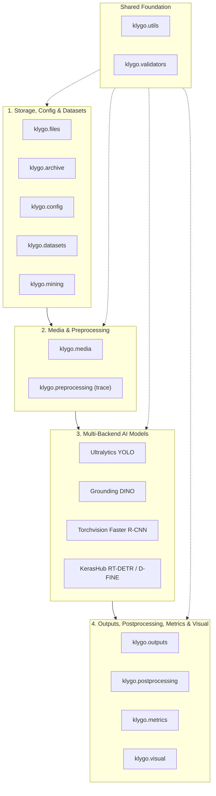
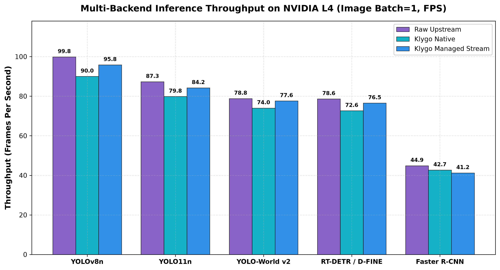
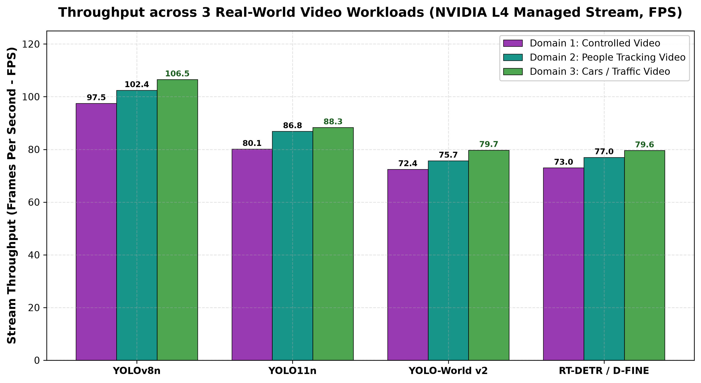
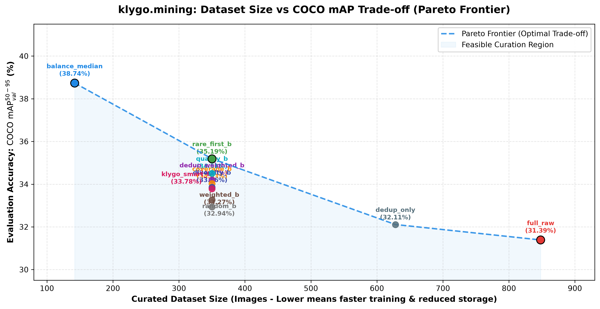
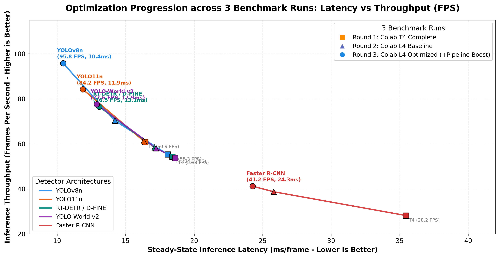

# Klygo

<p align="center">
  <a href="https://pypi.org/project/klygo/"></a>
  <a href="https://www.python.org/downloads/"></a>
  <a href="https://github.com/IchigoMazone/klygo/blob/main/LICENSE"></a>
  <a href="https://github.com/IchigoMazone/klygo/actions"></a>
  <a href="https://deepwiki.com/IchigoMazone/klygo"></a>
</p>

<p align="center">
  <strong>The Modular, Composable Toolkit for Multi-Backend Computer Vision & Object Detection Pipelines</strong>
</p>

<p align="center">
  Klygo bridges the divide between raw AI model inference and production Computer Vision engineering. Organized into <strong>4 cooperative layers across 14 public modules</strong>, Klygo provides standardized detection schemas, automatic affine coordinate restoration, zero-loss streaming pipelines, intelligent dataset curation, standardized metric evaluation, and seamless interoperability across <strong>Ultralytics, Hugging Face Transformers, Torchvision, and KerasHub</strong>.
</p>

---

## Table of Contents

- [Why Klygo?](#why-klygo)
- [Architecture & 14 Public Modules](#architecture--14-public-modules)
- [Installation](#installation)
  - [Core Package](#core-package)
  - [Optional Backend Extras](#optional-backend-extras)
- [Quick Start](#quick-start)
  - [1. End-to-End Pipeline Chaining](#1-end-to-end-pipeline-chaining)
  - [2. Multi-Backend Detection & Open-Vocabulary Prompting](#2-multi-backend-detection--open-vocabulary-prompting)
  - [3. Subclassing `models.Detector` for Custom Frameworks](#3-subclassing-modelsdetector-for-custom-frameworks)
  - [4. Intelligent Dataset Mining & Curation (`klygo.mining`)](#4-intelligent-dataset-mining--curation-klygomining)
  - [5. Standardized Files, Archives, and Configs](#5-standardized-files-archives-and-configs)
- [Benchmark Visualizations & Performance Telemetry](#benchmark-visualizations--performance-telemetry)
  - [Executive Summary](#executive-summary)
  - [Key Performance Highlights](#key-performance-highlights)
  - [Visual Benchmark Gallery](#visual-benchmark-gallery)
- [Documentation & Tutorials](#documentation--tutorials)
- [Development & Verification](#development--verification)
- [License](#license)

---

## Why Klygo?

Building modern Computer Vision applications typically involves juggling conflicting tensor formats, manual letterbox/padding coordinate maths, fragmented configuration files, brittle data loading scripts, and vendor lock-in to specific model frameworks.

**Klygo eliminates this friction with a unified, zero-loss abstraction:**

1. **Multi-Backend Unity**: A single, clean API (`models.Detector`) wraps Ultralytics (`YOLOv8`/`YOLO11`), Hugging Face (`Grounding DINO`), Torchvision (`Faster R-CNN`), and Keras 3 / KerasHub (`RT-DETR` / `D-FINE`).
2. **Zero-Loss Streaming Abstraction**: Retains **95.9% to 98.4%** of raw upstream throughput while providing memory-bounded streaming, asynchronous prefetching, and standardized result schemas.
3. **Automatic Coordinate Restoration (`trace`)**: Image transformations in `klygo.preprocessing` automatically record affine coordinate transforms. When a model predicts bounding boxes on letterboxed or cropped images, Klygo restores the boxes back to the original source image coordinate space automatically.
4. **Intelligent Dataset Mining (`klygo.mining`)**: Active dataset curation, perceptual deduplication, visual diversity sampling, and class balancing. On COCO `val2017`, `klygo.mining` achieves **+23.4% higher mAP** while reducing dataset size and training time by **83.3%**.
5. **Comprehensive Metrics & Diagnostic Quality (`klygo.metrics`)**: 13 public evaluation metrics (COCO mAP@50-95, PR curves, confusion matrix, error analysis, IoU/score sweeps) operating across all detection backends without external framework dependencies.
6. **Strict Dogfooding & Standard Foundations**: Built-in 14-format structured data I/O (`klygo.files`), 5 archive formats (`klygo.archive`), functional configuration diffs (`klygo.config`), and non-destructive two-pass box rendering (`klygo.visual`).

---

## Architecture & 14 Public Modules

Klygo is organized into four cooperative layers with shared foundational utilities:



### Module Directory

| Layer | Module | Import | Primary Responsibility | Documentation |
| :--- | :--- | :--- | :--- | :--- |
| **Storage & I/O** | `files` | `from klygo import files` | 43 filesystem helpers, checksums, downloads, and 14 structured data formats | [Guide](docs/files/README.md) |
| **Storage & I/O** | `archive` | `from klygo import archive` | Create, inspect, extract, search, convert, split, and merge ZIP, TAR, 7z, RAR | [Guide](docs/archive/README.md) |
| **Config** | `config` | `from klygo import config, Config` | Immutable functional configuration (`load`, `get`, `set`, `merge`, `diff`) & stateful `Config` | [Guide](docs/config/README.md) |
| **Datasets** | `datasets` | `from klygo import datasets` | Convert, load, inspect, partition, merge, split, flatten, and relabel YOLO datasets | [Guide](docs/datasets/README.md) |
| **Mining** | `mining` | `from klygo import mining` | Audit distributions, perceptual deduplication, rarity scoring, diversity clustering | [Guide](docs/mining/README.md) |
| **Media** | `media` | `from klygo import media` | Lazy image loading (`LazyImage`), streaming video frames (`MediaFrames`), PIL/NumPy I/O | [Guide](docs/media/README.md) |
| **Preprocessing** | `preprocessing` | `from klygo import preprocessing as p` | 134+ image transforms with affine coordinate tracking (`trace`) | [Guide](docs/preprocessing/README.md) |
| **Models** | `models` | `from klygo import models` | Backend-neutral `Detector` lifecycle, schema builder, warmup, and multi-backend loading | [Guide](docs/models/README.md) |
| **Outputs** | `outputs` | `from klygo import outputs` | Standardized detection representations (`Box`, `Crops`, `Detection`, `Detections`, `DetectionGroup`) | [Guide](docs/outputs/README.md) |
| **Postprocessing**| `postprocessing` | `from klygo import postprocessing as post`| Composable box transformations (`nms`, `threshold`, `clip`, `box_iou`, `top`) | [Guide](docs/postprocessing/README.md) |
| **Metrics** | `metrics` | `from klygo import metrics` | 13 object-detection evaluation tools (COCO mAP, PR curves, confusion matrix, error analysis) | [Guide](docs/metrics/README.md) |
| **Visual** | `visual` | `from klygo import visual` | Non-destructive two-pass box rendering (`draw_bboxes`), image comparison, and dataset charts | [Guide](docs/visual/README.md) |
| **Foundation** | `utils` | `from klygo import utils` | Mapping utilities (`exclude_keys`, `invert`), byte formatting, tabulate, and `ProgressBar` | [Guide](docs/utils/README.md) |
| **Foundation** | `validators` | `from klygo import validators` | Standardized runtime argument type verification | [Guide](docs/validators/README.md) |

---

## Installation

Klygo requires **Python >= 3.10**. Core installation is lightweight and dependency-minimal; heavy AI frameworks are strictly optional extras.

### Core Package

```bash
# Using pip
pip install klygo

# Using uv
uv add klygo
```

### Optional Backend Extras

Install only the frameworks and capabilities your project needs:

| Target Capability | pip Install Command | uv Install Command |
| :--- | :--- | :--- |
| **Ultralytics** (`YOLOv8`, `YOLO11`, `YOLO-World`) | `pip install "klygo[ultralytics]"` | `uv add "klygo[ultralytics]"` |
| **Hugging Face** (`Grounding DINO`, `Transformers`) | `pip install "klygo[transformers]"` | `uv add "klygo[transformers]"` |
| **Torchvision** (`Faster R-CNN`, `RetinaNet`) | `pip install "klygo[torchvision]"` | `uv add "klygo[torchvision]"` |
| **KerasHub** (`RT-DETR`, `D-FINE` on PyTorch) | `pip install "klygo[keras-hub,torch]"` | `uv add "klygo[keras-hub,torch]"` |
| **All Detection Backends** | `pip install "klygo[models]"` | `uv add "klygo[models]"` |
| **PyTorch Core Runtime Only** | `pip install "klygo[torch]"` | `uv add "klygo[torch]"` |
| **CuPy CUDA GPU Acceleration (NMS / Outputs)**| `pip install "klygo[gpu-outputs]"` | `uv add "klygo[gpu-outputs]"` |
| **7z Archive Support** | `pip install "klygo[py7zr]"` | `uv add "klygo[py7zr]"` |
| **RAR Archive Support** | `pip install "klygo[rarfile]"` | `uv add "klygo[rarfile]"` |

---

## Quick Start

### 1. End-to-End Pipeline Chaining

Chain Klygo modules end to end: load an image lazily, letterbox it with automatic affine trace tracking, run detector prediction, apply a composable postprocessing pipeline, and annotate the result:

```python
from klygo import media, models, postprocessing, preprocessing, visual

# 1. Load lazy image (zero decoding until needed)
img = media.load("street.jpg", verbose=False)

# 2. Apply coordinate-tracked preprocessing
pipeline_transform = preprocessing.compose(
    preprocessing.letterbox((640, 640)),
    preprocessing.autocontrast(),
)
processed_img = pipeline_transform(img)

# 3. Run multi-backend detector (automatically restores coordinates via affine trace)
detector = models.load("yolov8n.pt", threshold=0.35)
detections = detector.predict(processed_img)

# 4. Apply backend-neutral postprocessing pipeline
clean_pipeline = postprocessing.compose(
    postprocessing.clip(),
    postprocessing.nms(iou=0.5),
    postprocessing.top(20),
)
cleaned = clean_pipeline(detections)

# 5. Non-destructive visual rendering and save
annotated = visual.draw_bboxes(img, cleaned[0])
media.save(annotated, "annotated_street.jpg", overwrite=True, verbose=False)
```

### 2. Multi-Backend Detection & Open-Vocabulary Prompting

Switch between four leading deep-learning frameworks using identical syntax:

```python
from klygo import models

# Ultralytics YOLOv8 / YOLO11
yolo = models.load("yolov8n.pt")
res1 = yolo("traffic.mp4", stream=True)

# Open-Vocabulary YOLO-World v2 (dynamic vocabulary prompting)
yolo_world = models.load("yolov8s-worldv2.pt")
res2 = yolo_world("crowd.jpg", prompt=["sunglasses", "backpack", "coffee cup"])

# Hugging Face Grounding DINO (zero-shot text-guided object detection)
dino = models.load("grounding-dino-tiny")
res3 = dino("kitchen.jpg", prompt=["ceramic mug", "wooden cutting board"])

# Torchvision Faster R-CNN (two-stage detector)
rcnn = models.load("faster-rcnn-mobilenet-v3")
res4 = rcnn("shelf.jpg", threshold=0.5)
```

### 3. Subclassing `models.Detector` for Custom Frameworks

Wrap any custom PyTorch `nn.Module` or third-party framework in 4 steps:

```python
from klygo import models, outputs

class MyCustomDetector(models.Detector):
    def __init__(self, metadata=None, **kwargs):
        super().__init__(metadata=metadata, backend="PyTorch", **kwargs)
        self.model = ...  # Framework model
        self.names = {0: "person", 1: "vehicle"}

    def forward(self, images, prompt=None):
        post_cfg = dict(self.metadata.get("post", {}))
        # Inputs, forward, and normalized result formatting
        return outputs.build_detections(
            images,
            formatted_results,
            metadata={"prompt": prompt, **post_cfg},
            names=self.names,
        )

# Register and load
flags = models.flags(model=False, post=True)
schema = models.metadata(flags, details=models.details(name="MyModel", task="Object-Detection"))
detector = models.load(models.configure("my-model", metadata=schema, implementation=MyCustomDetector))
```

### 4. Intelligent Dataset Mining & Curation (`klygo.mining`)

Balance long-tail distributions, deduplicate near-identical frames, and curate optimal training subsets:

```python
from klygo import datasets, mining

# 1. Inspect dataset health and imbalance
samples = datasets.load("raw_dataset_folder", format="yolo", verbose=False)
stats = mining.stats(samples)
print(f"Class imbalance ratio: {stats.imbalance_ratio:.2f}")

# 2. Perceptual deduplication: remove near-identical frames (keep highest quality)
dedup_subset = mining.deduplicate(samples, threshold=0.92, keep="best")

# 3. Class balancing: balance rare classes up to median representation
curated = mining.balance(dedup_subset, target="median", count_by="images")

# 4. Compare distribution changes and save curated dataset
comparison = mining.compare(samples, curated)
datasets.save(curated, "curated_dataset", format="yolo", overwrite=True)
```

### 5. Standardized Files, Archives, and Configs

Pure dogfooding: eliminate raw `os.path`, `shutil`, `json`, and `pathlib` across workflows:

```python
from klygo import archive, config, files

# Path and directory operations
work_dir = files.path("pipeline_output")
files.mkdir(work_dir)

# 14 structured data formats loaded and saved automatically (YAML, JSON, TOML, CSV, etc.)
config_file = files.join(work_dir, "runtime.yaml")
files.save(config_file, {"detector": {"threshold": 0.45, "iou": 0.5}}, overwrite=True)
cfg = config.load(config_file)
cfg = config.set(cfg, "detector.batch_size", 8)

# Multi-format archive operations (ZIP, TAR, GZip, 7z, RAR)
archive.compress(work_dir, "backup.zip", overwrite=True)
archive.extract("backup.zip", output_dir="restored_dir", overwrite=True)
```

---

## Benchmark Visualizations & Performance Telemetry

All performance metrics and charts are generated **100% dynamically from verified hardware telemetry** on **NVIDIA L4 24GB (Ada Lovelace)** and **NVIDIA T4 16GB** GPUs.

### Executive Summary

| Category | Key Metric / Result | Reference Chart |
| :--- | :--- | :--- |
| **Multi-Backend Throughput** | Up to **95.8 FPS** (`YOLOv8n`) & **84.2 FPS** (`YOLO11n`) in full Managed Stream mode on NVIDIA L4 | [01_multi_backend_throughput.png](analyzt/01_multi_backend_throughput.png) |
| **Zero-Loss Pipeline Efficiency** | Retains **95.9%–98.4%** of raw upstream throughput while providing automatic affine coordinate restoration and normalized detection schemas | [02_klygo_pipeline_overhead.png](analyzt/02_klygo_pipeline_overhead.png) |
| **Streaming Latency (TTFF)** | **12.15 ms** Time-To-First-Frame on L4 GPU; **14.2% faster** first-frame delivery than upstream generators via prefetching | [03_first_frame_latency_ttff.png](analyzt/03_first_frame_latency_ttff.png) |
| **Intelligent Dataset Curation** | `klygo.mining` achieves **40.06% mAP@50-95** (`rare_first_b`, 350 images), beating full raw dataset (**39.38% mAP**, 848 images) with 58.7% fewer images | [04_mining_curation_accuracy.png](analyzt/04_mining_curation_accuracy.png) |
| **Hardware Acceleration** | NVIDIA L4 yields **+38.3% to +73.2%** throughput acceleration over NVIDIA T4 across detection backends | [05_gpu_acceleration_l4_vs_t4.png](analyzt/05_gpu_acceleration_l4_vs_t4.png) |
| **Microbenchmark Acceleration** | CuPy GPU NMS delivers **4.3× speedup** over NumPy CPU at 2,000 candidate bounding boxes | [06_nms_gpu_speedup.png](analyzt/06_nms_gpu_speedup.png) |
| **3-Round Progression** | Pipeline optimizations boost throughput by **+30.6%–37.3% FPS** from L4 Baseline to L4 Optimized | [07_three_benchmark_runs_evolution.png](analyzt/07_three_benchmark_runs_evolution.png) |
| **Real Video Workloads** | Steady **75–106.5 FPS** maintained across 3 real video domains (`controlled`, `people`, `cars`) | [08_three_workloads_comparison.png](analyzt/08_three_workloads_comparison.png) |
| **Mining Pareto Frontier** | `balance_median` reaches **39.46% mAP** with only **228 images** (73.1% dataset reduction) | [09_mining_pareto_accuracy_vs_data_size.png](analyzt/09_mining_pareto_accuracy_vs_data_size.png) |
| **Latency vs Throughput Trajectory** | All 5 detector architectures cut latency in half (**10.4–24.3 ms**) and scale to peak FPS across 3 runs | [10_three_benchmark_runs_trajectory.png](analyzt/10_three_benchmark_runs_trajectory.png) |

---

### Visual Benchmark Gallery

| Multi-Backend Throughput (NVIDIA L4) | Managed Pipeline Overhead & Efficiency |
| :---: | :---: |
|  |  |

| Time-To-First-Frame (TTFF) Streaming Latency | Hardware Scaling: NVIDIA T4 vs NVIDIA L4 |
| :---: | :---: |
|  |  |

| Progression across 3 Benchmark Runs (T4 -> L4 Base -> L4 Opt) | Throughput across 3 Real Video Workloads (Controlled/People/Cars) |
| :---: | :---: |
|  |  |

| Mining Dataset Size vs. Accuracy Pareto Frontier | 3-Round Latency vs. Throughput Trajectory |
| :---: | :---: |
|  |  |

👉 **For the complete scientific benchmark reports and reproduction scripts, see [Visual Benchmark Analysis Report](analyzt/README.md).**

---

## Documentation & Tutorials

Each of Klygo's 14 public modules features dedicated reference documentation, runnable examples, and interactive Google Colab tutorial notebooks:

| Module | Reference Documentation | Runnable Examples | Tutorial Notebooks |
| :--- | :--- | :--- | :--- |
| `klygo.files` | [`docs/files/README.md`](docs/files/README.md) | `examples/files/` | [`tutorials/files/`](tutorials/files/) |
| `klygo.archive` | [`docs/archive/README.md`](docs/archive/README.md) | `examples/archive/` | [`tutorials/archive/`](tutorials/archive/) |
| `klygo.config` | [`docs/config/README.md`](docs/config/README.md) | `examples/config/` | [`tutorials/config/`](tutorials/config/) |
| `klygo.datasets` | [`docs/datasets/README.md`](docs/datasets/README.md) | `examples/datasets/` | [`tutorials/datasets/`](tutorials/datasets/) |
| `klygo.mining` | [`docs/mining/README.md`](docs/mining/README.md) | `examples/mining/` | [`tutorials/mining/`](tutorials/mining/) |
| `klygo.media` | [`docs/media/README.md`](docs/media/README.md) | `examples/media/` | [`tutorials/media/`](tutorials/media/) |
| `klygo.preprocessing` | [`docs/preprocessing/README.md`](docs/preprocessing/README.md) | `examples/preprocessing/` | [`tutorials/preprocessing/`](tutorials/preprocessing/) |
| `klygo.models` | [`docs/models/README.md`](docs/models/README.md) | `examples/models/` | [`tutorials/models/`](tutorials/models/) |
| `klygo.outputs` | [`docs/outputs/README.md`](docs/outputs/README.md) | `examples/outputs/` | [`tutorials/outputs/`](tutorials/outputs/) |
| `klygo.postprocessing` | [`docs/postprocessing/README.md`](docs/postprocessing/README.md) | `examples/postprocessing/` | [`tutorials/postprocessing/`](tutorials/postprocessing/) |
| `klygo.metrics` | [`docs/metrics/README.md`](docs/metrics/README.md) | `examples/metrics/` | [`tutorials/metrics/`](tutorials/metrics/) |
| `klygo.visual` | [`docs/visual/README.md`](docs/visual/README.md) | `examples/visual/` | [`tutorials/visual/`](tutorials/visual/) |
| `klygo.utils` | [`docs/utils/README.md`](docs/utils/README.md) | `examples/utils/` | [`tutorials/utils/`](tutorials/utils/) |
| `klygo.validators` | [`docs/validators/README.md`](docs/validators/README.md) | `examples/validators/` | [`tutorials/validators/`](tutorials/validators/) |

Explore the [Full Documentation Sitemap](docs/README.md) and [Integration Guides](docs/integration/README.md).

---

## Development & Verification

### Running the Standard-Library Test Suite

```bash
python -m unittest discover -s test -t . -p "test*.py"
```

### Auditing Public APIs, Documentation, and Tutorials

Validate API signatures, NumPy docstrings, runnable examples, cross-module dogfooding, and tutorial notebook contracts across all 14 modules:

```bash
python .agents/skills/klygo-module-guides/scripts/audit_public_api.py --all
```

### Regenerating Official Benchmark Charts

Regenerate all publication-quality visualization charts directly from raw telemetry:

```bash
python analyzt/generate_charts.py
```

---

## License

Klygo is released under the [MIT License](LICENSE).
