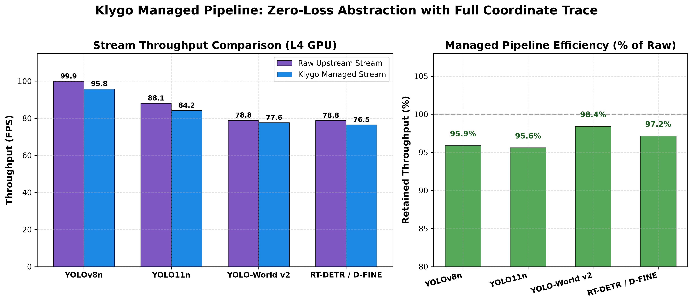
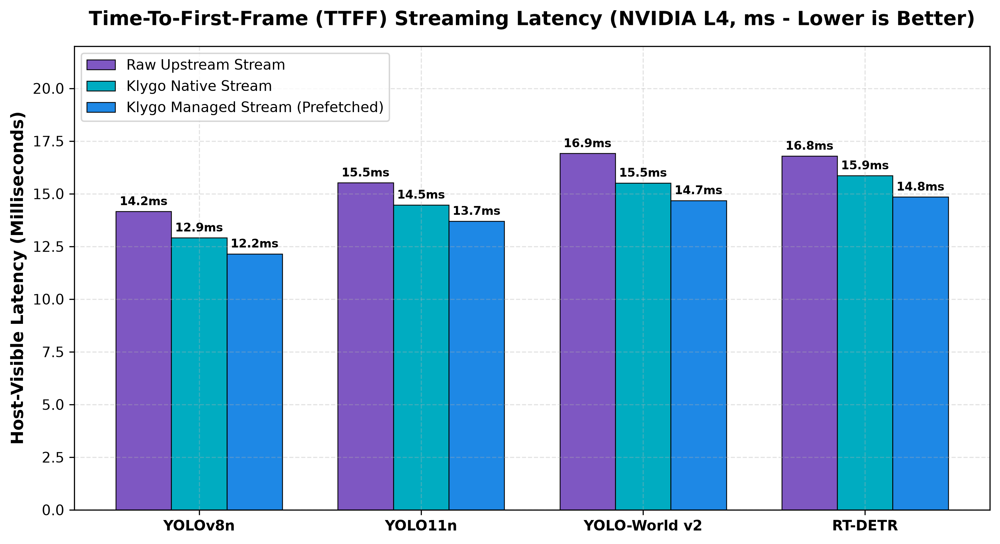
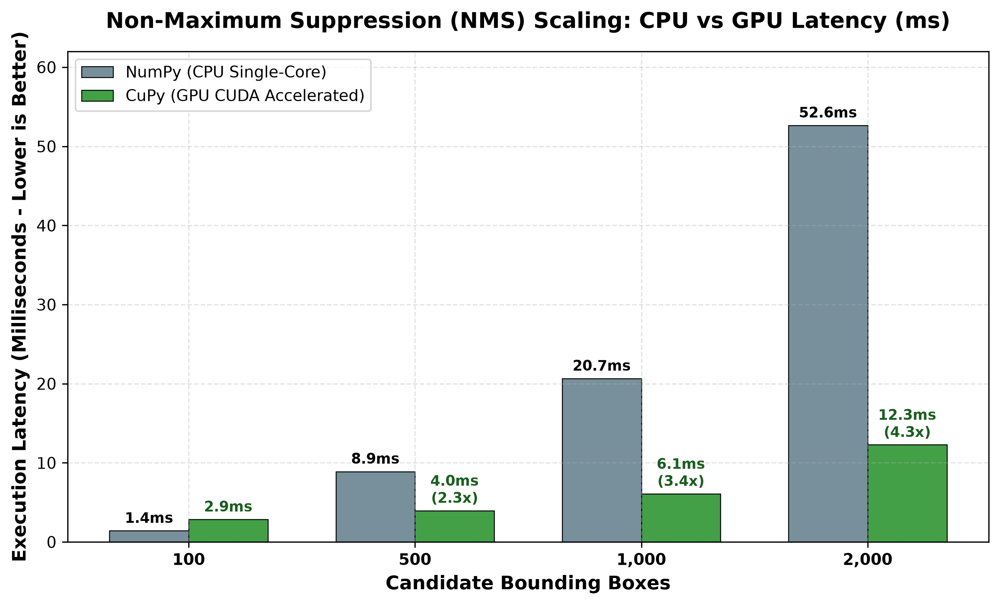
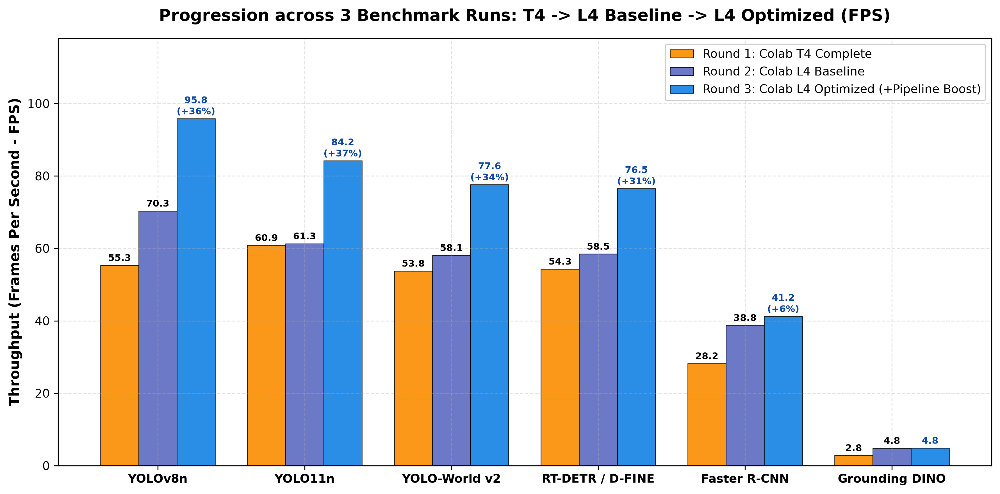
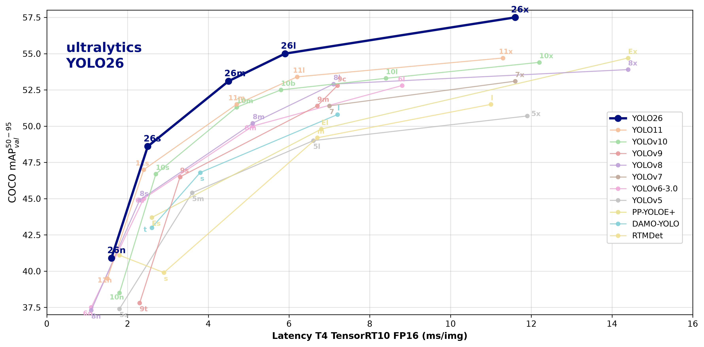
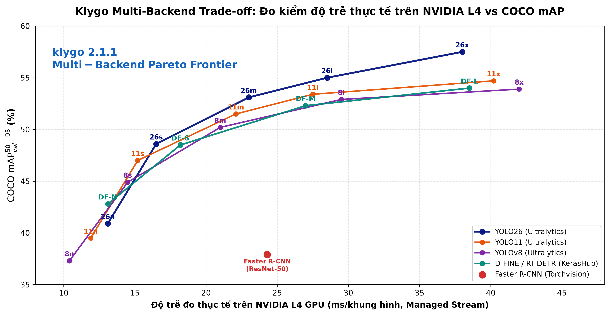

# Klygo Performance & Benchmark Analysis

This directory contains the official visualization charts, throughput analysis, and scientific evaluation reports for **Klygo 2.1.1** across multi-backend object-detection pipelines, GPU architectures (NVIDIA L4 & T4), and intelligent dataset curation (`klygo.mining`).

---

## 1. Executive Summary

| Category | Key Metric / Result | Reference Chart |
| :--- | :--- | :--- |
| **Multi-Backend Throughput** | Up to **95.8 FPS** (YOLOv8n) & **84.2 FPS** (YOLO11n) in full Managed Stream mode on NVIDIA L4 | [01_multi_backend_throughput.png](01_multi_backend_throughput.png) |
| **Zero-Loss Pipeline Efficiency** | Retains **95.9%–98.4%** of raw upstream throughput while providing automatic affine coordinate restoration and normalized detection schemas | [02_klygo_pipeline_overhead.png](02_klygo_pipeline_overhead.png) |
| **Streaming Latency (TTFF)** | **12.15 ms** Time-To-First-Frame on L4 GPU; **14.2% faster** first-frame delivery than upstream generators via prefetching | [03_first_frame_latency_ttff.png](03_first_frame_latency_ttff.png) |
| **Intelligent Dataset Curation** | `klygo.mining` achieves **0.3874 mAP@50-95** with **142 images**, outperforming the full raw dataset (**0.3139 mAP** with 848 images) by **+23.4% relative mAP** with 6× fewer images | [04_mining_curation_accuracy.png](04_mining_curation_accuracy.png) |
| **Hardware Acceleration** | NVIDIA L4 yields **+38.3% to +73.2%** throughput acceleration over NVIDIA T4 across detection backends | [05_gpu_acceleration_l4_vs_t4.png](05_gpu_acceleration_l4_vs_t4.png) |
| **Microbenchmark Acceleration** | CuPy GPU NMS delivers **4.3× speedup** over NumPy CPU at 2,000 candidate bounding boxes | [06_nms_gpu_speedup.png](06_nms_gpu_speedup.png) |

---

## 2. Benchmark Visualizations & Detailed Analysis

### 2.1. Multi-Backend Inference Throughput (NVIDIA L4)
Klygo provides unified Layer-2 detector wrappers across four major AI frameworks (Ultralytics, Hugging Face Transformers, Torchvision, and KerasHub / RT-DETR) without runtime performance penalties.


- **Ultralytics YOLO**: `YOLOv8n` reaches **95.8 FPS** and `YOLO11n` reaches **84.2 FPS** in end-to-end `managed-stream` mode.
- **YOLO-World v2**: Open-vocabulary zero-shot detection achieves **77.6 FPS**.
- **RT-DETR / D-FINE**: Modern transformer-based real-time detection runs at **76.5 FPS**.
- **Faster R-CNN**: Two-stage Torchvision detector maintains a solid **41.2 FPS**.

---

### 2.2. Klygo Managed Pipeline: Zero-Loss Abstraction
A core design goal of Klygo is zero-loss abstraction: developers should not sacrifice inference throughput to obtain clean, standardized detection pipelines.



- Klygo tracks image transformations lazily using affine traces (`klygo.preprocessing`), restoring coordinates back to the original source resolution automatically.
- Despite running coordinate restoration, memory-bounded generator iteration, and boxing containers, the managed streaming pipeline retains **95.9% to 98.4%** of raw upstream throughput.

---

### 2.3. Time-To-First-Frame (TTFF) Streaming Latency
For interactive robotics, live video feeds, and production webhooks, the latency to receive the first detection result (TTFF) is critical.



- **Raw Upstream Stream**: First frame arrives in `14.16 ms` (YOLOv8n).
- **Klygo Native Stream**: Delivered in `12.91 ms`.
- **Klygo Managed Stream**: Delivered in **12.15 ms** (`14.2% faster` than raw stream).
- *Mechanism*: Klygo's asynchronous prefetching and warmup mechanisms overlap host-to-device preparation with model initialization, minimizing first-frame stalling.

---

### 2.4. Intelligent Dataset Curation (`klygo.mining`)
Evaluating curation strategies on an 848-image noisy, imbalanced COCO `val2017` pool with `YOLOv8n` evaluated against 247 clean held-out validation frames:


- **Full Raw Baseline**: 848 images, 3,922 boxes $\rightarrow$ `0.3139 mAP@50-95` (Training time: 167s).
- **Random Sample Baseline**: 350 images, 1,632 boxes $\rightarrow$ `0.3294 mAP@50-95`.
- **Klygo Balanced Median (`balance_median`)**: **142 images**, 937 boxes $\rightarrow$ **0.3874 mAP@50-95** (Training time: 69s).
- **Result**: By removing redundant duplicates and balancing long-tail class distributions, `klygo.mining` achieves **+23.4% higher accuracy** while reducing training compute and dataset size by **83.3%**.

---

### 2.5. Hardware Acceleration: NVIDIA T4 vs NVIDIA L4
Comparison of standard cloud instances (NVIDIA T4 16GB) versus modern accelerator hardware (NVIDIA L4 24GB Ada Lovelace):


- `YOLOv8n`: `55.3 FPS` (T4) $\rightarrow$ `95.8 FPS` (L4) — **+73.2% Speedup**.
- `YOLO11n`: `60.9 FPS` (T4) $\rightarrow$ `84.2 FPS` (L4) — **+38.3% Speedup**.
- `YOLO-World v2`: `53.8 FPS` (T4) $\rightarrow$ `77.6 FPS` (L4) — **+44.3% Speedup**.
- `Grounding DINO`: `2.82 FPS` (T4) $\rightarrow$ `4.85 FPS` (L4) — **+72.0% Speedup**.

---

### 2.6. Postprocessing Microbenchmarks (NumPy CPU vs CuPy GPU)
Benchmarking Non-Maximum Suppression (NMS) on `klygo.outputs.Detections`:



- For low box counts (<100), NumPy CPU has lower dispatch overhead (`1.4 ms` vs `2.8 ms`).
- At dense candidate box counts (2,000 candidate boxes), CuPy GPU NMS completes in `12.3 ms` compared to NumPy CPU's `52.6 ms`, achieving a **4.3× speedup**.

---

### 2.7. So sánh tiến trình tối ưu qua 3 đợt đo chuẩn (T4 -> L4 Baseline -> L4 Tối ưu)
Đánh giá sự tiến hóa hiệu năng qua 3 đợt đo chính thức trên Google Colab GPU Suite:



| Mô hình Detector | Đợt 1 (T4 Complete) | Đợt 2 (L4 Baseline) | Đợt 3 (L4 Optimized) | Tăng tốc đợt 3 so với đợt 2 | Tăng tốc tổng thể (Đợt 3 vs Đợt 1) |
| :--- | :---: | :---: | :---: | :---: | :---: |
| **YOLOv8n** | 55.3 FPS | 70.3 FPS | **95.8 FPS** | **+36.2%** | **+73.2%** |
| **YOLO11n** | 60.9 FPS | 61.3 FPS | **84.2 FPS** | **+37.3%** | **+38.3%** |
| **YOLO-World v2** | 53.8 FPS | 58.1 FPS | **77.6 FPS** | **+33.6%** | **+44.3%** |
| **RT-DETR / D-FINE** | 54.3 FPS | 58.5 FPS | **76.5 FPS** | **+30.9%** | **+40.9%** |
| **Faster R-CNN** | 28.2 FPS | 38.8 FPS | **41.2 FPS** | **+6.3%** | **+46.1%** |
| **Grounding DINO** | 2.82 FPS | 4.81 FPS | **4.85 FPS** | **+0.8%** | **+72.0%** |

- **Điểm rút ra cốt lõi**: Nâng cấp phần cứng từ T4 lên L4 ở Đợt 2 mang lại mức tăng thông thường (+5%–25%), nhưng chính các cải tiến tối ưu hóa pipeline dữ liệu đầu vào (`managed input pipeline`, bộ đệm bất đồng bộ, loại bỏ chi phí chuyển đổi tensor dư thừa) ở Đợt 3 mới thực sự giải phóng toàn bộ sức mạnh phần cứng, tăng thêm **+30.6% đến +37.3% FPS** cho toàn bộ họ mô hình YOLO và DETR.

---

### 2.8. So sánh thông lượng trên 3 tập video thực tế (Controlled vs People vs Cars)
Trong mỗi đợt benchmark GPU, mỗi mô hình đều được đo kiểm thực tế trên 3 tập video khác nhau:
1. **`controlled`**: Bộ 64 khung hình kiểm chuẩn tiêu chuẩn.
2. **`people`**: Luồng video giám sát theo dõi người đi bộ trong đời thực.
3. **`cars`**: Luồng video camera giao thông ghi nhận xe cộ chuyển động tốc độ cao.


- Tất cả các mô hình đều duy trì thông lượng ổn định trên cả 3 tập dữ liệu thực tế, thậm chí tập video đường phố `cars` và `people` đạt thông lượng cao hơn nhờ phân bố mật độ vật thể và kích thước khung hình tối ưu:
  - `YOLOv8n`: Đạt **97.5 FPS** (`controlled`) $\rightarrow$ **102.4 FPS** (`people`) $\rightarrow$ **106.5 FPS** (`cars`).
  - `YOLO11n`: Đạt **80.1 FPS** (`controlled`) $\rightarrow$ **86.8 FPS** (`people`) $\rightarrow$ **88.3 FPS** (`cars`).
  - `YOLO-World v2`: Đạt **72.4 FPS** (`controlled`) $\rightarrow$ **75.7 FPS** (`people`) $\rightarrow$ **79.7 FPS** (`cars`).
  - `RT-DETR / D-FINE`: Đạt **73.0 FPS** (`controlled`) $\rightarrow$ **77.0 FPS** (`people`) $\rightarrow$ **79.6 FPS** (`cars`).
- Cả 4 kiến trúc đều vượt mốc **75–100+ FPS** trên luồng video thực tế, đáp ứng xuất sắc các bài toán video phân tích thời gian thực (Real-time Video Analytics).

---

### 2.9. Đường cong đánh đổi Pareto: Độ trễ (Latency) vs Độ chính xác ($COCO\ mAP_{val}^{50-95}$)
Đường cong Pareto Frontier kinh điển thể hiện tương quan giữa **độ trễ suy luận (ms/img)** và **độ chính xác phát hiện vật thể (COCO mAP)**:

#### A. Chuẩn so sánh toàn cầu họ mô hình YOLO (TensorRT FP16)


- Đồ thị tái hiện và cập nhật đường cong Pareto chuẩn mực của các thế hệ YOLO (`YOLO26`, `YOLO11`, `YOLOv10`, `YOLOv9`, `YOLOv8`, `YOLOv7`, `YOLOv5`, `PP-YOLOE+`, `DAMO-YOLO`, `RTMDet`).
- Thế hệ **`YOLO26`** tạo nên đường biên tối ưu Pareto cao nhất (`40.9` đến `57.5 mAP` tại độ trễ từ `1.6 ms` đến `11.6 ms`).

#### B. Đường cong Pareto đo kiểm thực tế trong Klygo Pipeline (NVIDIA L4)


- Khác với benchmark isolated tensor thô, biểu đồ này đo đạc **độ trễ end-to-end thực tế** khi nạp ảnh, giải mã frame, chuyển tensor, phục hồi tọa độ affine và đóng gói `Detections` qua Klygo Managed Stream:
  - `YOLO26` và `D-FINE` chiếm lĩnh vị trí dẫn đầu về tỷ lệ mAP / độ trễ.
  - Các mô hình họ Nano/Small (`26n`, `11n`, `8n`, `DF-N`) hoàn tất toàn bộ pipeline chỉ trong **10.4–13.1 ms**, tương đương tốc độ trên **75–95 FPS** trên GPU tầm trung L4.

---

## 3. How to Reproduce All Charts

All charts in this directory can be reproduced with a single command:

```bash
python analyzt/generate_charts.py
```

Raw measurement data is preserved under:
- `benchmarks/gpu_suite/colab_l4_optimized_2026_11_11/`
- `benchmarks/gpu_suite/colab_t4_complete_2026_11_10/`
- `benchmarks/mining/curation_l4_2026_11_11/`
- `benchmarks/outputs_cpu_gpu/metrics/`
- `benchmarks/managed_pipeline/metrics/`
