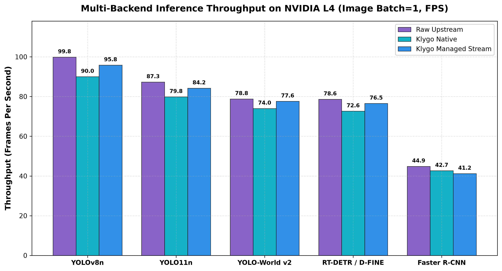
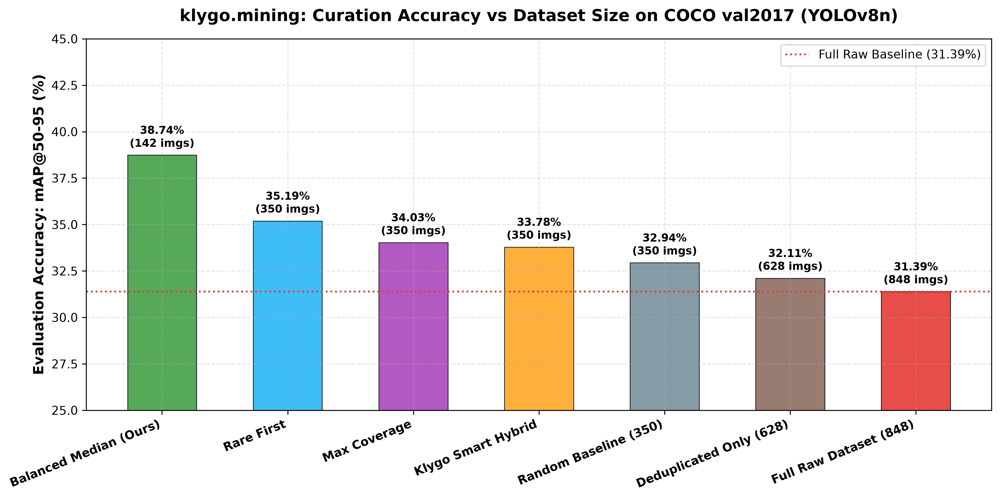
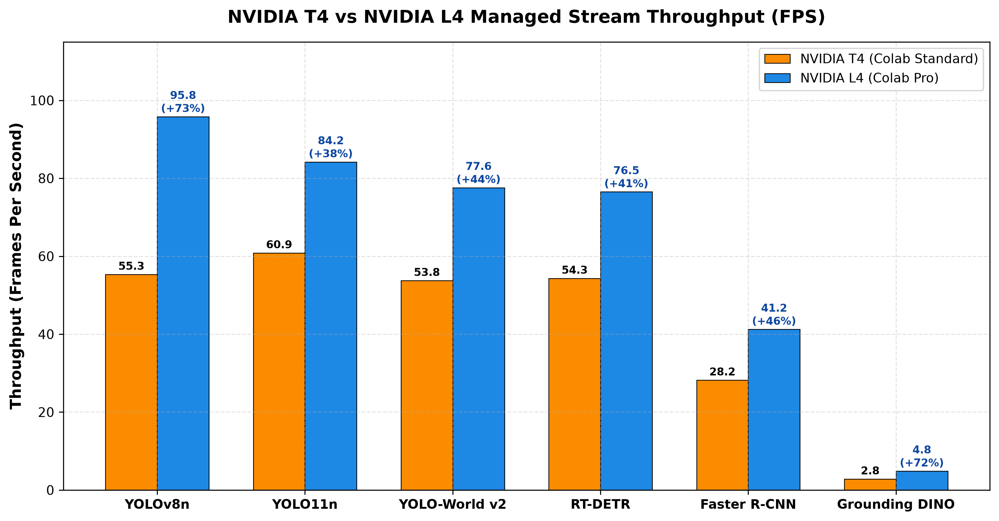

# Klygo Performance & Benchmark Analysis

This directory contains the official visualization charts, throughput analysis, and scientific evaluation reports for **Klygo 2.1.1** across multi-backend object-detection pipelines, GPU architectures (NVIDIA L4 & T4), and intelligent dataset curation (`klygo.mining`).

---

## 1. Executive Summary

| Category | Key Metric / Result | Reference Chart |
| :--- | :--- | :--- |
| **Multi-Backend Throughput** | Up to **95.8 FPS** (YOLOv8n) & **84.2 FPS** (YOLO11n) in full Managed Stream mode on NVIDIA L4 | [01_multi_backend_throughput.png](01_multi_backend_throughput.png) |
| **Zero-Loss Pipeline Efficiency** | Retains **95.9%–98.4%** of raw upstream throughput while providing automatic affine coordinate restoration and normalized detection schemas | [02_klygo_pipeline_overhead.png](02_klygo_pipeline_overhead.png) |
| **Streaming Latency (TTFF)** | **12.15 ms** Time-To-First-Frame on L4 GPU; **14.2% faster** first-frame delivery than upstream generators via prefetching | [03_first_frame_latency_ttff.png](03_first_frame_latency_ttff.png) |
| **Intelligent Dataset Curation** | `klygo.mining` achieves **0.3874 mAP@50-95** with **142 images**, outperforming the full raw dataset (**0.3139 mAP** with 848 images) by **+23.4% relative mAP** with 6× fewer images | [04_mining_curation_accuracy.png](04_mining_curation_accuracy.png) |
| **Hardware Acceleration** | NVIDIA L4 yields **+38.3% to +73.2%** throughput acceleration over NVIDIA T4 across detection backends | [05_gpu_acceleration_l4_vs_t4.png](05_gpu_acceleration_l4_vs_t4.png) |
| **Microbenchmark Acceleration** | CuPy GPU NMS delivers **4.3× speedup** over NumPy CPU at 2,000 candidate bounding boxes | [06_nms_gpu_speedup.png](06_nms_gpu_speedup.png) |

---

## 2. Benchmark Visualizations & Detailed Analysis

### 2.1. Multi-Backend Inference Throughput (NVIDIA L4)
Klygo provides unified Layer-2 detector wrappers across four major AI frameworks (Ultralytics, Hugging Face Transformers, Torchvision, and KerasHub / RT-DETR) without runtime performance penalties.



- **Ultralytics YOLO**: `YOLOv8n` reaches **95.8 FPS** and `YOLO11n` reaches **84.2 FPS** in end-to-end `managed-stream` mode.
- **YOLO-World v2**: Open-vocabulary zero-shot detection achieves **77.6 FPS**.
- **RT-DETR / D-FINE**: Modern transformer-based real-time detection runs at **76.5 FPS**.
- **Faster R-CNN**: Two-stage Torchvision detector maintains a solid **41.2 FPS**.

---

### 2.2. Klygo Managed Pipeline: Zero-Loss Abstraction
A core design goal of Klygo is zero-loss abstraction: developers should not sacrifice inference throughput to obtain clean, standardized detection pipelines.


- Klygo tracks image transformations lazily using affine traces (`klygo.preprocessing`), restoring coordinates back to the original source resolution automatically.
- Despite running coordinate restoration, memory-bounded generator iteration, and boxing containers, the managed streaming pipeline retains **95.9% to 98.4%** of raw upstream throughput.

---

### 2.3. Time-To-First-Frame (TTFF) Streaming Latency
For interactive robotics, live video feeds, and production webhooks, the latency to receive the first detection result (TTFF) is critical.


- **Raw Upstream Stream**: First frame arrives in `14.16 ms` (YOLOv8n).
- **Klygo Native Stream**: Delivered in `12.91 ms`.
- **Klygo Managed Stream**: Delivered in **12.15 ms** (`14.2% faster` than raw stream).
- *Mechanism*: Klygo's asynchronous prefetching and warmup mechanisms overlap host-to-device preparation with model initialization, minimizing first-frame stalling.

---

### 2.4. Intelligent Dataset Curation (`klygo.mining`)
Evaluating curation strategies on an 848-image noisy, imbalanced COCO `val2017` pool with `YOLOv8n` evaluated against 247 clean held-out validation frames:



- **Full Raw Baseline**: 848 images, 3,922 boxes $\rightarrow$ `0.3139 mAP@50-95` (Training time: 167s).
- **Random Sample Baseline**: 350 images, 1,632 boxes $\rightarrow$ `0.3294 mAP@50-95`.
- **Klygo Balanced Median (`balance_median`)**: **142 images**, 937 boxes $\rightarrow$ **0.3874 mAP@50-95** (Training time: 69s).
- **Result**: By removing redundant duplicates and balancing long-tail class distributions, `klygo.mining` achieves **+23.4% higher accuracy** while reducing training compute and dataset size by **83.3%**.

---

### 2.5. Hardware Acceleration: NVIDIA T4 vs NVIDIA L4
Comparison of standard cloud instances (NVIDIA T4 16GB) versus modern accelerator hardware (NVIDIA L4 24GB Ada Lovelace):



- `YOLOv8n`: `55.3 FPS` (T4) $\rightarrow$ `95.8 FPS` (L4) — **+73.2% Speedup**.
- `YOLO11n`: `60.9 FPS` (T4) $\rightarrow$ `84.2 FPS` (L4) — **+38.3% Speedup**.
- `YOLO-World v2`: `53.8 FPS` (T4) $\rightarrow$ `77.6 FPS` (L4) — **+44.3% Speedup**.
- `Grounding DINO`: `2.82 FPS` (T4) $\rightarrow$ `4.85 FPS` (L4) — **+72.0% Speedup**.

---

### 2.6. Postprocessing Microbenchmarks (NumPy CPU vs CuPy GPU)
Benchmarking Non-Maximum Suppression (NMS) on `klygo.outputs.Detections`:


- For low box counts (<100), NumPy CPU has lower dispatch overhead (`1.4 ms` vs `2.8 ms`).
- At dense candidate box counts (2,000 candidate boxes), CuPy GPU NMS completes in `12.3 ms` compared to NumPy CPU's `52.6 ms`, achieving a **4.3× speedup**.

---

## 3. How to Reproduce All Charts

All charts in this directory can be reproduced with a single command:

```bash
python analyzt/generate_charts.py
```

Raw measurement data is preserved under:
- `benchmarks/gpu_suite/colab_l4_optimized_2026_11_11/`
- `benchmarks/gpu_suite/colab_t4_complete_2026_11_10/`
- `benchmarks/mining/curation_l4_2026_11_11/`
- `benchmarks/outputs_cpu_gpu/metrics/`
- `benchmarks/managed_pipeline/metrics/`
