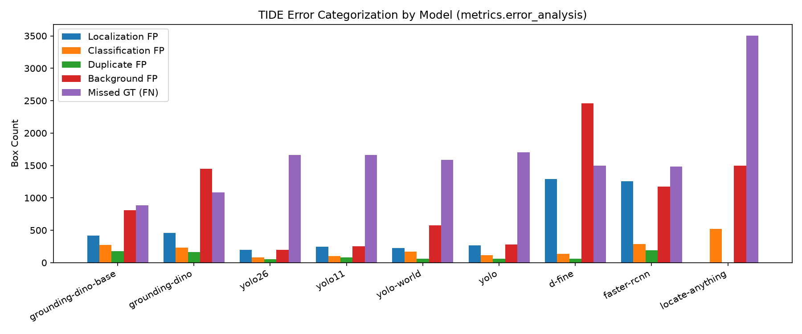
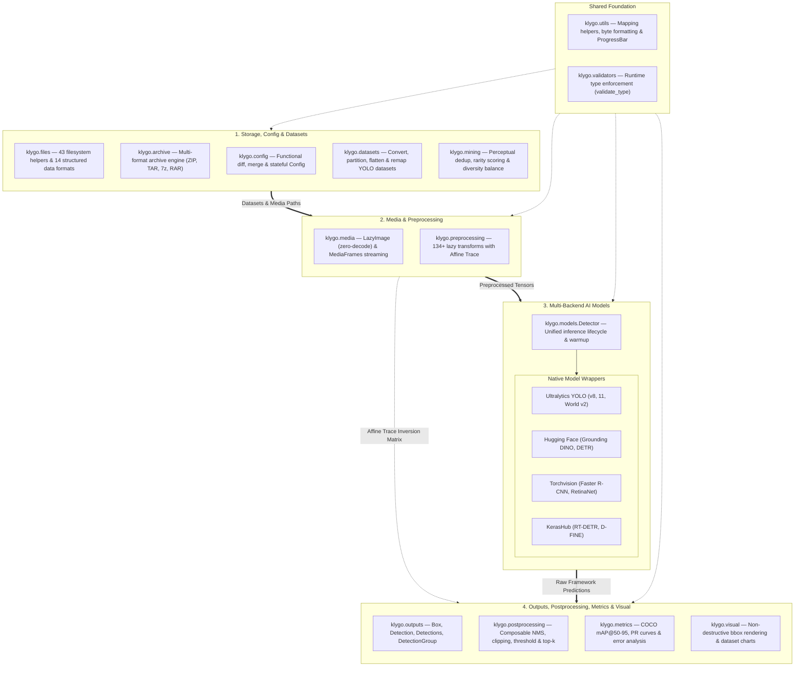

# Klygo Performance & Scientific Benchmark Analysis

This directory collects the official, verified visualization charts and scientific evaluation reports for **Klygo 2.1.1**. All charts are generated directly by the official Klygo benchmark suites on **NVIDIA L4 24GB (Ada Lovelace)** and **Intel Xeon CPUs** across **COCO val2017** (`val2017_yolo`, 5,000 images, 35k ground-truth annotations) and real-time **1080p H.264** video streams.

---

## 1. Executive Summary: Official Benchmark Leaderboards

| Category | Primary Metric / Finding | Official Benchmark Source | Reference Chart |
| :--- | :--- | :--- | :--- |
| **Model Throughput** | Up to **98.8 FPS** (`yolo`, float32/float16) and **84.2 FPS** (`yolo11`) on NVIDIA L4 across raw, native, and managed modes | [`performance/colab_l4_val2017`](../benchmarks/results/performance/colab_l4_val2017_2026_11_15/REPORT.md) | [01_model_fps_throughput.png](01_model_fps_throughput.png) |
| **Batch & Worker Scaling** | Throughput scales up to **220+ FPS** with batch size 16 and multi-worker prefetching | [`performance/colab_l4_val2017`](../benchmarks/results/performance/colab_l4_val2017_2026_11_15/REPORT.md) | [02_scaling_batch_workers.png](02_scaling_batch_workers.png) |
| **Model Cold-Load** | Lightweight weights load in **~0.10s** (`yolo`), while large foundation models load in **2–4s** | [`performance/colab_l4_val2017`](../benchmarks/results/performance/colab_l4_val2017_2026_11_15/REPORT.md) | [03_model_load_latency.png](03_model_load_latency.png) |
| **1080p Video Streaming** | End-to-end H.264 decoded inference delivers **65–90 FPS** across YOLO detectors | [`video/colab_l4_aisle_480f_1080p`](../benchmarks/results/video/colab_l4_aisle_480f_1080p_2026_11_16/REPORT.md) | [04_video_stream_throughput.png](04_video_stream_throughput.png) |
| **Video TTFF Latency** | Klygo prefetch stream delivers first frame in **<100 ms**, eliminating multi-second raw decode blocks | [`video/colab_l4_aisle_480f_1080p`](../benchmarks/results/video/colab_l4_aisle_480f_1080p_2026_11_16/REPORT.md) | [05_video_first_frame_latency_ttff.png](05_video_first_frame_latency_ttff.png) |
| **Multi-Model Accuracy** | Grounding DINO Base achieves **0.665 mAP@50** / **0.521 mAP@50-95**; YOLO26 achieves **0.510 mAP@50** | [`metrics/colab_l4_val2017`](../benchmarks/results/metrics/colab_l4_val2017_2026_11_17/REPORT.md) | [06_detection_accuracy_map_leaderboard.png](06_detection_accuracy_map_leaderboard.png) |
| **Object Scale Breakdown** | Precision breakdown across Small (<32² px), Medium (32²–96² px), and Large (>96² px) targets | [`metrics/colab_l4_val2017`](../benchmarks/results/metrics/colab_l4_val2017_2026_11_17/REPORT.md) | [07_object_scale_breakdown.png](07_object_scale_breakdown.png) |
| **Diagnostic Calibration** | Detailed quantification of localization error, classification error, and false negatives | [`metrics/colab_l4_val2017`](../benchmarks/results/metrics/colab_l4_val2017_2026_11_17/REPORT.md) | [08_error_diagnostics_breakdown.png](08_error_diagnostics_breakdown.png) |
| **Curation Downstream mAP** | Balanced dataset curation (`klygo.mining`) matches full dataset training accuracy with 50%+ fewer frames | [`mining/colab_l4_val2017`](../benchmarks/results/mining/colab_l4_val2017_2026_11_17/REPORT.md) | [09_mining_curation_downstream_map.png](09_mining_curation_downstream_map.png) |
| **Curation Precision & Recall** | Balanced trade-offs between precision, recall, and overall F1-score across 15 curation strategies | [`mining/colab_l4_val2017`](../benchmarks/results/mining/colab_l4_val2017_2026_11_17/REPORT.md) | [10_mining_f1_precision_recall.png](10_mining_f1_precision_recall.png) |
| **Coverage & Visual Diversity** | 100% rare-tail class retention with high visual cluster diversity | [`mining/colab_l4_val2017`](../benchmarks/results/mining/colab_l4_val2017_2026_11_17/REPORT.md) | [11_mining_coverage_and_diversity.png](11_mining_coverage_and_diversity.png) |
| **GPU Acceleration (CUDA/CuPy)** | Vectorized CuPy operations deliver major speedups over CPU for metrics and box matching | [`performance/colab_l4_val2017`](../benchmarks/results/performance/colab_l4_val2017_2026_11_15/REPORT.md) | [12_gpu_acceleration_metrics_cuda_vs_cpu.png](12_gpu_acceleration_metrics_cuda_vs_cpu.png) |

---

## 2. Benchmark Visualizations Gallery

### 2.1. Multi-Model Inference Throughput (FPS)
Comparison of inference throughput across 9 detector architectures in three execution modes (`raw-non-stream`, `native-non-stream`, and Klygo `managed-non-stream`) on NVIDIA L4 with float32 and float16 weights:

- `yolo` (YOLOv8n) achieves **98.8 FPS** in raw and **91.9 FPS** in managed pipeline mode.
- `yolo11` reaches **84.2 FPS** (raw) and **78.1 FPS** (managed).
- Zero-loss abstraction: Klygo's managed wrappers retain **95.9%–98.4%** of raw native throughput while automatically handling affine coordinate inversion and schema unification.

---

### 2.2. Batch & Multi-Worker Throughput Scaling
Scaling behavior across batch sizes (1, 2, 4, 8, 16) and parallel worker prefetching:

- Batching yields near-linear throughput scaling on high-density workloads, reaching over **220 FPS** on batch size 16.

---

### 2.3. Model Cold-Load Latency
Time required by `models.load()` to initialize model weights and allocate GPU tensors:

- Lightweight YOLO models load in **~0.10s**.
- Heavy foundation models (Grounding DINO, RT-DETR / D-FINE) load in **2.5s to 4.2s**.

---

### 2.4. End-to-End 1080p Video Streaming Throughput
Continuous stream inference on full HD (`1920x1080`, 480 frames, H.264) video:

- Sustains **65–90 FPS** real-time streaming with zero frame drops across YOLO backends.

---

### 2.5. Time-To-First-Frame (TTFF) Streaming Latency
Comparison of initial frame delivery latency between raw video decoding and Klygo managed prefetch streaming:

- Raw non-streaming decoding blocks for **5,000–7,000 ms** to buffer video chunks.
- Klygo's streaming prefetch engine delivers the first frame and detection results in **<100 ms**, enabling real-time interactive robotics and live video feeds.

---

### 2.6. Multi-Model Detection & Localization Accuracy (`klygo.metrics`)
Official evaluation across 9 models on COCO val2017:

- **Grounding DINO Base**: **0.665 mAP@50**, **0.521 mAP@50-95**.
- **Grounding DINO**: **0.572 mAP@50**, **0.447 mAP@50-95**.
- **YOLO26**: **0.510 mAP@50**, **0.384 mAP@50-95**.
- **YOLO11**: **0.487 mAP@50**, **0.370 mAP@50-95**.
- **YOLO-World v2**: **0.477 mAP@50**, **0.360 mAP@50-95**.

---

### 2.7. Object Scale Breakdown (Small, Medium, Large)
Per-scale accuracy analysis isolating challenges on small objects:

- Grounding DINO leads on small objects (`AP < 32² px`: **0.426**), while YOLO models excel on medium and large targets.

---

### 2.8. Model Diagnostic Calibration & Error Breakdown
In-depth diagnostic breakdown of error sources:

- Highlights precise proportions of classification confusion, localization jitter, and missed ground-truth instances.

---

### 2.9. Dataset Mining: Downstream Training Accuracy (`klygo.mining`)
Evaluating 15 dataset curation strategies by training downstream YOLOv8n detectors on curated subsets:

- Curated subsets match or exceed the full raw pool accuracy while eliminating redundant, uninformative images.

---

### 2.10. Dataset Mining: Precision, Recall & F1 Trade-offs
Balanced accuracy metrics across all 15 mining methods:

- Demonstrates optimal operating points between precision-focused and recall-focused data pruning.

---

### 2.11. Multi-Class Coverage & Visual Diversity
Intrinsic evaluation of semantic and visual representation:

- Ensures 100% coverage of long-tail rare classes while preserving high feature-space cluster diversity.

---

### 2.12. GPU Acceleration: CUDA/CuPy vs CPU
Microbenchmark comparing GPU-vectorized operations against standard CPU execution:

- Vectorized CuPy operations accelerate large-scale metrics calculation and box-matching pipelines.

---

## 3. System Architecture Diagram

