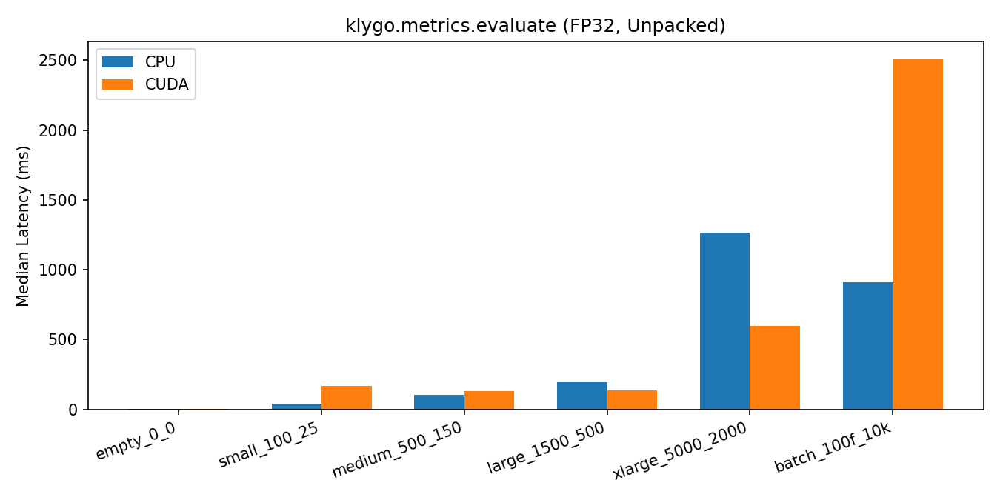
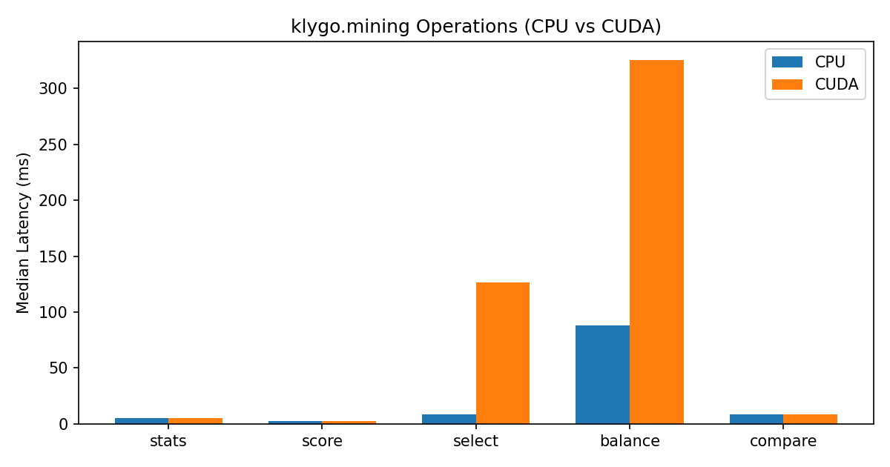
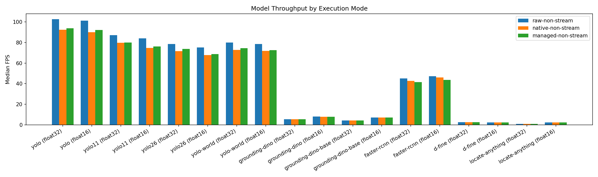
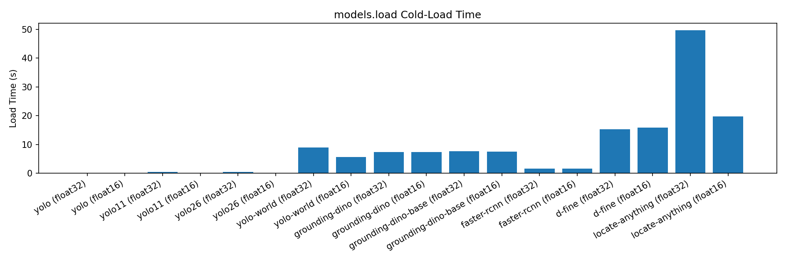
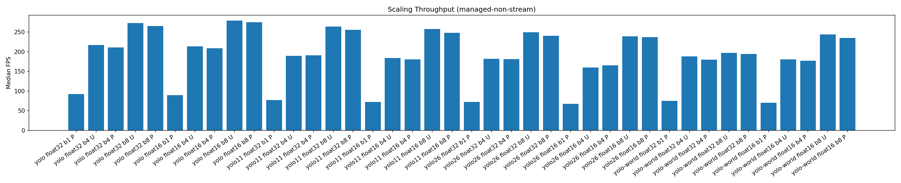

# Klygo Release Benchmark Report

- **GPU**: `NVIDIA L4` (22563.1 MB VRAM)
- **CUDA / CuPy**: `torch_cuda=True`, `cupy_cuda=True`, `cuda_runtime=13.0`
- **Git**: `detection-evaluation` @ `ae0eaaaa668446cb4f1d62c30472c6028e3673b3` (dirty: `yes`)
- **OS / Python**: `Linux-6.6.159+-x86_64-with-glibc2.39` / Python `3.13.16`

## Package Versions

| torch | torchvision | ultralytics | transformers | keras | keras_hub | numpy | cupy | pillow | opencv |
| --- | --- | --- | --- | --- | --- | --- | --- | --- | --- |
| 2.14.1+cu130 | 0.29.1+cu130 | 8.4.213 | 5.22.1 | 3.13.2 | 0.26.0 | 2.4.6 | not-installed | 11.3.0 | 5.0.0.93 |

## klygo.metrics (CPU vs CUDA)

| case | device | precision | packed | first_ms | evaluate_median_ms | compose_median_ms | f1 | f1_drift_vs_fp64 | status |
| --- | --- | --- | --- | --- | --- | --- | --- | --- | --- |
| empty_0_0 | cpu | fp16 | False | 0.474 | 0.4171 | 1.4594 | 0.0 | 0.0 | passed |
| empty_0_0 | cuda | fp16 | False | 162.2065 | 2.577 | 14.0706 | 0.0 | 0.0 | passed |
| empty_0_0 | cpu | fp32 | False | 0.4962 | 0.3699 | 1.4286 | 0.0 | 0.0 | passed |
| empty_0_0 | cuda | fp32 | False | 2.5805 | 2.5276 | 13.9919 | 0.0 | 0.0 | passed |
| empty_0_0 | cpu | fp32 | True | 0.5674 | 0.4719 | 1.5324 | 0.0 | 0.0 | passed |
| empty_0_0 | cuda | fp32 | True | 3.016 | 2.9273 | 14.4279 | 0.0 | 0.0 | passed |
| empty_0_0 | cpu | fp64 | False | 0.4743 | 0.3561 | 1.4246 | 0.0 | 0.0 | passed |
| empty_0_0 | cuda | fp64 | False | 2.5865 | 2.5341 | 14.0301 | 0.0 | 0.0 | passed |
| empty_0_0 | cpu | fp64 | True | 0.5179 | 0.4729 | 1.5359 | 0.0 | 0.0 | passed |
| empty_0_0 | cuda | fp64 | True | 2.9943 | 2.9275 | 14.5138 | 0.0 | 0.0 | passed |
| small_100_25 | cpu | fp16 | False | 42.248 | 41.4635 | 17.1143 | 0.236 | 0.0 | passed |
| small_100_25 | cuda | fp16 | False | 290.0957 | 166.7 | 106.0092 | 0.236 | 0.0 | passed |
| small_100_25 | cpu | fp32 | False | 41.8534 | 41.2988 | 17.1686 | 0.236 | 0.0 | passed |
| small_100_25 | cuda | fp32 | False | 170.144 | 169.2302 | 106.0269 | 0.236 | 0.0 | passed |
| small_100_25 | cpu | fp32 | True | 42.277 | 42.1827 | 17.66 | 0.236 | 0.0 | passed |
| small_100_25 | cuda | fp32 | True | 195.25 | 171.1262 | 109.7991 | 0.236 | 0.0 | passed |
| small_100_25 | cpu | fp64 | False | 43.1233 | 42.2903 | 17.4578 | 0.236 | 0.0 | passed |
| small_100_25 | cuda | fp64 | False | 171.1714 | 168.312 | 107.5766 | 0.236 | 0.0 | passed |
| small_100_25 | cpu | fp64 | True | 41.6741 | 42.003 | 17.625 | 0.236 | 0.0 | passed |
| small_100_25 | cuda | fp64 | True | 173.5474 | 171.433 | 110.618 | 0.236 | 0.0 | passed |
| medium_500_150 | cpu | fp16 | False | 101.6924 | 102.3151 | 43.7033 | 0.30615 | 0.0 | passed |
| medium_500_150 | cuda | fp16 | False | 163.4077 | 131.714 | 73.9362 | 0.30615 | 0.0 | passed |
| medium_500_150 | cpu | fp32 | False | 103.6131 | 102.3882 | 43.3803 | 0.30615 | 0.0 | passed |
| medium_500_150 | cuda | fp32 | False | 133.9311 | 131.7142 | 74.3301 | 0.30615 | 0.0 | passed |
| medium_500_150 | cpu | fp32 | True | 103.085 | 102.9767 | 44.4971 | 0.30615 | 0.0 | passed |
| medium_500_150 | cuda | fp32 | True | 161.7892 | 133.5727 | 76.4741 | 0.30615 | 0.0 | passed |
| medium_500_150 | cpu | fp64 | False | 102.5723 | 102.9698 | 43.77 | 0.30615 | 0.0 | passed |
| medium_500_150 | cuda | fp64 | False | 134.7325 | 134.287 | 74.5956 | 0.30615 | 0.0 | passed |
| medium_500_150 | cpu | fp64 | True | 103.7273 | 102.8926 | 43.715 | 0.30615 | 0.0 | passed |
| medium_500_150 | cuda | fp64 | True | 134.5607 | 133.6914 | 76.0766 | 0.30615 | 0.0 | passed |
| large_1500_500 | cpu | fp16 | False | 191.4154 | 192.25 | 103.2018 | 0.366 | 0.001 | passed |
| large_1500_500 | cuda | fp16 | False | 149.0695 | 135.0822 | 65.9329 | 0.366 | 0.001 | passed |
| large_1500_500 | cpu | fp32 | False | 194.9371 | 191.6303 | 102.3274 | 0.365 | 0.0 | passed |
| large_1500_500 | cuda | fp32 | False | 134.4532 | 134.1255 | 66.181 | 0.365 | 0.0 | passed |
| large_1500_500 | cpu | fp32 | True | 194.7549 | 192.6112 | 103.3412 | 0.365 | 0.0 | passed |
| large_1500_500 | cuda | fp32 | True | 136.2002 | 134.2218 | 66.663 | 0.365 | 0.0 | passed |
| large_1500_500 | cpu | fp64 | False | 192.4672 | 193.2223 | 103.6688 | 0.365 | 0.0 | passed |
| large_1500_500 | cuda | fp64 | False | 134.5878 | 132.565 | 64.6058 | 0.365 | 0.0 | passed |
| large_1500_500 | cpu | fp64 | True | 192.3285 | 192.096 | 103.6429 | 0.365 | 0.0 | passed |
| large_1500_500 | cuda | fp64 | True | 136.1529 | 134.8468 | 65.4635 | 0.365 | 0.0 | passed |
| xlarge_5000_2000 | cpu | fp16 | False | 1264.2494 | 1270.6769 | 926.225 | 0.43486 | 0.000571 | passed |
| xlarge_5000_2000 | cuda | fp16 | False | 601.8226 | 599.5776 | 219.9055 | 0.43486 | 0.000571 | passed |
| xlarge_5000_2000 | cpu | fp32 | False | 1275.0549 | 1267.8437 | 929.9635 | 0.43429 | 0.0 | passed |
| xlarge_5000_2000 | cuda | fp32 | False | 599.1883 | 598.2785 | 219.6904 | 0.43429 | 0.0 | passed |
| xlarge_5000_2000 | cpu | fp32 | True | 1270.6207 | 1269.3358 | 924.2188 | 0.43429 | 0.0 | passed |
| xlarge_5000_2000 | cuda | fp32 | True | 600.9038 | 600.0432 | 221.4477 | 0.43429 | 0.0 | passed |
| xlarge_5000_2000 | cpu | fp64 | False | 1263.3874 | 1263.8823 | 925.1572 | 0.43429 | 0.0 | passed |
| xlarge_5000_2000 | cuda | fp64 | False | 599.2648 | 599.0805 | 219.245 | 0.43429 | 0.0 | passed |
| xlarge_5000_2000 | cpu | fp64 | True | 1266.088 | 1274.2235 | 933.8038 | 0.43429 | 0.0 | passed |
| xlarge_5000_2000 | cuda | fp64 | True | 601.3725 | 599.2444 | 221.0813 | 0.43429 | 0.0 | passed |
| batch_100f_10k | cpu | fp16 | False | 916.9572 | 917.0936 | 368.5634 | 0.27631 | 0.0 | passed |
| batch_100f_10k | cuda | fp16 | False | 2505.3294 | 2494.3467 | 1988.4186 | 0.27631 | 0.0 | passed |
| batch_100f_10k | cpu | fp32 | False | 918.7686 | 912.5721 | 369.3006 | 0.27631 | 0.0 | passed |
| batch_100f_10k | cuda | fp32 | False | 2522.4338 | 2509.7754 | 2010.2835 | 0.27631 | 0.0 | passed |
| batch_100f_10k | cpu | fp32 | True | 933.0803 | 926.5821 | 377.959 | 0.27631 | 0.0 | passed |
| batch_100f_10k | cuda | fp32 | True | 2583.815 | 2573.021 | 2076.8296 | 0.27631 | 0.0 | passed |
| batch_100f_10k | cpu | fp64 | False | 910.9586 | 918.6724 | 368.533 | 0.27631 | 0.0 | passed |
| batch_100f_10k | cuda | fp64 | False | 2493.0486 | 2501.4446 | 1999.5829 | 0.27631 | 0.0 | passed |
| batch_100f_10k | cpu | fp64 | True | 927.5458 | 924.8233 | 376.7955 | 0.27631 | 0.0 | passed |
| batch_100f_10k | cuda | fp64 | True | 2568.8591 | 2585.7752 | 2074.6421 | 0.27631 | 0.0 | passed |

## DetectionGroup / Postprocessing / Outputs / Transfer

| device | frames | group_keep_ms | post_pipeline_ms | combine_ms | pack_ms | astype_fp16_ms | status |
| --- | --- | --- | --- | --- | --- | --- | --- |
| cpu | 100 | 20.717 | 299.298 | 224.3156 | 10.2935 | 9.3335 | passed |
| cuda | 100 | 552.1786 | 643.7423 | 2150.5092 | 305.345 | 323.6529 | passed |
| transfer | 100 | 29.8208 | 54.8217 | 0.0 | 0.0 | 0.0 | passed |

## klygo.mining (CPU vs CUDA)

| scope | device | stats_ms | score_ms | select_ms | balance_ms | compare_ms | status |
| --- | --- | --- | --- | --- | --- | --- | --- |
| detections_200f | cpu | 5.5797 | 2.8169 | 8.7466 | 88.251 | 8.3043 | passed |
| detections_200f | cuda | 5.5351 | 2.8929 | 126.4428 | 325.7531 | 8.248 | passed |

## Loaders / Preprocessing / Disk Mining

| operation | median_ms | status |
| --- | --- | --- |
| datasets.load (coco128, 128 imgs) | 193.7215 | passed |
| media.load_eager (coco128, 128 imgs) | 9.6228 | passed |
| media.load_stream (coco128, 128 imgs) | 9.9958 | passed |
| preprocessing.compose (coco128, 32 imgs) | 0.2427 | passed |
| mining.stats_quality (coco128, 128 imgs) | 1628.1751 | passed |
| mining.find_duplicates (coco128, 128 imgs) | 194.9579 | passed |
| mining.cluster (coco128, 128 imgs, k=8) | 1665.4343 | passed |
| datasets.load_scaled (2048 imgs) | 3035.3485 | passed |
| media.load_indexed (2048 imgs) | 76.3453 | passed |
| media.strided_decode (stride=32, 64 imgs) | 228.8407 | passed |
| media.random_jump_numpy (64/2048 imgs) | 139.8209 | passed |
| media.random_jump_pil (64/2048 imgs) | 129.5884 | passed |
| detections.random_jump_index (64/2048) | 0.0118 | passed |
| detections.random_jump_image_read (64/2048) | 22.6058 | passed |

## models.load Cold-Load Latency

| model | dtype | actual_dtype | load_seconds | device |
| --- | --- | --- | --- | --- |
| yolo | float32 | torch.float32 | 0.0984 |  |
| yolo | float16 | torch.float16 | 0.0987 |  |
| yolo11 | float32 | torch.float32 | 0.5516 |  |
| yolo11 | float16 | torch.float16 | 0.1088 |  |
| yolo26 | float32 | torch.float32 | 0.5627 |  |
| yolo26 | float16 | torch.float16 | 0.1262 |  |
| yolo-world | float32 | torch.float32 | 8.9126 |  |
| yolo-world | float16 | torch.float16 | 5.718 |  |
| grounding-dino | float32 | torch.float32 | 7.4588 |  |
| grounding-dino | float16 | torch.float16 | 7.4346 |  |
| grounding-dino-base | float32 | torch.float32 | 7.7474 |  |
| grounding-dino-base | float16 | torch.float16 | 7.5992 |  |
| faster-rcnn | float32 | torch.float32 | 1.6281 |  |
| faster-rcnn | float16 | torch.float16 | 1.6675 |  |
| d-fine | float32 | float32 | 15.35 |  |
| d-fine | float16 | float16 | 15.8397 |  |
| locate-anything | float32 | torch.float32 | 49.6555 |  |
| locate-anything | float16 | torch.float16 | 19.7765 |  |

## 6-Mode Model Run Status

| model | dtype | returncode | status | output_dir | error |
| --- | --- | --- | --- | --- | --- |
| yolo | float32 | 0 | passed | artifacts/benchmarks/colab_l4_full/inference/yolo_float32 |  |
| yolo | float16 | 0 | passed | artifacts/benchmarks/colab_l4_full/inference/yolo_float16 |  |
| yolo11 | float32 | 0 | passed | artifacts/benchmarks/colab_l4_full/inference/yolo11_float32 |  |
| yolo11 | float16 | 0 | passed | artifacts/benchmarks/colab_l4_full/inference/yolo11_float16 |  |
| yolo26 | float32 | 0 | passed | artifacts/benchmarks/colab_l4_full/inference/yolo26_float32 |  |
| yolo26 | float16 | 0 | passed | artifacts/benchmarks/colab_l4_full/inference/yolo26_float16 |  |
| yolo-world | float32 | 0 | passed | artifacts/benchmarks/colab_l4_full/inference/yolo-world_float32 |  |
| yolo-world | float16 | 0 | passed | artifacts/benchmarks/colab_l4_full/inference/yolo-world_float16 |  |
| grounding-dino | float32 | 0 | passed | artifacts/benchmarks/colab_l4_full/inference/grounding-dino_float32 |  |
| grounding-dino | float16 | 0 | passed | artifacts/benchmarks/colab_l4_full/inference/grounding-dino_float16 |  |
| grounding-dino-base | float32 | 0 | passed | artifacts/benchmarks/colab_l4_full/inference/grounding-dino-base_float32 |  |
| grounding-dino-base | float16 | 0 | passed | artifacts/benchmarks/colab_l4_full/inference/grounding-dino-base_float16 |  |
| faster-rcnn | float32 | 0 | passed | artifacts/benchmarks/colab_l4_full/inference/faster-rcnn_float32 |  |
| faster-rcnn | float16 | 0 | passed | artifacts/benchmarks/colab_l4_full/inference/faster-rcnn_float16 |  |
| d-fine | float32 | 0 | passed | artifacts/benchmarks/colab_l4_full/inference/d-fine_float32 |  |
| d-fine | float16 | 0 | passed | artifacts/benchmarks/colab_l4_full/inference/d-fine_float16 |  |
| locate-anything | float32 | 0 | passed | artifacts/benchmarks/colab_l4_full/locate_anything/fp32 |  |
| locate-anything | float16 | 0 | passed | artifacts/benchmarks/colab_l4_full/locate_anything/fp16 |  |

## 6-Mode Model Inference Details

| model | dtype | actual_dtype | mode | status | fps_median | p50_ms | parity_pass |
| --- | --- | --- | --- | --- | --- | --- | --- |
| yolo | float32 | torch.float32 | raw-non-stream | ok | 102.62 | 9.7 | True |
| yolo | float32 | torch.float32 | raw-stream | ok | 102.23 | 9.71 | True |
| yolo | float32 | torch.float32 | native-non-stream | ok | 92.34 | 10.7 | True |
| yolo | float32 | torch.float32 | native-stream | ok | 93.73 | 10.77 | True |
| yolo | float32 | torch.float32 | managed-non-stream | ok | 93.79 | 10.54 | True |
| yolo | float32 | torch.float32 | managed-stream | ok | 93.05 | 10.58 | True |
| yolo | float16 | torch.float16 | raw-non-stream | ok | 101.12 | 9.77 | True |
| yolo | float16 | torch.float16 | raw-stream | ok | 101.42 | 9.71 | True |
| yolo | float16 | torch.float16 | native-non-stream | ok | 89.98 | 10.8 | True |
| yolo | float16 | torch.float16 | native-stream | ok | 90.69 | 10.82 | True |
| yolo | float16 | torch.float16 | managed-non-stream | ok | 91.95 | 10.7 | True |
| yolo | float16 | torch.float16 | managed-stream | ok | 90.91 | 10.73 | True |
| yolo11 | float32 | torch.float32 | raw-non-stream | ok | 86.94 | 11.23 | True |
| yolo11 | float32 | torch.float32 | raw-stream | ok | 86.87 | 11.38 | True |
| yolo11 | float32 | torch.float32 | native-non-stream | ok | 79.64 | 12.71 | True |
| yolo11 | float32 | torch.float32 | native-stream | ok | 80.16 | 12.63 | True |
| yolo11 | float32 | torch.float32 | managed-non-stream | ok | 79.96 | 12.8 | True |
| yolo11 | float32 | torch.float32 | managed-stream | ok | 80.7 | 12.57 | True |
| yolo11 | float16 | torch.float16 | raw-non-stream | ok | 83.83 | 11.34 | True |
| yolo11 | float16 | torch.float16 | raw-stream | ok | 84.14 | 11.7 | True |
| yolo11 | float16 | torch.float16 | native-non-stream | ok | 74.74 | 12.92 | True |
| yolo11 | float16 | torch.float16 | native-stream | ok | 75.26 | 13.46 | True |
| yolo11 | float16 | torch.float16 | managed-non-stream | ok | 76.02 | 13.14 | True |
| yolo11 | float16 | torch.float16 | managed-stream | ok | 75.24 | 13.56 | True |
| yolo26 | float32 | torch.float32 | raw-non-stream | ok | 78.53 | 12.7 | True |
| yolo26 | float32 | torch.float32 | raw-stream | ok | 78.9 | 12.5 | True |
| yolo26 | float32 | torch.float32 | native-non-stream | ok | 71.6 | 13.72 | True |
| yolo26 | float32 | torch.float32 | native-stream | ok | 72.83 | 13.41 | True |
| yolo26 | float32 | torch.float32 | managed-non-stream | ok | 73.7 | 13.57 | True |
| yolo26 | float32 | torch.float32 | managed-stream | ok | 73.78 | 13.6 | True |
| yolo26 | float16 | torch.float16 | raw-non-stream | ok | 75.1 | 13.15 | True |
| yolo26 | float16 | torch.float16 | raw-stream | ok | 74.43 | 13.27 | True |
| yolo26 | float16 | torch.float16 | native-non-stream | ok | 67.63 | 14.71 | True |
| yolo26 | float16 | torch.float16 | native-stream | ok | 67.5 | 15.06 | True |
| yolo26 | float16 | torch.float16 | managed-non-stream | ok | 68.79 | 14.42 | True |
| yolo26 | float16 | torch.float16 | managed-stream | ok | 68.96 | 14.26 | True |
| yolo-world | float32 | torch.float32 | raw-non-stream | ok | 79.84 | 12.22 | True |
| yolo-world | float32 | torch.float32 | raw-stream | ok | 79.5 | 12.41 | True |
| yolo-world | float32 | torch.float32 | native-non-stream | ok | 72.86 | 13.89 | True |
| yolo-world | float32 | torch.float32 | native-stream | ok | 72.92 | 13.76 | True |
| yolo-world | float32 | torch.float32 | managed-non-stream | ok | 74.34 | 13.17 | True |
| yolo-world | float32 | torch.float32 | managed-stream | ok | 73.17 | 13.23 | True |
| yolo-world | float16 | torch.float16 | raw-non-stream | ok | 78.51 | 12.64 | True |
| yolo-world | float16 | torch.float16 | raw-stream | ok | 78.78 | 12.62 | True |
| yolo-world | float16 | torch.float16 | native-non-stream | ok | 71.69 | 13.69 | True |
| yolo-world | float16 | torch.float16 | native-stream | ok | 71.18 | 13.82 | True |
| yolo-world | float16 | torch.float16 | managed-non-stream | ok | 72.41 | 13.58 | True |
| yolo-world | float16 | torch.float16 | managed-stream | ok | 72.15 | 13.77 | True |
| grounding-dino | float32 | torch.float32 | raw-stream | N/A | None | None | None |
| grounding-dino | float32 | torch.float32 | native-stream | N/A | None | None | None |
| grounding-dino | float32 | torch.float32 | raw-non-stream | ok | 5.62 | 177.18 | True |
| grounding-dino | float32 | torch.float32 | native-non-stream | ok | 5.55 | 178.27 | True |
| grounding-dino | float32 | torch.float32 | managed-non-stream | ok | 5.55 | 180.04 | True |
| grounding-dino | float32 | torch.float32 | managed-stream | ok | 5.55 | 177.82 | True |
| grounding-dino | float16 | torch.float16 | raw-stream | N/A | None | None | None |
| grounding-dino | float16 | torch.float16 | native-stream | N/A | None | None | None |
| grounding-dino | float16 | torch.float16 | raw-non-stream | ok | 8.1 | 123.51 | True |
| grounding-dino | float16 | torch.float16 | native-non-stream | ok | 7.96 | 127.43 | True |
| grounding-dino | float16 | torch.float16 | managed-non-stream | ok | 7.94 | 126.7 | True |
| grounding-dino | float16 | torch.float16 | managed-stream | ok | 7.95 | 126.37 | True |
| grounding-dino-base | float32 | torch.float32 | raw-stream | N/A | None | None | None |
| grounding-dino-base | float32 | torch.float32 | native-stream | N/A | None | None | None |
| grounding-dino-base | float32 | torch.float32 | raw-non-stream | ok | 4.34 | 228.71 | True |
| grounding-dino-base | float32 | torch.float32 | native-non-stream | ok | 4.3 | 231.94 | True |
| grounding-dino-base | float32 | torch.float32 | managed-non-stream | ok | 4.29 | 232.81 | True |
| grounding-dino-base | float32 | torch.float32 | managed-stream | ok | 4.29 | 230.56 | True |
| grounding-dino-base | float16 | torch.float16 | raw-stream | N/A | None | None | None |
| grounding-dino-base | float16 | torch.float16 | native-stream | N/A | None | None | None |
| grounding-dino-base | float16 | torch.float16 | raw-non-stream | ok | 7.32 | 137.49 | True |
| grounding-dino-base | float16 | torch.float16 | native-non-stream | ok | 7.24 | 139.65 | True |
| grounding-dino-base | float16 | torch.float16 | managed-non-stream | ok | 7.17 | 139.47 | True |
| grounding-dino-base | float16 | torch.float16 | managed-stream | ok | 7.15 | 138.31 | True |
| faster-rcnn | float32 | torch.float32 | raw-stream | N/A | None | None | None |
| faster-rcnn | float32 | torch.float32 | native-stream | N/A | None | None | None |
| faster-rcnn | float32 | torch.float32 | raw-non-stream | ok | 45.1 | 21.57 | True |
| faster-rcnn | float32 | torch.float32 | native-non-stream | ok | 42.78 | 23.24 | True |
| faster-rcnn | float32 | torch.float32 | managed-non-stream | ok | 41.53 | 23.9 | True |
| faster-rcnn | float32 | torch.float32 | managed-stream | ok | 41.1 | 24.22 | True |
| faster-rcnn | float16 | torch.float16 | raw-stream | N/A | None | None | None |
| faster-rcnn | float16 | torch.float16 | native-stream | N/A | None | None | None |
| faster-rcnn | float16 | torch.float16 | raw-non-stream | ok | 47.22 | 20.11 | True |
| faster-rcnn | float16 | torch.float16 | native-non-stream | ok | 46.07 | 21.0 | True |
| faster-rcnn | float16 | torch.float16 | managed-non-stream | ok | 43.71 | 22.27 | True |
| faster-rcnn | float16 | torch.float16 | managed-stream | ok | 43.75 | 22.24 | True |
| d-fine | float32 | float32 | raw-stream | N/A | None | None | None |
| d-fine | float32 | float32 | native-stream | N/A | None | None | None |
| d-fine | float32 | float32 | raw-non-stream | ok | 2.73 | 368.75 | True |
| d-fine | float32 | float32 | native-non-stream | ok | 2.71 | 368.16 | True |
| d-fine | float32 | float32 | managed-non-stream | ok | 2.71 | 368.42 | True |
| d-fine | float32 | float32 | managed-stream | ok | 2.71 | 369.35 | True |
| d-fine | float16 | float16 | raw-stream | N/A | None | None | None |
| d-fine | float16 | float16 | native-stream | N/A | None | None | None |
| d-fine | float16 | float16 | raw-non-stream | ok | 2.6 | 385.03 | True |
| d-fine | float16 | float16 | native-non-stream | ok | 2.6 | 383.16 | True |
| d-fine | float16 | float16 | managed-non-stream | ok | 2.6 | 385.0 | True |
| d-fine | float16 | float16 | managed-stream | ok | 2.6 | 383.95 | True |
| locate-anything | float32 | torch.float32 | raw-stream | N/A | None | None | None |
| locate-anything | float32 | torch.float32 | native-stream | N/A | None | None | None |
| locate-anything | float32 | torch.float32 | raw-non-stream | ok | 0.98 | 1013.43 | True |
| locate-anything | float32 | torch.float32 | native-non-stream | ok | 0.99 | 1019.29 | True |
| locate-anything | float32 | torch.float32 | managed-non-stream | ok | 0.98 | 1016.15 | True |
| locate-anything | float32 | torch.float32 | managed-stream | ok | 0.99 | 1018.16 | True |
| locate-anything | float16 | torch.float16 | raw-stream | N/A | None | None | None |
| locate-anything | float16 | torch.float16 | native-stream | N/A | None | None | None |
| locate-anything | float16 | torch.float16 | raw-non-stream | ok | 2.48 | 404.97 | True |
| locate-anything | float16 | torch.float16 | native-non-stream | ok | 2.47 | 407.55 | True |
| locate-anything | float16 | torch.float16 | managed-non-stream | ok | 2.48 | 402.04 | True |
| locate-anything | float16 | torch.float16 | managed-stream | ok | 2.48 | 404.39 | True |

## Batch / Workers / Prefetch / Packed Scaling

| model | dtype | batch | workers | prefetch | packed | mode | fps_median | p50_ms | parity |
| --- | --- | --- | --- | --- | --- | --- | --- | --- | --- |
| yolo | float32 | 1 | 1 | 1 | True | raw-non-stream | 102.57 | 9.54 | True |
| yolo | float32 | 1 | 1 | 1 | True | raw-stream | 102.28 | 10.06 | True |
| yolo | float32 | 1 | 1 | 1 | True | native-non-stream | 89.72 | 11.3 | True |
| yolo | float32 | 1 | 1 | 1 | True | native-stream | 93.43 | 10.81 | True |
| yolo | float32 | 1 | 1 | 1 | True | managed-non-stream | 92.01 | 10.78 | True |
| yolo | float32 | 1 | 1 | 1 | True | managed-stream | 93.04 | 10.87 | True |
| yolo | float32 | 4 | 2 | 2 | False | raw-non-stream | 206.42 | 0.01 | True |
| yolo | float32 | 4 | 2 | 2 | False | raw-stream | 204.93 | 0.02 | True |
| yolo | float32 | 4 | 2 | 2 | False | native-non-stream | 188.47 | 0.01 | True |
| yolo | float32 | 4 | 2 | 2 | False | native-stream | 189.57 | 0.48 | True |
| yolo | float32 | 4 | 2 | 2 | False | managed-non-stream | 217.2 | 0.01 | True |
| yolo | float32 | 4 | 2 | 2 | False | managed-stream | 219.47 | 0.03 | True |
| yolo | float32 | 4 | 2 | 2 | True | raw-non-stream | 202.75 | 0.01 | True |
| yolo | float32 | 4 | 2 | 2 | True | raw-stream | 202.46 | 0.02 | True |
| yolo | float32 | 4 | 2 | 2 | True | native-non-stream | 183.51 | 0.07 | True |
| yolo | float32 | 4 | 2 | 2 | True | native-stream | 190.55 | 0.48 | True |
| yolo | float32 | 4 | 2 | 2 | True | managed-non-stream | 210.43 | 0.08 | True |
| yolo | float32 | 4 | 2 | 2 | True | managed-stream | 217.25 | 0.03 | True |
| yolo | float32 | 8 | 4 | 4 | False | raw-non-stream | 249.76 | 0.01 | True |
| yolo | float32 | 8 | 4 | 4 | False | raw-stream | 250.63 | 0.01 | True |
| yolo | float32 | 8 | 4 | 4 | False | native-non-stream | 227.81 | 0.01 | True |
| yolo | float32 | 8 | 4 | 4 | False | native-stream | 226.91 | 0.48 | True |
| yolo | float32 | 8 | 4 | 4 | False | managed-non-stream | 273.14 | 0.01 | True |
| yolo | float32 | 8 | 4 | 4 | False | managed-stream | 272.91 | 0.03 | True |
| yolo | float32 | 8 | 4 | 4 | True | raw-non-stream | 253.32 | 0.01 | True |
| yolo | float32 | 8 | 4 | 4 | True | raw-stream | 254.72 | 0.01 | True |
| yolo | float32 | 8 | 4 | 4 | True | native-non-stream | 224.74 | 0.06 | True |
| yolo | float32 | 8 | 4 | 4 | True | native-stream | 228.84 | 0.48 | True |
| yolo | float32 | 8 | 4 | 4 | True | managed-non-stream | 265.24 | 0.07 | True |
| yolo | float32 | 8 | 4 | 4 | True | managed-stream | 278.2 | 0.03 | True |
| yolo | float16 | 1 | 1 | 1 | True | raw-non-stream | 98.81 | 10.06 | True |
| yolo | float16 | 1 | 1 | 1 | True | raw-stream | 98.95 | 10.0 | True |
| yolo | float16 | 1 | 1 | 1 | True | native-non-stream | 86.73 | 11.26 | True |
| yolo | float16 | 1 | 1 | 1 | True | native-stream | 89.45 | 11.09 | True |
| yolo | float16 | 1 | 1 | 1 | True | managed-non-stream | 89.12 | 11.15 | True |
| yolo | float16 | 1 | 1 | 1 | True | managed-stream | 90.92 | 11.1 | True |
| yolo | float16 | 4 | 2 | 2 | False | raw-non-stream | 196.39 | 0.01 | True |
| yolo | float16 | 4 | 2 | 2 | False | raw-stream | 198.43 | 0.02 | True |
| yolo | float16 | 4 | 2 | 2 | False | native-non-stream | 184.57 | 0.01 | True |
| yolo | float16 | 4 | 2 | 2 | False | native-stream | 184.35 | 0.48 | True |
| yolo | float16 | 4 | 2 | 2 | False | managed-non-stream | 213.74 | 0.01 | True |
| yolo | float16 | 4 | 2 | 2 | False | managed-stream | 214.13 | 0.03 | True |
| yolo | float16 | 4 | 2 | 2 | True | raw-non-stream | 205.75 | 0.01 | True |
| yolo | float16 | 4 | 2 | 2 | True | raw-stream | 205.92 | 0.02 | True |
| yolo | float16 | 4 | 2 | 2 | True | native-non-stream | 185.88 | 0.08 | True |
| yolo | float16 | 4 | 2 | 2 | True | native-stream | 187.33 | 0.48 | True |
| yolo | float16 | 4 | 2 | 2 | True | managed-non-stream | 208.95 | 0.08 | True |
| yolo | float16 | 4 | 2 | 2 | True | managed-stream | 219.78 | 0.03 | True |
| yolo | float16 | 8 | 4 | 4 | False | raw-non-stream | 257.98 | 0.01 | True |
| yolo | float16 | 8 | 4 | 4 | False | raw-stream | 258.34 | 0.01 | True |
| yolo | float16 | 8 | 4 | 4 | False | native-non-stream | 237.58 | 0.01 | True |
| yolo | float16 | 8 | 4 | 4 | False | native-stream | 233.89 | 0.46 | True |
| yolo | float16 | 8 | 4 | 4 | False | managed-non-stream | 278.88 | 0.01 | True |
| yolo | float16 | 8 | 4 | 4 | False | managed-stream | 281.01 | 0.03 | True |
| yolo | float16 | 8 | 4 | 4 | True | raw-non-stream | 256.11 | 0.01 | True |
| yolo | float16 | 8 | 4 | 4 | True | raw-stream | 258.57 | 0.01 | True |
| yolo | float16 | 8 | 4 | 4 | True | native-non-stream | 237.19 | 0.06 | True |
| yolo | float16 | 8 | 4 | 4 | True | native-stream | 241.0 | 0.47 | True |
| yolo | float16 | 8 | 4 | 4 | True | managed-non-stream | 274.63 | 0.06 | True |
| yolo | float16 | 8 | 4 | 4 | True | managed-stream | 283.36 | 0.03 | True |
| yolo11 | float32 | 1 | 1 | 1 | True | raw-non-stream | 83.8 | 11.54 | True |
| yolo11 | float32 | 1 | 1 | 1 | True | raw-stream | 84.47 | 11.47 | True |
| yolo11 | float32 | 1 | 1 | 1 | True | native-non-stream | 76.57 | 13.4 | True |
| yolo11 | float32 | 1 | 1 | 1 | True | native-stream | 78.09 | 12.61 | True |
| yolo11 | float32 | 1 | 1 | 1 | True | managed-non-stream | 77.1 | 12.89 | True |
| yolo11 | float32 | 1 | 1 | 1 | True | managed-stream | 78.76 | 12.55 | True |
| yolo11 | float32 | 4 | 2 | 2 | False | raw-non-stream | 183.67 | 0.01 | True |
| yolo11 | float32 | 4 | 2 | 2 | False | raw-stream | 182.14 | 0.02 | True |
| yolo11 | float32 | 4 | 2 | 2 | False | native-non-stream | 170.28 | 0.01 | True |
| yolo11 | float32 | 4 | 2 | 2 | False | native-stream | 170.25 | 0.48 | True |
| yolo11 | float32 | 4 | 2 | 2 | False | managed-non-stream | 189.22 | 0.01 | True |
| yolo11 | float32 | 4 | 2 | 2 | False | managed-stream | 189.16 | 0.03 | True |
| yolo11 | float32 | 4 | 2 | 2 | True | raw-non-stream | 189.29 | 0.01 | True |
| yolo11 | float32 | 4 | 2 | 2 | True | raw-stream | 188.28 | 0.02 | True |
| yolo11 | float32 | 4 | 2 | 2 | True | native-non-stream | 171.26 | 0.07 | True |
| yolo11 | float32 | 4 | 2 | 2 | True | native-stream | 175.39 | 0.47 | True |
| yolo11 | float32 | 4 | 2 | 2 | True | managed-non-stream | 191.04 | 0.08 | True |
| yolo11 | float32 | 4 | 2 | 2 | True | managed-stream | 197.3 | 0.03 | True |
| yolo11 | float32 | 8 | 4 | 4 | False | raw-non-stream | 245.5 | 0.01 | True |
| yolo11 | float32 | 8 | 4 | 4 | False | raw-stream | 245.39 | 0.01 | True |
| yolo11 | float32 | 8 | 4 | 4 | False | native-non-stream | 224.88 | 0.01 | True |
| yolo11 | float32 | 8 | 4 | 4 | False | native-stream | 224.2 | 0.46 | True |
| yolo11 | float32 | 8 | 4 | 4 | False | managed-non-stream | 263.78 | 0.01 | True |
| yolo11 | float32 | 8 | 4 | 4 | False | managed-stream | 265.22 | 0.03 | True |
| yolo11 | float32 | 8 | 4 | 4 | True | raw-non-stream | 243.33 | 0.01 | True |
| yolo11 | float32 | 8 | 4 | 4 | True | raw-stream | 243.33 | 0.01 | True |
| yolo11 | float32 | 8 | 4 | 4 | True | native-non-stream | 220.62 | 0.06 | True |
| yolo11 | float32 | 8 | 4 | 4 | True | native-stream | 227.58 | 0.47 | True |
| yolo11 | float32 | 8 | 4 | 4 | True | managed-non-stream | 255.39 | 0.07 | True |
| yolo11 | float32 | 8 | 4 | 4 | True | managed-stream | 259.48 | 0.03 | True |
| yolo11 | float16 | 1 | 1 | 1 | True | raw-non-stream | 81.75 | 11.85 | True |
| yolo11 | float16 | 1 | 1 | 1 | True | raw-stream | 82.87 | 11.76 | True |
| yolo11 | float16 | 1 | 1 | 1 | True | native-non-stream | 72.42 | 13.16 | True |
| yolo11 | float16 | 1 | 1 | 1 | True | native-stream | 73.22 | 13.11 | True |
| yolo11 | float16 | 1 | 1 | 1 | True | managed-non-stream | 72.1 | 13.25 | True |
| yolo11 | float16 | 1 | 1 | 1 | True | managed-stream | 73.0 | 13.05 | True |
| yolo11 | float16 | 4 | 2 | 2 | False | raw-non-stream | 194.26 | 0.01 | True |
| yolo11 | float16 | 4 | 2 | 2 | False | raw-stream | 193.74 | 0.02 | True |
| yolo11 | float16 | 4 | 2 | 2 | False | native-non-stream | 181.25 | 0.01 | True |
| yolo11 | float16 | 4 | 2 | 2 | False | native-stream | 182.82 | 0.49 | True |
| yolo11 | float16 | 4 | 2 | 2 | False | managed-non-stream | 183.62 | 0.01 | True |
| yolo11 | float16 | 4 | 2 | 2 | False | managed-stream | 187.24 | 0.04 | True |
| yolo11 | float16 | 4 | 2 | 2 | True | raw-non-stream | 194.15 | 0.01 | True |
| yolo11 | float16 | 4 | 2 | 2 | True | raw-stream | 195.67 | 0.02 | True |
| yolo11 | float16 | 4 | 2 | 2 | True | native-non-stream | 175.84 | 0.08 | True |
| yolo11 | float16 | 4 | 2 | 2 | True | native-stream | 185.02 | 0.48 | True |
| yolo11 | float16 | 4 | 2 | 2 | True | managed-non-stream | 180.49 | 0.07 | True |
| yolo11 | float16 | 4 | 2 | 2 | True | managed-stream | 187.56 | 0.03 | True |
| yolo11 | float16 | 8 | 4 | 4 | False | raw-non-stream | 242.18 | 0.01 | True |
| yolo11 | float16 | 8 | 4 | 4 | False | raw-stream | 241.13 | 0.01 | True |
| yolo11 | float16 | 8 | 4 | 4 | False | native-non-stream | 224.15 | 0.01 | True |
| yolo11 | float16 | 8 | 4 | 4 | False | native-stream | 223.76 | 0.47 | True |
| yolo11 | float16 | 8 | 4 | 4 | False | managed-non-stream | 257.52 | 0.01 | True |
| yolo11 | float16 | 8 | 4 | 4 | False | managed-stream | 261.08 | 0.03 | True |
| yolo11 | float16 | 8 | 4 | 4 | True | raw-non-stream | 239.6 | 0.01 | True |
| yolo11 | float16 | 8 | 4 | 4 | True | raw-stream | 237.89 | 0.01 | True |
| yolo11 | float16 | 8 | 4 | 4 | True | native-non-stream | 218.43 | 0.06 | True |
| yolo11 | float16 | 8 | 4 | 4 | True | native-stream | 220.81 | 0.47 | True |
| yolo11 | float16 | 8 | 4 | 4 | True | managed-non-stream | 247.81 | 0.06 | True |
| yolo11 | float16 | 8 | 4 | 4 | True | managed-stream | 257.52 | 0.03 | True |
| yolo26 | float32 | 1 | 1 | 1 | True | raw-non-stream | 78.02 | 12.49 | True |
| yolo26 | float32 | 1 | 1 | 1 | True | raw-stream | 77.76 | 12.45 | True |
| yolo26 | float32 | 1 | 1 | 1 | True | native-non-stream | 70.6 | 13.83 | True |
| yolo26 | float32 | 1 | 1 | 1 | True | native-stream | 72.26 | 13.34 | True |
| yolo26 | float32 | 1 | 1 | 1 | True | managed-non-stream | 71.9 | 13.7 | True |
| yolo26 | float32 | 1 | 1 | 1 | True | managed-stream | 73.44 | 13.37 | True |
| yolo26 | float32 | 4 | 2 | 2 | False | raw-non-stream | 175.17 | 0.01 | True |
| yolo26 | float32 | 4 | 2 | 2 | False | raw-stream | 174.78 | 0.02 | True |
| yolo26 | float32 | 4 | 2 | 2 | False | native-non-stream | 161.33 | 0.01 | True |
| yolo26 | float32 | 4 | 2 | 2 | False | native-stream | 162.22 | 0.48 | True |
| yolo26 | float32 | 4 | 2 | 2 | False | managed-non-stream | 181.5 | 0.01 | True |
| yolo26 | float32 | 4 | 2 | 2 | False | managed-stream | 180.27 | 0.04 | True |
| yolo26 | float32 | 4 | 2 | 2 | True | raw-non-stream | 176.6 | 0.01 | True |
| yolo26 | float32 | 4 | 2 | 2 | True | raw-stream | 177.94 | 0.02 | True |
| yolo26 | float32 | 4 | 2 | 2 | True | native-non-stream | 159.14 | 0.08 | True |
| yolo26 | float32 | 4 | 2 | 2 | True | native-stream | 164.78 | 0.48 | True |
| yolo26 | float32 | 4 | 2 | 2 | True | managed-non-stream | 181.44 | 0.08 | True |
| yolo26 | float32 | 4 | 2 | 2 | True | managed-stream | 185.92 | 0.03 | True |
| yolo26 | float32 | 8 | 4 | 4 | False | raw-non-stream | 264.34 | 0.01 | True |
| yolo26 | float32 | 8 | 4 | 4 | False | raw-stream | 264.2 | 0.01 | True |
| yolo26 | float32 | 8 | 4 | 4 | False | native-non-stream | 227.23 | 0.01 | True |
| yolo26 | float32 | 8 | 4 | 4 | False | native-stream | 226.94 | 0.46 | True |
| yolo26 | float32 | 8 | 4 | 4 | False | managed-non-stream | 249.48 | 0.01 | True |
| yolo26 | float32 | 8 | 4 | 4 | False | managed-stream | 246.96 | 0.03 | True |
| yolo26 | float32 | 8 | 4 | 4 | True | raw-non-stream | 260.03 | 0.01 | True |
| yolo26 | float32 | 8 | 4 | 4 | True | raw-stream | 263.89 | 0.01 | True |
| yolo26 | float32 | 8 | 4 | 4 | True | native-non-stream | 221.02 | 0.06 | True |
| yolo26 | float32 | 8 | 4 | 4 | True | native-stream | 222.73 | 0.48 | True |
| yolo26 | float32 | 8 | 4 | 4 | True | managed-non-stream | 240.12 | 0.07 | True |
| yolo26 | float32 | 8 | 4 | 4 | True | managed-stream | 244.06 | 0.03 | True |
| yolo26 | float16 | 1 | 1 | 1 | True | raw-non-stream | 75.18 | 12.95 | True |
| yolo26 | float16 | 1 | 1 | 1 | True | raw-stream | 75.11 | 13.2 | True |
| yolo26 | float16 | 1 | 1 | 1 | True | native-non-stream | 66.79 | 14.96 | True |
| yolo26 | float16 | 1 | 1 | 1 | True | native-stream | 68.6 | 14.72 | True |
| yolo26 | float16 | 1 | 1 | 1 | True | managed-non-stream | 67.61 | 14.65 | True |
| yolo26 | float16 | 1 | 1 | 1 | True | managed-stream | 68.35 | 14.94 | True |
| yolo26 | float16 | 4 | 2 | 2 | False | raw-non-stream | 172.16 | 0.01 | True |
| yolo26 | float16 | 4 | 2 | 2 | False | raw-stream | 171.96 | 0.02 | True |
| yolo26 | float16 | 4 | 2 | 2 | False | native-non-stream | 163.35 | 0.01 | True |
| yolo26 | float16 | 4 | 2 | 2 | False | native-stream | 161.86 | 0.5 | True |
| yolo26 | float16 | 4 | 2 | 2 | False | managed-non-stream | 159.46 | 0.01 | True |
| yolo26 | float16 | 4 | 2 | 2 | False | managed-stream | 167.5 | 0.04 | True |
| yolo26 | float16 | 4 | 2 | 2 | True | raw-non-stream | 177.46 | 0.01 | True |
| yolo26 | float16 | 4 | 2 | 2 | True | raw-stream | 180.35 | 0.02 | True |
| yolo26 | float16 | 4 | 2 | 2 | True | native-non-stream | 165.22 | 0.08 | True |
| yolo26 | float16 | 4 | 2 | 2 | True | native-stream | 168.77 | 0.51 | True |
| yolo26 | float16 | 4 | 2 | 2 | True | managed-non-stream | 165.42 | 0.08 | True |
| yolo26 | float16 | 4 | 2 | 2 | True | managed-stream | 166.17 | 0.04 | True |
| yolo26 | float16 | 8 | 4 | 4 | False | raw-non-stream | 230.17 | 0.01 | True |
| yolo26 | float16 | 8 | 4 | 4 | False | raw-stream | 231.76 | 0.01 | True |
| yolo26 | float16 | 8 | 4 | 4 | False | native-non-stream | 212.38 | 0.01 | True |
| yolo26 | float16 | 8 | 4 | 4 | False | native-stream | 212.88 | 0.47 | True |
| yolo26 | float16 | 8 | 4 | 4 | False | managed-non-stream | 238.86 | 0.01 | True |
| yolo26 | float16 | 8 | 4 | 4 | False | managed-stream | 248.52 | 0.03 | True |
| yolo26 | float16 | 8 | 4 | 4 | True | raw-non-stream | 227.74 | 0.01 | True |
| yolo26 | float16 | 8 | 4 | 4 | True | raw-stream | 228.3 | 0.01 | True |
| yolo26 | float16 | 8 | 4 | 4 | True | native-non-stream | 209.25 | 0.06 | True |
| yolo26 | float16 | 8 | 4 | 4 | True | native-stream | 213.75 | 0.47 | True |
| yolo26 | float16 | 8 | 4 | 4 | True | managed-non-stream | 237.3 | 0.06 | True |
| yolo26 | float16 | 8 | 4 | 4 | True | managed-stream | 247.93 | 0.03 | True |
| yolo-world | float32 | 1 | 1 | 1 | True | raw-non-stream | 82.27 | 11.91 | True |
| yolo-world | float32 | 1 | 1 | 1 | True | raw-stream | 82.39 | 12.34 | True |
| yolo-world | float32 | 1 | 1 | 1 | True | native-non-stream | 73.13 | 13.52 | True |
| yolo-world | float32 | 1 | 1 | 1 | True | native-stream | 74.75 | 13.24 | True |
| yolo-world | float32 | 1 | 1 | 1 | True | managed-non-stream | 74.92 | 13.34 | True |
| yolo-world | float32 | 1 | 1 | 1 | True | managed-stream | 75.25 | 13.09 | True |
| yolo-world | float32 | 4 | 2 | 2 | False | raw-non-stream | 192.12 | 0.01 | True |
| yolo-world | float32 | 4 | 2 | 2 | False | raw-stream | 192.09 | 0.02 | True |
| yolo-world | float32 | 4 | 2 | 2 | False | native-non-stream | 182.58 | 0.01 | True |
| yolo-world | float32 | 4 | 2 | 2 | False | native-stream | 184.45 | 0.44 | True |
| yolo-world | float32 | 4 | 2 | 2 | False | managed-non-stream | 187.81 | 0.01 | True |
| yolo-world | float32 | 4 | 2 | 2 | False | managed-stream | 186.82 | 0.03 | True |
| yolo-world | float32 | 4 | 2 | 2 | True | raw-non-stream | 189.34 | 0.01 | True |
| yolo-world | float32 | 4 | 2 | 2 | True | raw-stream | 191.68 | 0.02 | True |
| yolo-world | float32 | 4 | 2 | 2 | True | native-non-stream | 178.54 | 0.08 | True |
| yolo-world | float32 | 4 | 2 | 2 | True | native-stream | 183.5 | 0.44 | True |
| yolo-world | float32 | 4 | 2 | 2 | True | managed-non-stream | 180.0 | 0.08 | True |
| yolo-world | float32 | 4 | 2 | 2 | True | managed-stream | 184.62 | 0.03 | True |
| yolo-world | float32 | 8 | 4 | 4 | False | raw-non-stream | 204.57 | 0.01 | True |
| yolo-world | float32 | 8 | 4 | 4 | False | raw-stream | 205.98 | 0.01 | True |
| yolo-world | float32 | 8 | 4 | 4 | False | native-non-stream | 182.12 | 0.01 | True |
| yolo-world | float32 | 8 | 4 | 4 | False | native-stream | 182.82 | 0.42 | True |
| yolo-world | float32 | 8 | 4 | 4 | False | managed-non-stream | 196.83 | 0.01 | True |
| yolo-world | float32 | 8 | 4 | 4 | False | managed-stream | 198.34 | 0.02 | True |
| yolo-world | float32 | 8 | 4 | 4 | True | raw-non-stream | 204.91 | 0.01 | True |
| yolo-world | float32 | 8 | 4 | 4 | True | raw-stream | 203.89 | 0.01 | True |
| yolo-world | float32 | 8 | 4 | 4 | True | native-non-stream | 179.4 | 0.07 | True |
| yolo-world | float32 | 8 | 4 | 4 | True | native-stream | 181.25 | 0.42 | True |
| yolo-world | float32 | 8 | 4 | 4 | True | managed-non-stream | 194.3 | 0.07 | True |
| yolo-world | float32 | 8 | 4 | 4 | True | managed-stream | 199.3 | 0.02 | True |
| yolo-world | float16 | 1 | 1 | 1 | True | raw-non-stream | 77.9 | 12.59 | True |
| yolo-world | float16 | 1 | 1 | 1 | True | raw-stream | 78.09 | 12.64 | True |
| yolo-world | float16 | 1 | 1 | 1 | True | native-non-stream | 70.52 | 14.1 | True |
| yolo-world | float16 | 1 | 1 | 1 | True | native-stream | 71.03 | 13.94 | True |
| yolo-world | float16 | 1 | 1 | 1 | True | managed-non-stream | 70.36 | 14.1 | True |
| yolo-world | float16 | 1 | 1 | 1 | True | managed-stream | 71.03 | 13.64 | True |
| yolo-world | float16 | 4 | 2 | 2 | False | raw-non-stream | 184.67 | 0.01 | True |
| yolo-world | float16 | 4 | 2 | 2 | False | raw-stream | 187.93 | 0.02 | True |
| yolo-world | float16 | 4 | 2 | 2 | False | native-non-stream | 177.47 | 0.01 | True |
| yolo-world | float16 | 4 | 2 | 2 | False | native-stream | 178.78 | 0.44 | True |
| yolo-world | float16 | 4 | 2 | 2 | False | managed-non-stream | 180.15 | 0.01 | True |
| yolo-world | float16 | 4 | 2 | 2 | False | managed-stream | 182.49 | 0.03 | True |
| yolo-world | float16 | 4 | 2 | 2 | True | raw-non-stream | 186.86 | 0.01 | True |
| yolo-world | float16 | 4 | 2 | 2 | True | raw-stream | 186.8 | 0.02 | True |
| yolo-world | float16 | 4 | 2 | 2 | True | native-non-stream | 175.07 | 0.08 | True |
| yolo-world | float16 | 4 | 2 | 2 | True | native-stream | 179.66 | 0.43 | True |
| yolo-world | float16 | 4 | 2 | 2 | True | managed-non-stream | 176.81 | 0.08 | True |
| yolo-world | float16 | 4 | 2 | 2 | True | managed-stream | 179.21 | 0.03 | True |
| yolo-world | float16 | 8 | 4 | 4 | False | raw-non-stream | 263.19 | 0.01 | True |
| yolo-world | float16 | 8 | 4 | 4 | False | raw-stream | 264.84 | 0.01 | True |
| yolo-world | float16 | 8 | 4 | 4 | False | native-non-stream | 223.56 | 0.01 | True |
| yolo-world | float16 | 8 | 4 | 4 | False | native-stream | 220.38 | 0.42 | True |
| yolo-world | float16 | 8 | 4 | 4 | False | managed-non-stream | 244.12 | 0.01 | True |
| yolo-world | float16 | 8 | 4 | 4 | False | managed-stream | 247.15 | 0.03 | True |
| yolo-world | float16 | 8 | 4 | 4 | True | raw-non-stream | 262.12 | 0.01 | True |
| yolo-world | float16 | 8 | 4 | 4 | True | raw-stream | 262.57 | 0.01 | True |
| yolo-world | float16 | 8 | 4 | 4 | True | native-non-stream | 222.04 | 0.07 | True |
| yolo-world | float16 | 8 | 4 | 4 | True | native-stream | 225.27 | 0.44 | True |
| yolo-world | float16 | 8 | 4 | 4 | True | managed-non-stream | 235.23 | 0.07 | True |
| yolo-world | float16 | 8 | 4 | 4 | True | managed-stream | 250.13 | 0.03 | True |

## Charts

### metrics cpu vs cuda

### mining cpu vs cuda

### model fps comparison

### model load seconds

### scaling fps

