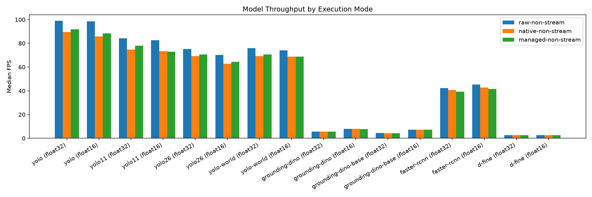
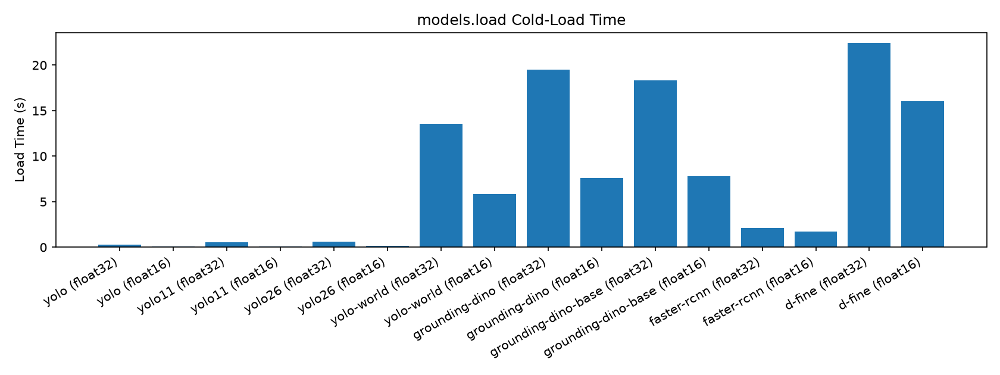
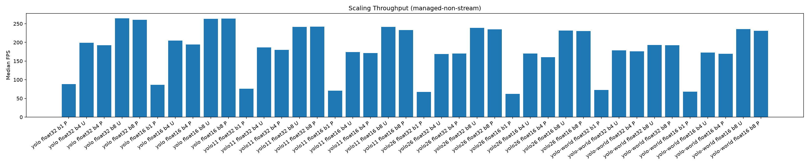

# GPU Inference, Scaling & 600s Stability (NVIDIA L4)

- **GPU**: `NVIDIA L4` (22563.1 MB VRAM)
- **CUDA / CuPy**: `torch_cuda=True`, `cupy_cuda=True`, `cuda_runtime=13.0`
- **Git**: `` @ `00ba3cf09b3bc9a561ec0fdb58bf10d924bdc620`

## models.load Cold-Load Latency (9/9 Models)

| model | dtype | actual_dtype | load_seconds | device |
| --- | --- | --- | --- | --- |
| yolo | float32 | torch.float32 | 0.3018 |  |
| yolo | float16 | torch.float16 | 0.0995 |  |
| yolo11 | float32 | torch.float32 | 0.5606 |  |
| yolo11 | float16 | torch.float16 | 0.1108 |  |
| yolo26 | float32 | torch.float32 | 0.5857 |  |
| yolo26 | float16 | torch.float16 | 0.1297 |  |
| yolo-world | float32 | torch.float32 | 13.5221 |  |
| yolo-world | float16 | torch.float16 | 5.8114 |  |
| grounding-dino | float32 | torch.float32 | 19.4896 |  |
| grounding-dino | float16 | torch.float16 | 7.6252 |  |
| grounding-dino-base | float32 | torch.float32 | 18.3062 |  |
| grounding-dino-base | float16 | torch.float16 | 7.8215 |  |
| faster-rcnn | float32 | torch.float32 | 2.1422 |  |
| faster-rcnn | float16 | torch.float16 | 1.727 |  |
| d-fine | float32 | float32 | 22.4662 |  |
| d-fine | float16 | float16 | 16.023 |  |
| locate-anything | float16 |  | None |  |
| locate-anything | float32 |  | None |  |

## 6-Mode Model Run Status (18/18 Passed)

| model | dtype | returncode | status | output_dir | error |
| --- | --- | --- | --- | --- | --- |
| yolo | float32 | 0 | passed | artifacts/benchmarks/colab_l4_val2017/inference/yolo_float32 |  |
| yolo | float16 | 0 | passed | artifacts/benchmarks/colab_l4_val2017/inference/yolo_float16 |  |
| yolo11 | float32 | 0 | passed | artifacts/benchmarks/colab_l4_val2017/inference/yolo11_float32 |  |
| yolo11 | float16 | 0 | passed | artifacts/benchmarks/colab_l4_val2017/inference/yolo11_float16 |  |
| yolo26 | float32 | 0 | passed | artifacts/benchmarks/colab_l4_val2017/inference/yolo26_float32 |  |
| yolo26 | float16 | 0 | passed | artifacts/benchmarks/colab_l4_val2017/inference/yolo26_float16 |  |
| yolo-world | float32 | 0 | passed | artifacts/benchmarks/colab_l4_val2017/inference/yolo-world_float32 |  |
| yolo-world | float16 | 0 | passed | artifacts/benchmarks/colab_l4_val2017/inference/yolo-world_float16 |  |
| grounding-dino | float32 | 0 | passed | artifacts/benchmarks/colab_l4_val2017/inference/grounding-dino_float32 |  |
| grounding-dino | float16 | 0 | passed | artifacts/benchmarks/colab_l4_val2017/inference/grounding-dino_float16 |  |
| grounding-dino-base | float32 | 0 | passed | artifacts/benchmarks/colab_l4_val2017/inference/grounding-dino-base_float32 |  |
| grounding-dino-base | float16 | 0 | passed | artifacts/benchmarks/colab_l4_val2017/inference/grounding-dino-base_float16 |  |
| faster-rcnn | float32 | 0 | passed | artifacts/benchmarks/colab_l4_val2017/inference/faster-rcnn_float32 |  |
| faster-rcnn | float16 | 0 | passed | artifacts/benchmarks/colab_l4_val2017/inference/faster-rcnn_float16 |  |
| d-fine | float32 | 0 | passed | artifacts/benchmarks/colab_l4_val2017/inference/d-fine_float32 |  |
| d-fine | float16 | 0 | passed | artifacts/benchmarks/colab_l4_val2017/inference/d-fine_float16 |  |
| locate-anything | float16 | 0 | passed | artifacts/benchmarks/colab_l4_val2017/inference/locate-anything_float16 |  |
| locate-anything | float32 | 0 | passed | artifacts/benchmarks/colab_l4_val2017/inference/locate-anything_float32 |  |

## 6-Mode Model Inference Details

| model | dtype | actual_dtype | mode | status | fps_median | p50_ms | parity_pass |
| --- | --- | --- | --- | --- | --- | --- | --- |
| yolo | float32 | torch.float32 | raw-non-stream | ok | 98.98 | 9.53 | True |
| yolo | float32 | torch.float32 | raw-stream | ok | 100.09 | 10.07 | True |
| yolo | float32 | torch.float32 | native-non-stream | ok | 89.44 | 10.82 | True |
| yolo | float32 | torch.float32 | native-stream | ok | 91.23 | 11.04 | True |
| yolo | float32 | torch.float32 | managed-non-stream | ok | 91.85 | 10.91 | True |
| yolo | float32 | torch.float32 | managed-stream | ok | 89.87 | 10.49 | True |
| yolo | float16 | torch.float16 | raw-non-stream | ok | 98.41 | 9.87 | True |
| yolo | float16 | torch.float16 | raw-stream | ok | 98.03 | 9.86 | True |
| yolo | float16 | torch.float16 | native-non-stream | ok | 85.75 | 11.11 | True |
| yolo | float16 | torch.float16 | native-stream | ok | 88.34 | 10.98 | True |
| yolo | float16 | torch.float16 | managed-non-stream | ok | 88.4 | 11.02 | True |
| yolo | float16 | torch.float16 | managed-stream | ok | 89.16 | 11.12 | True |
| yolo11 | float32 | torch.float32 | raw-non-stream | ok | 84.15 | 11.55 | True |
| yolo11 | float32 | torch.float32 | raw-stream | ok | 82.1 | 11.71 | True |
| yolo11 | float32 | torch.float32 | native-non-stream | ok | 74.83 | 13.2 | True |
| yolo11 | float32 | torch.float32 | native-stream | ok | 77.4 | 12.85 | True |
| yolo11 | float32 | torch.float32 | managed-non-stream | ok | 77.9 | 12.65 | True |
| yolo11 | float32 | torch.float32 | managed-stream | ok | 77.61 | 12.63 | True |
| yolo11 | float16 | torch.float16 | raw-non-stream | ok | 82.71 | 12.26 | True |
| yolo11 | float16 | torch.float16 | raw-stream | ok | 81.98 | 12.07 | True |
| yolo11 | float16 | torch.float16 | native-non-stream | ok | 73.38 | 13.62 | True |
| yolo11 | float16 | torch.float16 | native-stream | ok | 72.5 | 14.39 | True |
| yolo11 | float16 | torch.float16 | managed-non-stream | ok | 72.99 | 13.62 | True |
| yolo11 | float16 | torch.float16 | managed-stream | ok | 74.14 | 13.76 | True |
| yolo26 | float32 | torch.float32 | raw-non-stream | ok | 75.15 | 12.61 | True |
| yolo26 | float32 | torch.float32 | raw-stream | ok | 75.99 | 13.08 | True |
| yolo26 | float32 | torch.float32 | native-non-stream | ok | 69.16 | 14.95 | True |
| yolo26 | float32 | torch.float32 | native-stream | ok | 69.8 | 14.23 | True |
| yolo26 | float32 | torch.float32 | managed-non-stream | ok | 70.71 | 13.9 | True |
| yolo26 | float32 | torch.float32 | managed-stream | ok | 71.08 | 13.73 | True |
| yolo26 | float16 | torch.float16 | raw-non-stream | ok | 70.24 | 13.49 | True |
| yolo26 | float16 | torch.float16 | raw-stream | ok | 70.95 | 13.84 | True |
| yolo26 | float16 | torch.float16 | native-non-stream | ok | 62.8 | 15.69 | True |
| yolo26 | float16 | torch.float16 | native-stream | ok | 64.11 | 15.01 | True |
| yolo26 | float16 | torch.float16 | managed-non-stream | ok | 64.42 | 15.34 | True |
| yolo26 | float16 | torch.float16 | managed-stream | ok | 65.99 | 15.57 | True |
| yolo-world | float32 | torch.float32 | raw-non-stream | ok | 75.92 | 12.94 | True |
| yolo-world | float32 | torch.float32 | raw-stream | ok | 75.89 | 12.71 | True |
| yolo-world | float32 | torch.float32 | native-non-stream | ok | 69.18 | 14.25 | True |
| yolo-world | float32 | torch.float32 | native-stream | ok | 69.37 | 14.52 | True |
| yolo-world | float32 | torch.float32 | managed-non-stream | ok | 70.69 | 14.31 | True |
| yolo-world | float32 | torch.float32 | managed-stream | ok | 69.93 | 14.12 | True |
| yolo-world | float16 | torch.float16 | raw-non-stream | ok | 74.12 | 12.89 | True |
| yolo-world | float16 | torch.float16 | raw-stream | ok | 74.98 | 13.04 | True |
| yolo-world | float16 | torch.float16 | native-non-stream | ok | 68.83 | 14.58 | True |
| yolo-world | float16 | torch.float16 | native-stream | ok | 67.25 | 14.43 | True |
| yolo-world | float16 | torch.float16 | managed-non-stream | ok | 68.72 | 14.1 | True |
| yolo-world | float16 | torch.float16 | managed-stream | ok | 69.35 | 15.14 | True |
| grounding-dino | float32 | torch.float32 | raw-stream | N/A | None | None | None |
| grounding-dino | float32 | torch.float32 | native-stream | N/A | None | None | None |
| grounding-dino | float32 | torch.float32 | raw-non-stream | ok | 5.64 | 177.46 | True |
| grounding-dino | float32 | torch.float32 | native-non-stream | ok | 5.56 | 179.77 | True |
| grounding-dino | float32 | torch.float32 | managed-non-stream | ok | 5.54 | 180.81 | True |
| grounding-dino | float32 | torch.float32 | managed-stream | ok | 5.57 | 179.0 | True |
| grounding-dino | float16 | torch.float16 | raw-stream | N/A | None | None | None |
| grounding-dino | float16 | torch.float16 | native-stream | N/A | None | None | None |
| grounding-dino | float16 | torch.float16 | raw-non-stream | ok | 7.95 | 125.9 | True |
| grounding-dino | float16 | torch.float16 | native-non-stream | ok | 7.83 | 128.53 | True |
| grounding-dino | float16 | torch.float16 | managed-non-stream | ok | 7.77 | 128.62 | True |
| grounding-dino | float16 | torch.float16 | managed-stream | ok | 7.83 | 128.17 | True |
| grounding-dino-base | float32 | torch.float32 | raw-stream | N/A | None | None | None |
| grounding-dino-base | float32 | torch.float32 | native-stream | N/A | None | None | None |
| grounding-dino-base | float32 | torch.float32 | raw-non-stream | ok | 4.35 | 230.21 | True |
| grounding-dino-base | float32 | torch.float32 | native-non-stream | ok | 4.3 | 228.44 | True |
| grounding-dino-base | float32 | torch.float32 | managed-non-stream | ok | 4.31 | 231.95 | True |
| grounding-dino-base | float32 | torch.float32 | managed-stream | ok | 4.3 | 229.05 | True |
| grounding-dino-base | float16 | torch.float16 | raw-stream | N/A | None | None | None |
| grounding-dino-base | float16 | torch.float16 | native-stream | N/A | None | None | None |
| grounding-dino-base | float16 | torch.float16 | raw-non-stream | ok | 7.27 | 136.71 | True |
| grounding-dino-base | float16 | torch.float16 | native-non-stream | ok | 7.17 | 139.0 | True |
| grounding-dino-base | float16 | torch.float16 | managed-non-stream | ok | 7.13 | 139.78 | True |
| grounding-dino-base | float16 | torch.float16 | managed-stream | ok | 7.14 | 139.38 | True |
| faster-rcnn | float32 | torch.float32 | raw-stream | N/A | None | None | None |
| faster-rcnn | float32 | torch.float32 | native-stream | N/A | None | None | None |
| faster-rcnn | float32 | torch.float32 | raw-non-stream | ok | 42.25 | 23.46 | True |
| faster-rcnn | float32 | torch.float32 | native-non-stream | ok | 40.64 | 24.78 | True |
| faster-rcnn | float32 | torch.float32 | managed-non-stream | ok | 39.33 | 25.6 | True |
| faster-rcnn | float32 | torch.float32 | managed-stream | ok | 39.18 | 25.36 | True |
| faster-rcnn | float16 | torch.float16 | raw-stream | N/A | None | None | None |
| faster-rcnn | float16 | torch.float16 | native-stream | N/A | None | None | None |
| faster-rcnn | float16 | torch.float16 | raw-non-stream | ok | 45.31 | 22.57 | True |
| faster-rcnn | float16 | torch.float16 | native-non-stream | ok | 42.84 | 23.38 | True |
| faster-rcnn | float16 | torch.float16 | managed-non-stream | ok | 41.63 | 23.89 | True |
| faster-rcnn | float16 | torch.float16 | managed-stream | ok | 41.27 | 24.05 | True |
| d-fine | float32 | float32 | raw-stream | N/A | None | None | None |
| d-fine | float32 | float32 | native-stream | N/A | None | None | None |
| d-fine | float32 | float32 | raw-non-stream | ok | 2.64 | 380.33 | True |
| d-fine | float32 | float32 | native-non-stream | ok | 2.63 | 379.14 | True |
| d-fine | float32 | float32 | managed-non-stream | ok | 2.65 | 386.34 | True |
| d-fine | float32 | float32 | managed-stream | ok | 2.64 | 380.9 | True |
| d-fine | float16 | float16 | raw-stream | N/A | None | None | None |
| d-fine | float16 | float16 | native-stream | N/A | None | None | None |
| d-fine | float16 | float16 | raw-non-stream | ok | 2.55 | 389.69 | True |
| d-fine | float16 | float16 | native-non-stream | ok | 2.55 | 397.55 | True |
| d-fine | float16 | float16 | managed-non-stream | ok | 2.55 | 391.55 | True |
| d-fine | float16 | float16 | managed-stream | ok | 2.55 | 391.34 | True |

## DetectionGroup / Postprocessing / Outputs / Transfer

| device | frames | group_keep_ms | post_pipeline_ms | combine_ms | pack_ms | astype_fp16_ms | status |
| --- | --- | --- | --- | --- | --- | --- | --- |
| cpu | 100 | 20.5281 | 295.692 | 224.7276 | 9.9714 | 9.2596 | passed |
| cuda | 100 | 540.5621 | 617.1292 | 2184.3507 | 303.8437 | 319.7882 | passed |
| transfer | 100 | 27.2702 | 51.883 | 0.0 | 0.0 | 0.0 | passed |

## Batch / Workers / Prefetch / Packed Scaling

| model | dtype | batch | workers | prefetch | packed | mode | fps_median | p50_ms | parity |
| --- | --- | --- | --- | --- | --- | --- | --- | --- | --- |
| yolo | float32 | 1 | 1 | 1 | True | raw-non-stream | 95.32 | 9.87 | True |
| yolo | float32 | 1 | 1 | 1 | True | raw-stream | 97.18 | 10.09 | True |
| yolo | float32 | 1 | 1 | 1 | True | native-non-stream | 85.96 | 11.32 | True |
| yolo | float32 | 1 | 1 | 1 | True | native-stream | 88.75 | 11.05 | True |
| yolo | float32 | 1 | 1 | 1 | True | managed-non-stream | 88.32 | 12.27 | True |
| yolo | float32 | 1 | 1 | 1 | True | managed-stream | 89.43 | 11.38 | True |
| yolo | float32 | 4 | 2 | 2 | False | raw-non-stream | 192.32 | 0.01 | True |
| yolo | float32 | 4 | 2 | 2 | False | raw-stream | 193.92 | 0.02 | True |
| yolo | float32 | 4 | 2 | 2 | False | native-non-stream | 175.24 | 0.01 | True |
| yolo | float32 | 4 | 2 | 2 | False | native-stream | 173.61 | 0.54 | True |
| yolo | float32 | 4 | 2 | 2 | False | managed-non-stream | 198.88 | 0.01 | True |
| yolo | float32 | 4 | 2 | 2 | False | managed-stream | 205.45 | 0.04 | True |
| yolo | float32 | 4 | 2 | 2 | True | raw-non-stream | 192.61 | 0.01 | True |
| yolo | float32 | 4 | 2 | 2 | True | raw-stream | 190.36 | 0.02 | True |
| yolo | float32 | 4 | 2 | 2 | True | native-non-stream | 168.81 | 0.08 | True |
| yolo | float32 | 4 | 2 | 2 | True | native-stream | 172.84 | 0.5 | True |
| yolo | float32 | 4 | 2 | 2 | True | managed-non-stream | 192.46 | 0.08 | True |
| yolo | float32 | 4 | 2 | 2 | True | managed-stream | 201.65 | 0.04 | True |
| yolo | float32 | 8 | 4 | 4 | False | raw-non-stream | 244.87 | 0.01 | True |
| yolo | float32 | 8 | 4 | 4 | False | raw-stream | 248.63 | 0.01 | True |
| yolo | float32 | 8 | 4 | 4 | False | native-non-stream | 227.79 | 0.01 | True |
| yolo | float32 | 8 | 4 | 4 | False | native-stream | 229.56 | 0.47 | True |
| yolo | float32 | 8 | 4 | 4 | False | managed-non-stream | 264.59 | 0.01 | True |
| yolo | float32 | 8 | 4 | 4 | False | managed-stream | 270.82 | 0.03 | True |
| yolo | float32 | 8 | 4 | 4 | True | raw-non-stream | 245.56 | 0.01 | True |
| yolo | float32 | 8 | 4 | 4 | True | raw-stream | 248.58 | 0.01 | True |
| yolo | float32 | 8 | 4 | 4 | True | native-non-stream | 224.05 | 0.06 | True |
| yolo | float32 | 8 | 4 | 4 | True | native-stream | 229.39 | 0.48 | True |
| yolo | float32 | 8 | 4 | 4 | True | managed-non-stream | 260.39 | 0.07 | True |
| yolo | float32 | 8 | 4 | 4 | True | managed-stream | 271.5 | 0.03 | True |
| yolo | float16 | 1 | 1 | 1 | True | raw-non-stream | 97.88 | 10.09 | True |
| yolo | float16 | 1 | 1 | 1 | True | raw-stream | 96.75 | 10.07 | True |
| yolo | float16 | 1 | 1 | 1 | True | native-non-stream | 84.76 | 11.23 | True |
| yolo | float16 | 1 | 1 | 1 | True | native-stream | 86.74 | 11.49 | True |
| yolo | float16 | 1 | 1 | 1 | True | managed-non-stream | 86.2 | 11.48 | True |
| yolo | float16 | 1 | 1 | 1 | True | managed-stream | 88.61 | 11.62 | True |
| yolo | float16 | 4 | 2 | 2 | False | raw-non-stream | 194.81 | 0.01 | True |
| yolo | float16 | 4 | 2 | 2 | False | raw-stream | 192.72 | 0.02 | True |
| yolo | float16 | 4 | 2 | 2 | False | native-non-stream | 177.12 | 0.01 | True |
| yolo | float16 | 4 | 2 | 2 | False | native-stream | 177.21 | 0.5 | True |
| yolo | float16 | 4 | 2 | 2 | False | managed-non-stream | 205.09 | 0.01 | True |
| yolo | float16 | 4 | 2 | 2 | False | managed-stream | 205.95 | 0.03 | True |
| yolo | float16 | 4 | 2 | 2 | True | raw-non-stream | 191.7 | 0.01 | True |
| yolo | float16 | 4 | 2 | 2 | True | raw-stream | 186.05 | 0.02 | True |
| yolo | float16 | 4 | 2 | 2 | True | native-non-stream | 167.02 | 0.07 | True |
| yolo | float16 | 4 | 2 | 2 | True | native-stream | 170.57 | 0.54 | True |
| yolo | float16 | 4 | 2 | 2 | True | managed-non-stream | 194.1 | 0.08 | True |
| yolo | float16 | 4 | 2 | 2 | True | managed-stream | 204.29 | 0.03 | True |
| yolo | float16 | 8 | 4 | 4 | False | raw-non-stream | 245.22 | 0.01 | True |
| yolo | float16 | 8 | 4 | 4 | False | raw-stream | 245.43 | 0.01 | True |
| yolo | float16 | 8 | 4 | 4 | False | native-non-stream | 227.04 | 0.01 | True |
| yolo | float16 | 8 | 4 | 4 | False | native-stream | 226.06 | 0.48 | True |
| yolo | float16 | 8 | 4 | 4 | False | managed-non-stream | 263.11 | 0.01 | True |
| yolo | float16 | 8 | 4 | 4 | False | managed-stream | 266.12 | 0.03 | True |
| yolo | float16 | 8 | 4 | 4 | True | raw-non-stream | 251.05 | 0.01 | True |
| yolo | float16 | 8 | 4 | 4 | True | raw-stream | 249.48 | 0.01 | True |
| yolo | float16 | 8 | 4 | 4 | True | native-non-stream | 223.75 | 0.06 | True |
| yolo | float16 | 8 | 4 | 4 | True | native-stream | 232.72 | 0.49 | True |
| yolo | float16 | 8 | 4 | 4 | True | managed-non-stream | 263.67 | 0.07 | True |
| yolo | float16 | 8 | 4 | 4 | True | managed-stream | 265.88 | 0.03 | True |
| yolo11 | float32 | 1 | 1 | 1 | True | raw-non-stream | 81.55 | 12.37 | True |
| yolo11 | float32 | 1 | 1 | 1 | True | raw-stream | 84.05 | 12.43 | True |
| yolo11 | float32 | 1 | 1 | 1 | True | native-non-stream | 72.31 | 14.07 | True |
| yolo11 | float32 | 1 | 1 | 1 | True | native-stream | 75.63 | 13.54 | True |
| yolo11 | float32 | 1 | 1 | 1 | True | managed-non-stream | 75.86 | 13.57 | True |
| yolo11 | float32 | 1 | 1 | 1 | True | managed-stream | 75.33 | 13.35 | True |
| yolo11 | float32 | 4 | 2 | 2 | False | raw-non-stream | 178.01 | 0.01 | True |
| yolo11 | float32 | 4 | 2 | 2 | False | raw-stream | 178.8 | 0.02 | True |
| yolo11 | float32 | 4 | 2 | 2 | False | native-non-stream | 162.06 | 0.01 | True |
| yolo11 | float32 | 4 | 2 | 2 | False | native-stream | 162.29 | 0.5 | True |
| yolo11 | float32 | 4 | 2 | 2 | False | managed-non-stream | 186.69 | 0.01 | True |
| yolo11 | float32 | 4 | 2 | 2 | False | managed-stream | 188.63 | 0.03 | True |
| yolo11 | float32 | 4 | 2 | 2 | True | raw-non-stream | 178.32 | 0.01 | True |
| yolo11 | float32 | 4 | 2 | 2 | True | raw-stream | 176.17 | 0.02 | True |
| yolo11 | float32 | 4 | 2 | 2 | True | native-non-stream | 158.55 | 0.08 | True |
| yolo11 | float32 | 4 | 2 | 2 | True | native-stream | 162.88 | 0.49 | True |
| yolo11 | float32 | 4 | 2 | 2 | True | managed-non-stream | 179.89 | 0.08 | True |
| yolo11 | float32 | 4 | 2 | 2 | True | managed-stream | 187.43 | 0.04 | True |
| yolo11 | float32 | 8 | 4 | 4 | False | raw-non-stream | 228.86 | 0.01 | True |
| yolo11 | float32 | 8 | 4 | 4 | False | raw-stream | 228.01 | 0.01 | True |
| yolo11 | float32 | 8 | 4 | 4 | False | native-non-stream | 213.17 | 0.01 | True |
| yolo11 | float32 | 8 | 4 | 4 | False | native-stream | 209.27 | 0.47 | True |
| yolo11 | float32 | 8 | 4 | 4 | False | managed-non-stream | 241.37 | 0.01 | True |
| yolo11 | float32 | 8 | 4 | 4 | False | managed-stream | 244.63 | 0.03 | True |
| yolo11 | float32 | 8 | 4 | 4 | True | raw-non-stream | 230.39 | 0.01 | True |
| yolo11 | float32 | 8 | 4 | 4 | True | raw-stream | 231.25 | 0.01 | True |
| yolo11 | float32 | 8 | 4 | 4 | True | native-non-stream | 210.39 | 0.07 | True |
| yolo11 | float32 | 8 | 4 | 4 | True | native-stream | 211.83 | 0.47 | True |
| yolo11 | float32 | 8 | 4 | 4 | True | managed-non-stream | 242.18 | 0.07 | True |
| yolo11 | float32 | 8 | 4 | 4 | True | managed-stream | 249.93 | 0.03 | True |
| yolo11 | float16 | 1 | 1 | 1 | True | raw-non-stream | 79.59 | 12.71 | True |
| yolo11 | float16 | 1 | 1 | 1 | True | raw-stream | 80.71 | 12.65 | True |
| yolo11 | float16 | 1 | 1 | 1 | True | native-non-stream | 69.86 | 14.35 | True |
| yolo11 | float16 | 1 | 1 | 1 | True | native-stream | 71.13 | 14.39 | True |
| yolo11 | float16 | 1 | 1 | 1 | True | managed-non-stream | 70.54 | 14.02 | True |
| yolo11 | float16 | 1 | 1 | 1 | True | managed-stream | 71.67 | 13.84 | True |
| yolo11 | float16 | 4 | 2 | 2 | False | raw-non-stream | 183.2 | 0.01 | True |
| yolo11 | float16 | 4 | 2 | 2 | False | raw-stream | 186.89 | 0.02 | True |
| yolo11 | float16 | 4 | 2 | 2 | False | native-non-stream | 169.61 | 0.01 | True |
| yolo11 | float16 | 4 | 2 | 2 | False | native-stream | 174.86 | 0.5 | True |
| yolo11 | float16 | 4 | 2 | 2 | False | managed-non-stream | 174.26 | 0.01 | True |
| yolo11 | float16 | 4 | 2 | 2 | False | managed-stream | 175.31 | 0.03 | True |
| yolo11 | float16 | 4 | 2 | 2 | True | raw-non-stream | 184.27 | 0.01 | True |
| yolo11 | float16 | 4 | 2 | 2 | True | raw-stream | 185.51 | 0.02 | True |
| yolo11 | float16 | 4 | 2 | 2 | True | native-non-stream | 167.62 | 0.08 | True |
| yolo11 | float16 | 4 | 2 | 2 | True | native-stream | 172.93 | 0.52 | True |
| yolo11 | float16 | 4 | 2 | 2 | True | managed-non-stream | 171.15 | 0.08 | True |
| yolo11 | float16 | 4 | 2 | 2 | True | managed-stream | 174.83 | 0.04 | True |
| yolo11 | float16 | 8 | 4 | 4 | False | raw-non-stream | 225.58 | 0.01 | True |
| yolo11 | float16 | 8 | 4 | 4 | False | raw-stream | 223.62 | 0.01 | True |
| yolo11 | float16 | 8 | 4 | 4 | False | native-non-stream | 206.7 | 0.01 | True |
| yolo11 | float16 | 8 | 4 | 4 | False | native-stream | 206.91 | 0.47 | True |
| yolo11 | float16 | 8 | 4 | 4 | False | managed-non-stream | 241.5 | 0.01 | True |
| yolo11 | float16 | 8 | 4 | 4 | False | managed-stream | 243.78 | 0.03 | True |
| yolo11 | float16 | 8 | 4 | 4 | True | raw-non-stream | 224.37 | 0.01 | True |
| yolo11 | float16 | 8 | 4 | 4 | True | raw-stream | 224.63 | 0.01 | True |
| yolo11 | float16 | 8 | 4 | 4 | True | native-non-stream | 206.26 | 0.06 | True |
| yolo11 | float16 | 8 | 4 | 4 | True | native-stream | 209.61 | 0.47 | True |
| yolo11 | float16 | 8 | 4 | 4 | True | managed-non-stream | 233.29 | 0.06 | True |
| yolo11 | float16 | 8 | 4 | 4 | True | managed-stream | 242.77 | 0.03 | True |
| yolo26 | float32 | 1 | 1 | 1 | True | raw-non-stream | 73.21 | 13.65 | True |
| yolo26 | float32 | 1 | 1 | 1 | True | raw-stream | 74.73 | 13.71 | True |
| yolo26 | float32 | 1 | 1 | 1 | True | native-non-stream | 65.1 | 15.37 | True |
| yolo26 | float32 | 1 | 1 | 1 | True | native-stream | 67.54 | 15.07 | True |
| yolo26 | float32 | 1 | 1 | 1 | True | managed-non-stream | 67.58 | 14.94 | True |
| yolo26 | float32 | 1 | 1 | 1 | True | managed-stream | 67.69 | 14.86 | True |
| yolo26 | float32 | 4 | 2 | 2 | False | raw-non-stream | 161.58 | 0.01 | True |
| yolo26 | float32 | 4 | 2 | 2 | False | raw-stream | 161.12 | 0.02 | True |
| yolo26 | float32 | 4 | 2 | 2 | False | native-non-stream | 148.45 | 0.01 | True |
| yolo26 | float32 | 4 | 2 | 2 | False | native-stream | 146.89 | 0.53 | True |
| yolo26 | float32 | 4 | 2 | 2 | False | managed-non-stream | 169.14 | 0.01 | True |
| yolo26 | float32 | 4 | 2 | 2 | False | managed-stream | 172.0 | 0.03 | True |
| yolo26 | float32 | 4 | 2 | 2 | True | raw-non-stream | 163.05 | 0.01 | True |
| yolo26 | float32 | 4 | 2 | 2 | True | raw-stream | 162.51 | 0.02 | True |
| yolo26 | float32 | 4 | 2 | 2 | True | native-non-stream | 150.46 | 0.08 | True |
| yolo26 | float32 | 4 | 2 | 2 | True | native-stream | 155.62 | 0.5 | True |
| yolo26 | float32 | 4 | 2 | 2 | True | managed-non-stream | 170.13 | 0.08 | True |
| yolo26 | float32 | 4 | 2 | 2 | True | managed-stream | 171.15 | 0.03 | True |
| yolo26 | float32 | 8 | 4 | 4 | False | raw-non-stream | 251.04 | 0.01 | True |
| yolo26 | float32 | 8 | 4 | 4 | False | raw-stream | 252.33 | 0.01 | True |
| yolo26 | float32 | 8 | 4 | 4 | False | native-non-stream | 217.57 | 0.01 | True |
| yolo26 | float32 | 8 | 4 | 4 | False | native-stream | 219.39 | 0.46 | True |
| yolo26 | float32 | 8 | 4 | 4 | False | managed-non-stream | 238.68 | 0.01 | True |
| yolo26 | float32 | 8 | 4 | 4 | False | managed-stream | 241.86 | 0.03 | True |
| yolo26 | float32 | 8 | 4 | 4 | True | raw-non-stream | 253.94 | 0.01 | True |
| yolo26 | float32 | 8 | 4 | 4 | True | raw-stream | 252.14 | 0.01 | True |
| yolo26 | float32 | 8 | 4 | 4 | True | native-non-stream | 215.41 | 0.07 | True |
| yolo26 | float32 | 8 | 4 | 4 | True | native-stream | 221.03 | 0.48 | True |
| yolo26 | float32 | 8 | 4 | 4 | True | managed-non-stream | 235.06 | 0.07 | True |
| yolo26 | float32 | 8 | 4 | 4 | True | managed-stream | 241.73 | 0.03 | True |
| yolo26 | float16 | 1 | 1 | 1 | True | raw-non-stream | 70.08 | 14.17 | True |
| yolo26 | float16 | 1 | 1 | 1 | True | raw-stream | 71.38 | 14.51 | True |
| yolo26 | float16 | 1 | 1 | 1 | True | native-non-stream | 63.75 | 16.4 | True |
| yolo26 | float16 | 1 | 1 | 1 | True | native-stream | 64.49 | 15.65 | True |
| yolo26 | float16 | 1 | 1 | 1 | True | managed-non-stream | 61.98 | 16.02 | True |
| yolo26 | float16 | 1 | 1 | 1 | True | managed-stream | 62.96 | 16.04 | True |
| yolo26 | float16 | 4 | 2 | 2 | False | raw-non-stream | 178.49 | 0.01 | True |
| yolo26 | float16 | 4 | 2 | 2 | False | raw-stream | 179.22 | 0.02 | True |
| yolo26 | float16 | 4 | 2 | 2 | False | native-non-stream | 164.49 | 0.01 | True |
| yolo26 | float16 | 4 | 2 | 2 | False | native-stream | 170.03 | 0.5 | True |
| yolo26 | float16 | 4 | 2 | 2 | False | managed-non-stream | 170.2 | 0.01 | True |
| yolo26 | float16 | 4 | 2 | 2 | False | managed-stream | 171.28 | 0.03 | True |
| yolo26 | float16 | 4 | 2 | 2 | True | raw-non-stream | 172.93 | 0.01 | True |
| yolo26 | float16 | 4 | 2 | 2 | True | raw-stream | 173.45 | 0.02 | True |
| yolo26 | float16 | 4 | 2 | 2 | True | native-non-stream | 153.98 | 0.08 | True |
| yolo26 | float16 | 4 | 2 | 2 | True | native-stream | 163.78 | 0.51 | True |
| yolo26 | float16 | 4 | 2 | 2 | True | managed-non-stream | 160.07 | 0.08 | True |
| yolo26 | float16 | 4 | 2 | 2 | True | managed-stream | 164.4 | 0.04 | True |
| yolo26 | float16 | 8 | 4 | 4 | False | raw-non-stream | 213.25 | 0.01 | True |
| yolo26 | float16 | 8 | 4 | 4 | False | raw-stream | 213.24 | 0.01 | True |
| yolo26 | float16 | 8 | 4 | 4 | False | native-non-stream | 197.41 | 0.01 | True |
| yolo26 | float16 | 8 | 4 | 4 | False | native-stream | 197.69 | 0.48 | True |
| yolo26 | float16 | 8 | 4 | 4 | False | managed-non-stream | 231.8 | 0.01 | True |
| yolo26 | float16 | 8 | 4 | 4 | False | managed-stream | 233.25 | 0.03 | True |
| yolo26 | float16 | 8 | 4 | 4 | True | raw-non-stream | 217.28 | 0.01 | True |
| yolo26 | float16 | 8 | 4 | 4 | True | raw-stream | 217.99 | 0.01 | True |
| yolo26 | float16 | 8 | 4 | 4 | True | native-non-stream | 197.53 | 0.07 | True |
| yolo26 | float16 | 8 | 4 | 4 | True | native-stream | 199.61 | 0.48 | True |
| yolo26 | float16 | 8 | 4 | 4 | True | managed-non-stream | 230.34 | 0.07 | True |
| yolo26 | float16 | 8 | 4 | 4 | True | managed-stream | 236.56 | 0.03 | True |
| yolo-world | float32 | 1 | 1 | 1 | True | raw-non-stream | 79.05 | 12.6 | True |
| yolo-world | float32 | 1 | 1 | 1 | True | raw-stream | 80.03 | 12.34 | True |
| yolo-world | float32 | 1 | 1 | 1 | True | native-non-stream | 71.65 | 14.29 | True |
| yolo-world | float32 | 1 | 1 | 1 | True | native-stream | 72.44 | 13.63 | True |
| yolo-world | float32 | 1 | 1 | 1 | True | managed-non-stream | 72.47 | 13.78 | True |
| yolo-world | float32 | 1 | 1 | 1 | True | managed-stream | 74.01 | 13.55 | True |
| yolo-world | float32 | 4 | 2 | 2 | False | raw-non-stream | 184.21 | 0.01 | True |
| yolo-world | float32 | 4 | 2 | 2 | False | raw-stream | 185.94 | 0.02 | True |
| yolo-world | float32 | 4 | 2 | 2 | False | native-non-stream | 176.82 | 0.01 | True |
| yolo-world | float32 | 4 | 2 | 2 | False | native-stream | 178.49 | 0.45 | True |
| yolo-world | float32 | 4 | 2 | 2 | False | managed-non-stream | 178.46 | 0.01 | True |
| yolo-world | float32 | 4 | 2 | 2 | False | managed-stream | 178.91 | 0.04 | True |
| yolo-world | float32 | 4 | 2 | 2 | True | raw-non-stream | 188.2 | 0.01 | True |
| yolo-world | float32 | 4 | 2 | 2 | True | raw-stream | 185.53 | 0.02 | True |
| yolo-world | float32 | 4 | 2 | 2 | True | native-non-stream | 175.54 | 0.08 | True |
| yolo-world | float32 | 4 | 2 | 2 | True | native-stream | 178.48 | 0.44 | True |
| yolo-world | float32 | 4 | 2 | 2 | True | managed-non-stream | 176.31 | 0.08 | True |
| yolo-world | float32 | 4 | 2 | 2 | True | managed-stream | 179.59 | 0.03 | True |
| yolo-world | float32 | 8 | 4 | 4 | False | raw-non-stream | 202.36 | 0.01 | True |
| yolo-world | float32 | 8 | 4 | 4 | False | raw-stream | 202.72 | 0.01 | True |
| yolo-world | float32 | 8 | 4 | 4 | False | native-non-stream | 178.46 | 0.01 | True |
| yolo-world | float32 | 8 | 4 | 4 | False | native-stream | 177.2 | 0.42 | True |
| yolo-world | float32 | 8 | 4 | 4 | False | managed-non-stream | 192.77 | 0.01 | True |
| yolo-world | float32 | 8 | 4 | 4 | False | managed-stream | 194.34 | 0.03 | True |
| yolo-world | float32 | 8 | 4 | 4 | True | raw-non-stream | 203.97 | 0.01 | True |
| yolo-world | float32 | 8 | 4 | 4 | True | raw-stream | 203.65 | 0.01 | True |
| yolo-world | float32 | 8 | 4 | 4 | True | native-non-stream | 177.56 | 0.07 | True |
| yolo-world | float32 | 8 | 4 | 4 | True | native-stream | 178.99 | 0.42 | True |
| yolo-world | float32 | 8 | 4 | 4 | True | managed-non-stream | 192.12 | 0.07 | True |
| yolo-world | float32 | 8 | 4 | 4 | True | managed-stream | 196.52 | 0.02 | True |
| yolo-world | float16 | 1 | 1 | 1 | True | raw-non-stream | 76.27 | 13.37 | True |
| yolo-world | float16 | 1 | 1 | 1 | True | raw-stream | 76.47 | 13.06 | True |
| yolo-world | float16 | 1 | 1 | 1 | True | native-non-stream | 67.73 | 14.42 | True |
| yolo-world | float16 | 1 | 1 | 1 | True | native-stream | 68.41 | 14.2 | True |
| yolo-world | float16 | 1 | 1 | 1 | True | managed-non-stream | 68.34 | 14.92 | True |
| yolo-world | float16 | 1 | 1 | 1 | True | managed-stream | 70.29 | 14.24 | True |
| yolo-world | float16 | 4 | 2 | 2 | False | raw-non-stream | 182.53 | 0.01 | True |
| yolo-world | float16 | 4 | 2 | 2 | False | raw-stream | 184.05 | 0.02 | True |
| yolo-world | float16 | 4 | 2 | 2 | False | native-non-stream | 171.93 | 0.01 | True |
| yolo-world | float16 | 4 | 2 | 2 | False | native-stream | 175.16 | 0.45 | True |
| yolo-world | float16 | 4 | 2 | 2 | False | managed-non-stream | 172.66 | 0.01 | True |
| yolo-world | float16 | 4 | 2 | 2 | False | managed-stream | 175.9 | 0.03 | True |
| yolo-world | float16 | 4 | 2 | 2 | True | raw-non-stream | 181.54 | 0.01 | True |
| yolo-world | float16 | 4 | 2 | 2 | True | raw-stream | 183.34 | 0.02 | True |
| yolo-world | float16 | 4 | 2 | 2 | True | native-non-stream | 168.87 | 0.08 | True |
| yolo-world | float16 | 4 | 2 | 2 | True | native-stream | 172.3 | 0.48 | True |
| yolo-world | float16 | 4 | 2 | 2 | True | managed-non-stream | 169.5 | 0.08 | True |
| yolo-world | float16 | 4 | 2 | 2 | True | managed-stream | 169.91 | 0.03 | True |
| yolo-world | float16 | 8 | 4 | 4 | False | raw-non-stream | 251.29 | 0.01 | True |
| yolo-world | float16 | 8 | 4 | 4 | False | raw-stream | 250.43 | 0.01 | True |
| yolo-world | float16 | 8 | 4 | 4 | False | native-non-stream | 215.52 | 0.01 | True |
| yolo-world | float16 | 8 | 4 | 4 | False | native-stream | 213.43 | 0.41 | True |
| yolo-world | float16 | 8 | 4 | 4 | False | managed-non-stream | 235.5 | 0.01 | True |
| yolo-world | float16 | 8 | 4 | 4 | False | managed-stream | 236.19 | 0.02 | True |
| yolo-world | float16 | 8 | 4 | 4 | True | raw-non-stream | 251.99 | 0.01 | True |
| yolo-world | float16 | 8 | 4 | 4 | True | raw-stream | 249.06 | 0.01 | True |
| yolo-world | float16 | 8 | 4 | 4 | True | native-non-stream | 212.4 | 0.07 | True |
| yolo-world | float16 | 8 | 4 | 4 | True | native-stream | 214.67 | 0.43 | True |
| yolo-world | float16 | 8 | 4 | 4 | True | managed-non-stream | 230.9 | 0.07 | True |
| yolo-world | float16 | 8 | 4 | 4 | True | managed-stream | 237.67 | 0.03 | True |

## 600s Streaming Stability Probe

- **Pass**: `True` | **Elapsed**: `601.1642746559992`s | **Frames**: `None` | **Failed Gates**: `[]`

## Charts

