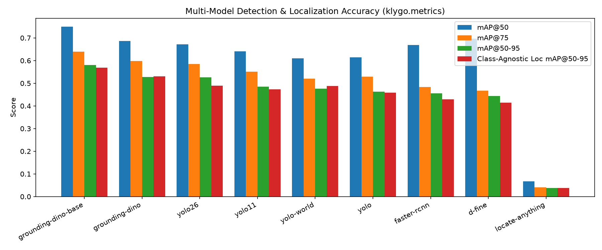
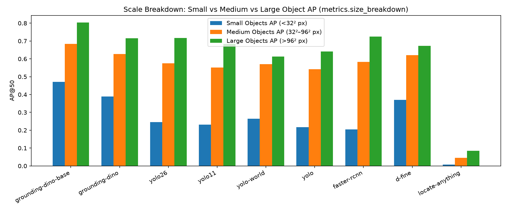
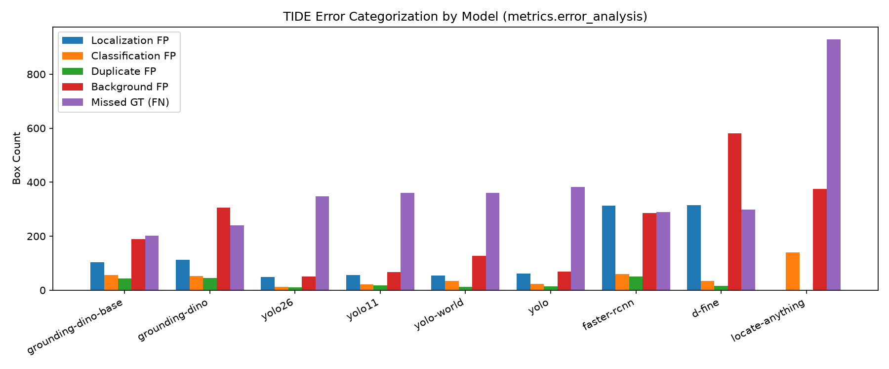

# Klygo Metrics Multi-Model Accuracy & Diagnostic Report

- **GPU**: `NVIDIA L4` (22563.1 MB VRAM)
- **Dataset**: `artifacts/datasets/coco128` (`128` images, `929` GT boxes, `71` defined classes, `71` active GT classes)
- **Models Evaluated**: `9` models (`grounding-dino-base, grounding-dino, yolo26, yolo11, yolo-world, yolo, faster-rcnn, d-fine, locate-anything`)
- **Git**: `detection-evaluation` @ `2051efd7be6d1149d78e7a201cf5f9f92b25340f`

## Multi-Model Detection & Localization Leaderboard (Sorted by mAP@50-95)

| rank | model | mode | mAP50_95 | mAP50 | mAP75 | f1 | precision | recall | mean_iou | loc_mAP50_95 | loc_mAP50 | optimal_threshold | optimal_f1 | ece | detected_classes |
| --- | --- | --- | --- | --- | --- | --- | --- | --- | --- | --- | --- | --- | --- | --- | --- |
| 1 | grounding-dino-base | multi-class | 0.5802 | 0.7497 | 0.6393 | 0.697 | 0.6276 | 0.7836 | 0.8717 | 0.5694 | 0.7635 | 0.4 | 0.741 | 0.1601 | 67/71 |
| 2 | grounding-dino | multi-class | 0.5283 | 0.6868 | 0.5986 | 0.6231 | 0.5372 | 0.7417 | 0.8672 | 0.5312 | 0.7161 | 0.4 | 0.6729 | 0.1132 | 66/71 |
| 3 | yolo26 | multi-class | 0.5262 | 0.6713 | 0.5847 | 0.6873 | 0.7634 | 0.625 | 0.876 | 0.4901 | 0.6508 | 0.0 | 0.6873 | 0.1583 | 66/71 |
| 4 | yolo11 | multi-class | 0.4851 | 0.6402 | 0.5516 | 0.6714 | 0.7428 | 0.6125 | 0.8753 | 0.4729 | 0.6465 | 0.0 | 0.6714 | 0.1171 | 65/71 |
| 5 | yolo-world | multi-class | 0.4764 | 0.6094 | 0.5204 | 0.6436 | 0.6791 | 0.6116 | 0.8687 | 0.4879 | 0.6481 | 0.3 | 0.6489 | 0.063 | 65/71 |
| 6 | yolo | multi-class | 0.4633 | 0.6148 | 0.5284 | 0.6521 | 0.7303 | 0.5889 | 0.8694 | 0.4578 | 0.6293 | 0.0 | 0.6521 | 0.1107 | 65/71 |
| 7 | faster-rcnn | multi-class | 0.4556 | 0.669 | 0.4831 | 0.5482 | 0.4552 | 0.6891 | 0.8066 | 0.4287 | 0.686 | 0.6 | 0.6146 | 0.2201 | 65/71 |
| 8 | d-fine | multi-class | 0.4435 | 0.697 | 0.467 | 0.4862 | 0.3787 | 0.6793 | 0.8068 | 0.4137 | 0.6836 | 0.5 | 0.6385 | 0.1983 | 64/71 |
| 9 | locate-anything | class-agnostic | 0.0384 | 0.0673 | 0.0401 | 0.2104 | 0.2166 | 0.2045 | 0.814 | 0.0384 | 0.0673 | 0.0 | 0.0 | 1.0 | 0/71 |

## Scale Breakdown (Small/Medium/Large), TIDE Error Counts & IoU Sweep

| model | small_ap | medium_ap | large_ap | small_f1 | medium_f1 | large_f1 | err_localization | err_classification | err_cls_loc | err_duplicate | err_background | err_missed_gt | f1_iou50 | f1_iou75 | f1_iou90 | cm_class_acc | per_image_mean_f1 | matched_tp_boxes |
| --- | --- | --- | --- | --- | --- | --- | --- | --- | --- | --- | --- | --- | --- | --- | --- | --- | --- | --- |
| yolo | 0.2169 | 0.5414 | 0.6416 | 0.3396 | 0.6385 | 0.7865 | 62 | 24 | 20 | 14 | 68 | 382 | 0.6521 | 0.5606 | 0.3475 | 0.9632 | 0.6841 | 547 |
| yolo11 | 0.2319 | 0.551 | 0.6838 | 0.3807 | 0.6565 | 0.7937 | 56 | 22 | 22 | 17 | 67 | 360 | 0.6714 | 0.5786 | 0.3395 | 0.9628 | 0.7107 | 569 |
| yolo26 | 0.2458 | 0.5753 | 0.7176 | 0.4138 | 0.6823 | 0.8228 | 48 | 13 | 17 | 11 | 51 | 348 | 0.6873 | 0.5986 | 0.388 | 0.9782 | 0.7259 | 581 |
| yolo-world | 0.2638 | 0.5701 | 0.6124 | 0.4079 | 0.6389 | 0.7511 | 55 | 34 | 25 | 13 | 127 | 361 | 0.6436 | 0.5489 | 0.3444 | 0.9501 | 0.6723 | 568 |
| grounding-dino | 0.3883 | 0.6276 | 0.7153 | 0.4706 | 0.6119 | 0.7412 | 113 | 52 | 50 | 45 | 306 | 240 | 0.6231 | 0.5435 | 0.3424 | 0.9613 | 0.697 | 689 |
| grounding-dino-base | 0.4705 | 0.6834 | 0.8037 | 0.5739 | 0.7061 | 0.7963 | 104 | 56 | 44 | 43 | 189 | 201 | 0.697 | 0.6127 | 0.3776 | 0.9721 | 0.7327 | 728 |
| faster-rcnn | 0.2039 | 0.5835 | 0.7248 | 0.3207 | 0.536 | 0.7032 | 313 | 60 | 88 | 50 | 285 | 289 | 0.5482 | 0.3951 | 0.1654 | 0.9392 | 0.6306 | 640 |
| d-fine | 0.3703 | 0.621 | 0.6728 | 0.3346 | 0.4764 | 0.6721 | 314 | 34 | 105 | 16 | 581 | 298 | 0.4862 | 0.3259 | 0.147 | 0.9525 | 0.5694 | 631 |
| locate-anything | 0.0076 | 0.0458 | 0.0844 | 0.0822 | 0.2183 | 0.2974 | 0 | 139 | 289 | 0 | 375 | 929 | 0.0 | 0.0 | 0.0 | 0.0 | 0.0 | 0 |

## Charts

### Multi-Model mAP & Localization Leaderboard

### Multi-Scale Object Breakdown (Small / Medium / Large)

### TIDE Error Categorization Breakdown

