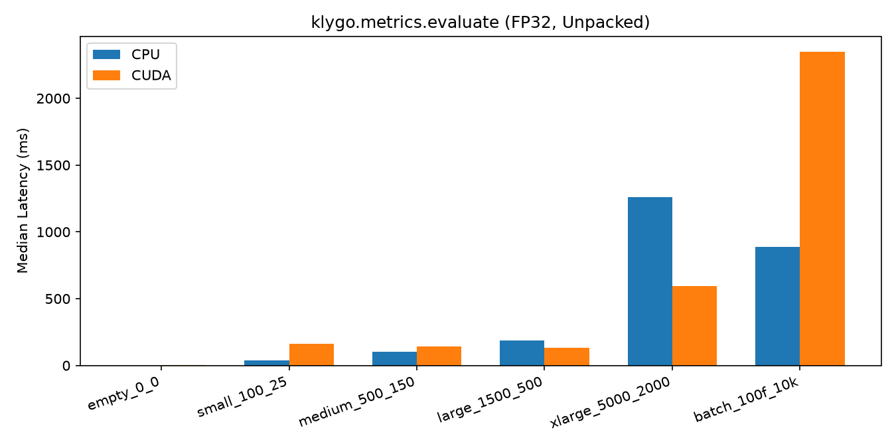

# klygo.metrics Benchmark (CPU vs CUDA, FP16/FP32/FP64)

- **GPU**: `NVIDIA L4` (22563.1 MB VRAM)
- **CUDA / CuPy**: `torch_cuda=True`, `cupy_cuda=True`, `cuda_runtime=13.0`
- **Git**: `` @ `00ba3cf09b3bc9a561ec0fdb58bf10d924bdc620`

## Metrics Latency & Precision Drift

| case | device | precision | packed | first_ms | evaluate_median_ms | compose_median_ms | f1 | f1_drift_vs_fp64 | status |
| --- | --- | --- | --- | --- | --- | --- | --- | --- | --- |
| empty_0_0 | cpu | fp16 | False | 0.4661 | 0.3764 | 1.4526 | 0.0 | 0.0 | passed |
| empty_0_0 | cuda | fp16 | False | 168.4168 | 2.5774 | 14.4542 | 0.0 | 0.0 | passed |
| empty_0_0 | cpu | fp32 | False | 0.4847 | 0.3558 | 1.4135 | 0.0 | 0.0 | passed |
| empty_0_0 | cuda | fp32 | False | 2.7663 | 2.5666 | 14.5173 | 0.0 | 0.0 | passed |
| empty_0_0 | cpu | fp32 | True | 0.5792 | 0.4585 | 1.5355 | 0.0 | 0.0 | passed |
| empty_0_0 | cuda | fp32 | True | 3.2863 | 2.9558 | 14.9011 | 0.0 | 0.0 | passed |
| empty_0_0 | cpu | fp64 | False | 0.458 | 0.356 | 1.4479 | 0.0 | 0.0 | passed |
| empty_0_0 | cuda | fp64 | False | 2.9119 | 2.5677 | 14.5104 | 0.0 | 0.0 | passed |
| empty_0_0 | cpu | fp64 | True | 0.6074 | 0.5065 | 1.5242 | 0.0 | 0.0 | passed |
| empty_0_0 | cuda | fp64 | True | 3.2043 | 2.956 | 15.0104 | 0.0 | 0.0 | passed |
| small_100_25 | cpu | fp16 | False | 40.4828 | 40.3384 | 17.1129 | 0.236 | 0.0 | passed |
| small_100_25 | cuda | fp16 | False | 227.3193 | 161.5513 | 102.028 | 0.236 | 0.0 | passed |
| small_100_25 | cpu | fp32 | False | 40.6505 | 40.3392 | 17.1594 | 0.236 | 0.0 | passed |
| small_100_25 | cuda | fp32 | False | 165.4556 | 160.6152 | 101.6818 | 0.236 | 0.0 | passed |
| small_100_25 | cpu | fp32 | True | 40.7589 | 40.7531 | 17.5669 | 0.236 | 0.0 | passed |
| small_100_25 | cuda | fp32 | True | 173.8724 | 166.2422 | 105.994 | 0.236 | 0.0 | passed |
| small_100_25 | cpu | fp64 | False | 40.2777 | 41.3115 | 17.1393 | 0.236 | 0.0 | passed |
| small_100_25 | cuda | fp64 | False | 163.4323 | 174.1615 | 104.7641 | 0.236 | 0.0 | passed |
| small_100_25 | cpu | fp64 | True | 40.9473 | 41.0372 | 17.4766 | 0.236 | 0.0 | passed |
| small_100_25 | cuda | fp64 | True | 166.3522 | 166.0546 | 104.8109 | 0.236 | 0.0 | passed |
| medium_500_150 | cpu | fp16 | False | 101.7339 | 100.8257 | 41.7303 | 0.30615 | 0.0 | passed |
| medium_500_150 | cuda | fp16 | False | 157.785 | 129.7277 | 73.8506 | 0.30615 | 0.0 | passed |
| medium_500_150 | cpu | fp32 | False | 101.7778 | 100.8889 | 45.0406 | 0.30615 | 0.0 | passed |
| medium_500_150 | cuda | fp32 | False | 131.8398 | 139.9582 | 72.8474 | 0.30615 | 0.0 | passed |
| medium_500_150 | cpu | fp32 | True | 100.8352 | 100.125 | 44.3836 | 0.30615 | 0.0 | passed |
| medium_500_150 | cuda | fp32 | True | 155.4658 | 133.1852 | 75.7101 | 0.30615 | 0.0 | passed |
| medium_500_150 | cpu | fp64 | False | 100.4021 | 100.2452 | 44.5087 | 0.30615 | 0.0 | passed |
| medium_500_150 | cuda | fp64 | False | 130.9252 | 129.5792 | 73.0444 | 0.30615 | 0.0 | passed |
| medium_500_150 | cpu | fp64 | True | 100.4911 | 100.8927 | 44.5726 | 0.30615 | 0.0 | passed |
| medium_500_150 | cuda | fp64 | True | 131.0332 | 130.9221 | 74.9114 | 0.30615 | 0.0 | passed |
| large_1500_500 | cpu | fp16 | False | 190.2837 | 189.1434 | 103.1812 | 0.366 | 0.001 | passed |
| large_1500_500 | cuda | fp16 | False | 145.3442 | 130.6265 | 64.2919 | 0.366 | 0.001 | passed |
| large_1500_500 | cpu | fp32 | False | 186.8426 | 186.6436 | 102.3881 | 0.365 | 0.0 | passed |
| large_1500_500 | cuda | fp32 | False | 130.8735 | 130.3768 | 63.7262 | 0.365 | 0.0 | passed |
| large_1500_500 | cpu | fp32 | True | 187.6842 | 187.3442 | 103.3402 | 0.365 | 0.0 | passed |
| large_1500_500 | cuda | fp32 | True | 132.153 | 132.2971 | 65.5869 | 0.365 | 0.0 | passed |
| large_1500_500 | cpu | fp64 | False | 188.9051 | 189.2122 | 102.5786 | 0.365 | 0.0 | passed |
| large_1500_500 | cuda | fp64 | False | 130.8853 | 129.8848 | 63.8758 | 0.365 | 0.0 | passed |
| large_1500_500 | cpu | fp64 | True | 190.2421 | 190.841 | 103.3622 | 0.365 | 0.0 | passed |
| large_1500_500 | cuda | fp64 | True | 132.0493 | 131.9496 | 65.0341 | 0.365 | 0.0 | passed |
| xlarge_5000_2000 | cpu | fp16 | False | 1284.0855 | 1266.0706 | 936.3551 | 0.43486 | 0.000571 | passed |
| xlarge_5000_2000 | cuda | fp16 | False | 593.7499 | 594.0587 | 217.8228 | 0.43486 | 0.000571 | passed |
| xlarge_5000_2000 | cpu | fp32 | False | 1292.0476 | 1257.74 | 922.4363 | 0.43429 | 0.0 | passed |
| xlarge_5000_2000 | cuda | fp32 | False | 592.4111 | 593.5006 | 217.4441 | 0.43429 | 0.0 | passed |
| xlarge_5000_2000 | cpu | fp32 | True | 1264.6343 | 1270.3808 | 930.1674 | 0.43429 | 0.0 | passed |
| xlarge_5000_2000 | cuda | fp32 | True | 594.34 | 595.8209 | 219.4237 | 0.43429 | 0.0 | passed |
| xlarge_5000_2000 | cpu | fp64 | False | 1270.8704 | 1268.2087 | 936.309 | 0.43429 | 0.0 | passed |
| xlarge_5000_2000 | cuda | fp64 | False | 593.2424 | 591.0914 | 217.6786 | 0.43429 | 0.0 | passed |
| xlarge_5000_2000 | cpu | fp64 | True | 1262.9479 | 1265.6577 | 933.5978 | 0.43429 | 0.0 | passed |
| xlarge_5000_2000 | cuda | fp64 | True | 592.7372 | 593.806 | 220.3082 | 0.43429 | 0.0 | passed |
| batch_100f_10k | cpu | fp16 | False | 890.73 | 893.8923 | 366.0069 | 0.27631 | 0.0 | passed |
| batch_100f_10k | cuda | fp16 | False | 2353.8773 | 2354.9955 | 1844.4334 | 0.27631 | 0.0 | passed |
| batch_100f_10k | cpu | fp32 | False | 902.4477 | 886.1479 | 375.3444 | 0.27631 | 0.0 | passed |
| batch_100f_10k | cuda | fp32 | False | 2384.536 | 2347.3962 | 1837.8725 | 0.27631 | 0.0 | passed |
| batch_100f_10k | cpu | fp32 | True | 918.3089 | 900.1165 | 370.9479 | 0.27631 | 0.0 | passed |
| batch_100f_10k | cuda | fp32 | True | 2416.2518 | 2395.835 | 1908.0434 | 0.27631 | 0.0 | passed |
| batch_100f_10k | cpu | fp64 | False | 896.7662 | 884.5198 | 364.0277 | 0.27631 | 0.0 | passed |
| batch_100f_10k | cuda | fp64 | False | 2348.2495 | 2343.4997 | 1832.7423 | 0.27631 | 0.0 | passed |
| batch_100f_10k | cpu | fp64 | True | 891.6086 | 890.6462 | 373.0045 | 0.27631 | 0.0 | passed |
| batch_100f_10k | cuda | fp64 | True | 2421.4446 | 2439.0279 | 1916.6132 | 0.27631 | 0.0 | passed |

## Charts

