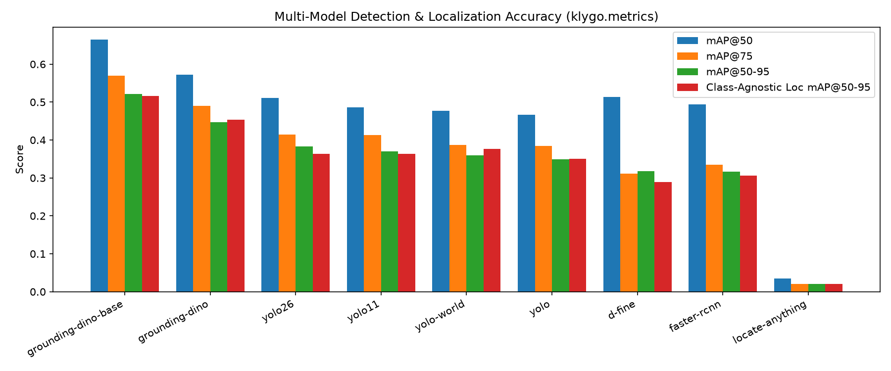
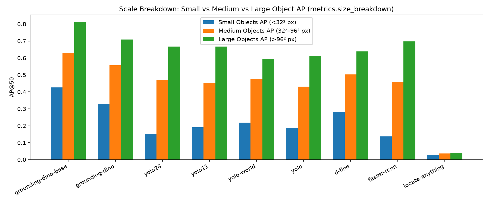
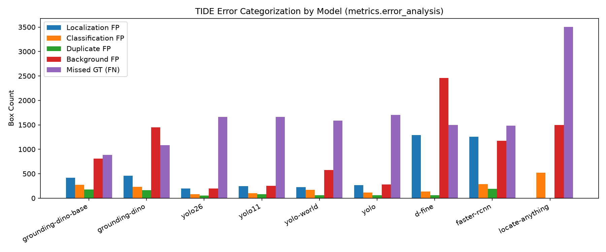

# Klygo Metrics Multi-Model Accuracy & Diagnostic Report

- **GPU**: `NVIDIA L4` (22563.1 MB VRAM)
- **Dataset**: `/content/datasets/val2017_yolo` (`500` images, `3504` GT boxes, `78` defined classes, `78` active GT classes)
- **Models Evaluated**: `9` models (`grounding-dino-base, grounding-dino, yolo26, yolo11, yolo-world, yolo, d-fine, faster-rcnn, locate-anything`)
- **Git**: `detection-evaluation` @ `2051efd7be6d1149d78e7a201cf5f9f92b25340f`

## Multi-Model Detection & Localization Leaderboard (Sorted by mAP@50-95)

| rank | model | mode | mAP50_95 | mAP50 | mAP75 | f1 | precision | recall | mean_iou | loc_mAP50_95 | loc_mAP50 | optimal_threshold | optimal_f1 | ece | detected_classes |
| --- | --- | --- | --- | --- | --- | --- | --- | --- | --- | --- | --- | --- | --- | --- | --- |
| 1 | grounding-dino-base | multi-class | 0.5211 | 0.6649 | 0.5691 | 0.6549 | 0.5831 | 0.7469 | 0.8686 | 0.5161 | 0.6893 | 0.4 | 0.698 | 0.1622 | 77/78 |
| 2 | grounding-dino | multi-class | 0.4474 | 0.5726 | 0.4895 | 0.5719 | 0.4884 | 0.6898 | 0.8659 | 0.4539 | 0.6089 | 0.4 | 0.625 | 0.1179 | 75/78 |
| 3 | yolo26 | multi-class | 0.3835 | 0.5109 | 0.4145 | 0.6196 | 0.7543 | 0.5257 | 0.8531 | 0.363 | 0.5047 | 0.0 | 0.6196 | 0.1565 | 76/78 |
| 4 | yolo11 | multi-class | 0.3696 | 0.4862 | 0.413 | 0.6029 | 0.7057 | 0.5263 | 0.8501 | 0.3631 | 0.5073 | 0.0 | 0.6029 | 0.1102 | 75/78 |
| 5 | yolo-world | multi-class | 0.3598 | 0.4766 | 0.387 | 0.5822 | 0.6222 | 0.5471 | 0.8581 | 0.3765 | 0.5163 | 0.3 | 0.5845 | 0.0558 | 76/78 |
| 6 | yolo | multi-class | 0.3491 | 0.4666 | 0.3849 | 0.5886 | 0.6891 | 0.5137 | 0.8498 | 0.3506 | 0.493 | 0.0 | 0.5886 | 0.1032 | 76/78 |
| 7 | d-fine | multi-class | 0.3181 | 0.5139 | 0.3118 | 0.4036 | 0.3117 | 0.5725 | 0.7911 | 0.2896 | 0.512 | 0.5 | 0.5575 | 0.1856 | 76/78 |
| 8 | faster-rcnn | multi-class | 0.317 | 0.4939 | 0.3349 | 0.4583 | 0.3804 | 0.5762 | 0.7871 | 0.3065 | 0.518 | 0.6 | 0.5515 | 0.223 | 76/78 |
| 9 | locate-anything | class-agnostic | 0.0202 | 0.0347 | 0.021 | 0.149 | 0.1583 | 0.1407 | 0.8031 | 0.0202 | 0.0347 | 0.0 | 0.0 | 1.0 | 0/78 |

## Scale Breakdown (Small/Medium/Large), TIDE Error Counts & IoU Sweep

| model | small_ap | medium_ap | large_ap | small_f1 | medium_f1 | large_f1 | err_localization | err_classification | err_cls_loc | err_duplicate | err_background | err_missed_gt | f1_iou50 | f1_iou75 | f1_iou90 | cm_class_acc | per_image_mean_f1 | matched_tp_boxes |
| --- | --- | --- | --- | --- | --- | --- | --- | --- | --- | --- | --- | --- | --- | --- | --- | --- | --- | --- |
| yolo | 0.1881 | 0.4307 | 0.6107 | 0.3276 | 0.5838 | 0.7585 | 266 | 117 | 91 | 60 | 278 | 1704 | 0.5886 | 0.4843 | 0.2721 | 0.951 | 0.6353 | 1800 |
| yolo11 | 0.1918 | 0.4521 | 0.6673 | 0.3427 | 0.592 | 0.7775 | 243 | 99 | 93 | 80 | 254 | 1660 | 0.6029 | 0.4983 | 0.2769 | 0.953 | 0.6549 | 1844 |
| yolo26 | 0.1518 | 0.4687 | 0.6675 | 0.3261 | 0.6205 | 0.7971 | 196 | 82 | 75 | 50 | 197 | 1662 | 0.6196 | 0.5099 | 0.295 | 0.9683 | 0.6739 | 1842 |
| yolo-world | 0.2177 | 0.4759 | 0.5958 | 0.3591 | 0.5902 | 0.7368 | 227 | 172 | 126 | 61 | 578 | 1587 | 0.5822 | 0.4914 | 0.2831 | 0.9387 | 0.6265 | 1917 |
| grounding-dino | 0.3303 | 0.5569 | 0.7087 | 0.4011 | 0.5855 | 0.7421 | 459 | 232 | 229 | 163 | 1449 | 1087 | 0.5719 | 0.494 | 0.3029 | 0.9575 | 0.6588 | 2417 |
| grounding-dino-base | 0.4259 | 0.6287 | 0.8143 | 0.5035 | 0.6688 | 0.7784 | 418 | 270 | 200 | 177 | 806 | 887 | 0.6549 | 0.5691 | 0.3529 | 0.9699 | 0.706 | 2617 |
| faster-rcnn | 0.1365 | 0.4597 | 0.6976 | 0.225 | 0.4532 | 0.6391 | 1254 | 284 | 384 | 192 | 1174 | 1485 | 0.4583 | 0.2969 | 0.1071 | 0.9296 | 0.555 | 2019 |
| d-fine | 0.2819 | 0.5035 | 0.6386 | 0.2488 | 0.4027 | 0.606 | 1288 | 133 | 490 | 60 | 2459 | 1498 | 0.4036 | 0.2577 | 0.1123 | 0.9376 | 0.4894 | 2006 |
| locate-anything | 0.0247 | 0.0363 | 0.0406 | 0.1254 | 0.161 | 0.1547 | 0 | 522 | 1099 | 0 | 1494 | 3504 | 0.0 | 0.0 | 0.0 | 0.0 | 0.0 | 0 |

## Charts

### Multi-Model mAP & Localization Leaderboard

### Multi-Scale Object Breakdown (Small / Medium / Large)

### TIDE Error Categorization Breakdown

