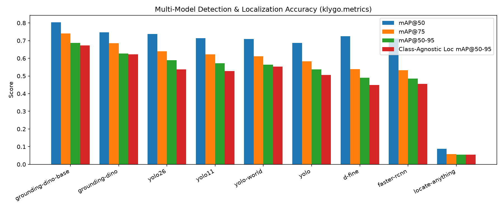
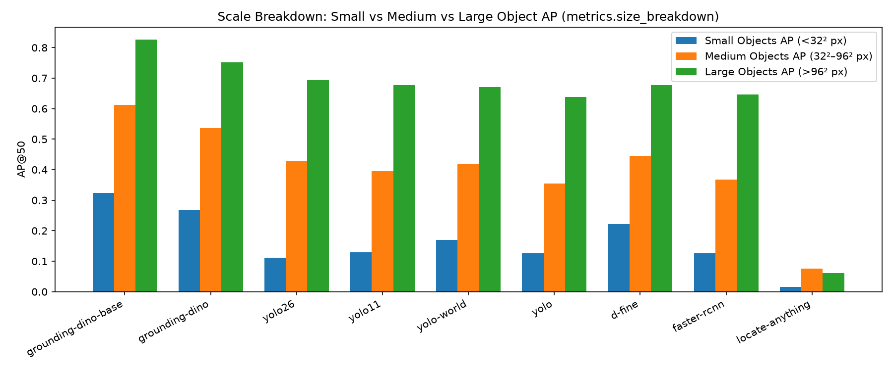
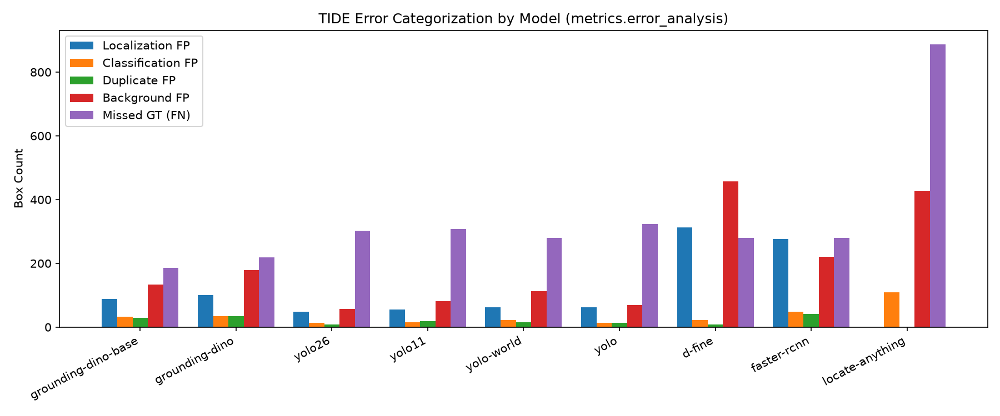

# Klygo Metrics Multi-Model Accuracy & Diagnostic Report

- **GPU**: `NVIDIA L4` (22563.1 MB VRAM)
- **Dataset**: `/content/datasets/voc2007_yolo` (`300` images, `887` GT boxes, `20` defined classes, `20` active GT classes)
- **Models Evaluated**: `9` models (`grounding-dino-base, grounding-dino, yolo26, yolo11, yolo-world, yolo, d-fine, faster-rcnn, locate-anything`)
- **Git**: `detection-evaluation` @ `2051efd7be6d1149d78e7a201cf5f9f92b25340f`

## Multi-Model Detection & Localization Leaderboard (Sorted by mAP@50-95)

| rank | model | mode | mAP50_95 | mAP50 | mAP75 | f1 | precision | recall | mean_iou | loc_mAP50_95 | loc_mAP50 | optimal_threshold | optimal_f1 | ece | detected_classes |
| --- | --- | --- | --- | --- | --- | --- | --- | --- | --- | --- | --- | --- | --- | --- | --- |
| 1 | grounding-dino-base | multi-class | 0.6868 | 0.8038 | 0.741 | 0.7699 | 0.7497 | 0.7912 | 0.8871 | 0.6723 | 0.8082 | 0.4 | 0.7969 | 0.1654 | 20/20 |
| 2 | grounding-dino | multi-class | 0.6276 | 0.7466 | 0.6853 | 0.7247 | 0.6976 | 0.7538 | 0.8863 | 0.622 | 0.7601 | 0.4 | 0.7561 | 0.1226 | 20/20 |
| 3 | yolo26 | multi-class | 0.5898 | 0.7381 | 0.6402 | 0.7303 | 0.8174 | 0.6601 | 0.8711 | 0.5375 | 0.7099 | 0.0 | 0.7303 | 0.1672 | 20/20 |
| 4 | yolo11 | multi-class | 0.5714 | 0.7135 | 0.6231 | 0.7082 | 0.7719 | 0.6542 | 0.8698 | 0.5283 | 0.7061 | 0.0 | 0.7082 | 0.108 | 20/20 |
| 5 | yolo-world | multi-class | 0.5647 | 0.7096 | 0.6121 | 0.7107 | 0.7383 | 0.6852 | 0.8767 | 0.5524 | 0.7259 | 0.3 | 0.7112 | 0.0571 | 20/20 |
| 6 | yolo | multi-class | 0.5369 | 0.6865 | 0.5835 | 0.6974 | 0.7699 | 0.6373 | 0.8687 | 0.5057 | 0.6784 | 0.0 | 0.6974 | 0.1042 | 20/20 |
| 7 | d-fine | multi-class | 0.4907 | 0.7247 | 0.5385 | 0.5273 | 0.4287 | 0.6847 | 0.8123 | 0.4497 | 0.7151 | 0.5 | 0.6706 | 0.1989 | 20/20 |
| 8 | faster-rcnn | multi-class | 0.4851 | 0.7106 | 0.5332 | 0.5818 | 0.5055 | 0.6858 | 0.8048 | 0.4552 | 0.7176 | 0.6 | 0.6558 | 0.2223 | 20/20 |
| 9 | locate-anything | class-agnostic | 0.0544 | 0.0881 | 0.0581 | 0.2605 | 0.2731 | 0.249 | 0.8329 | 0.0544 | 0.0881 | 0.0 | 0.0 | 1.0 | 0/20 |

## Scale Breakdown (Small/Medium/Large), TIDE Error Counts & IoU Sweep

| model | small_ap | medium_ap | large_ap | small_f1 | medium_f1 | large_f1 | err_localization | err_classification | err_cls_loc | err_duplicate | err_background | err_missed_gt | f1_iou50 | f1_iou75 | f1_iou90 | cm_class_acc | per_image_mean_f1 | matched_tp_boxes |
| --- | --- | --- | --- | --- | --- | --- | --- | --- | --- | --- | --- | --- | --- | --- | --- | --- | --- | --- |
| yolo | 0.1264 | 0.3541 | 0.6384 | 0.2523 | 0.4706 | 0.7963 | 62 | 14 | 22 | 14 | 69 | 323 | 0.6974 | 0.5925 | 0.3809 | 0.9757 | 0.722 | 564 |
| yolo11 | 0.1293 | 0.395 | 0.6775 | 0.2793 | 0.5061 | 0.8087 | 56 | 16 | 18 | 18 | 82 | 308 | 0.7082 | 0.6186 | 0.3926 | 0.973 | 0.7303 | 579 |
| yolo26 | 0.1119 | 0.4299 | 0.6934 | 0.2476 | 0.5516 | 0.8267 | 48 | 13 | 13 | 9 | 57 | 303 | 0.7303 | 0.6346 | 0.4042 | 0.9808 | 0.7584 | 584 |
| yolo-world | 0.1706 | 0.4187 | 0.6703 | 0.3016 | 0.5212 | 0.8078 | 63 | 22 | 23 | 16 | 112 | 280 | 0.7107 | 0.6159 | 0.3963 | 0.9664 | 0.7337 | 607 |
| grounding-dino | 0.2678 | 0.5362 | 0.751 | 0.3926 | 0.6033 | 0.8049 | 101 | 34 | 44 | 34 | 178 | 219 | 0.7247 | 0.6393 | 0.4414 | 0.9723 | 0.7586 | 668 |
| grounding-dino-base | 0.3235 | 0.6128 | 0.8264 | 0.4907 | 0.6723 | 0.8491 | 89 | 33 | 38 | 29 | 134 | 186 | 0.7699 | 0.697 | 0.5056 | 0.9782 | 0.8016 | 701 |
| faster-rcnn | 0.1259 | 0.368 | 0.6472 | 0.2319 | 0.4423 | 0.7072 | 276 | 49 | 83 | 41 | 221 | 280 | 0.5818 | 0.4393 | 0.1981 | 0.9416 | 0.6558 | 607 |
| d-fine | 0.2223 | 0.4449 | 0.6775 | 0.224 | 0.4357 | 0.7011 | 313 | 23 | 92 | 9 | 458 | 280 | 0.5273 | 0.3957 | 0.1927 | 0.9593 | 0.5878 | 607 |
| locate-anything | 0.0152 | 0.076 | 0.0617 | 0.1136 | 0.2891 | 0.2872 | 0 | 110 | 256 | 0 | 428 | 887 | 0.0 | 0.0 | 0.0 | 0.0 | 0.0 | 0 |

## Charts

### Multi-Model mAP & Localization Leaderboard

### Multi-Scale Object Breakdown (Small / Medium / Large)

### TIDE Error Categorization Breakdown

