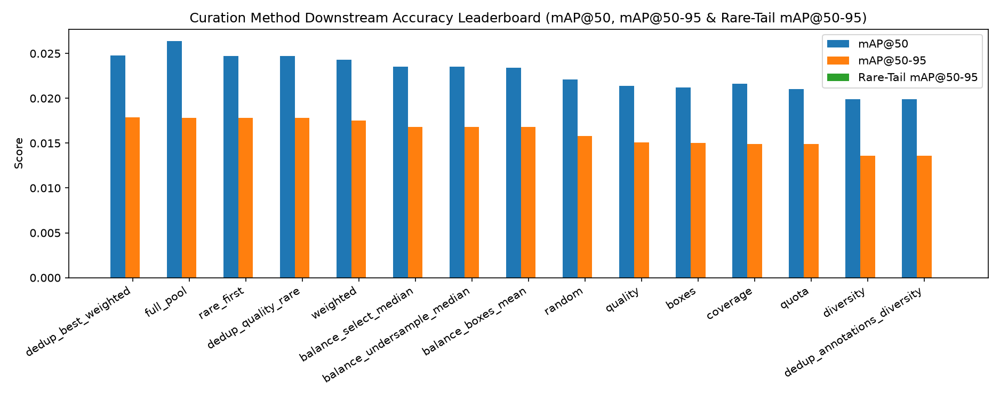
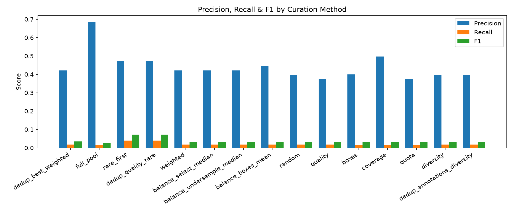
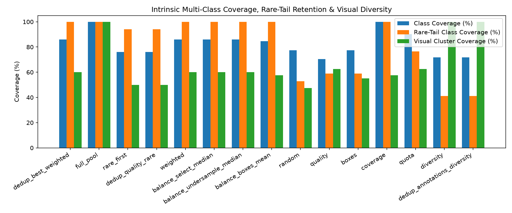

# Klygo Mining Full-Class Curation & Downstream Accuracy Report

- **GPU**: `NVIDIA L4` (22563.1 MB VRAM)
- **Dataset**: `artifacts/datasets/coco128` (`71` defined classes, `71` active in pool, train pool `103` imgs, clean val `25` imgs, budget `40` imgs)
- **Duplicate Analysis (`mining.find_duplicates`)**: `0` duplicate groups (`0` redundant images at threshold `0.92`)
- **Model / Epochs**: `yolov8n.pt` / `15` epochs
- **Git**: `detection-evaluation` @ `c9f23990f8df8b737c4a7cea2670ad66ba4de4bb`

## Curation Method Leaderboard (Sorted by Downstream mAP@50-95)

| rank | method | images_selected | mAP50_95 | mAP50 | rare_tail_mAP50_95 | f1 | precision | recall | delta_map50_95_vs_random | active_classes | class_coverage_pct | rare_tail_coverage_pct | cluster_coverage_pct | class_entropy_norm | mean_quality_score |
| --- | --- | --- | --- | --- | --- | --- | --- | --- | --- | --- | --- | --- | --- | --- | --- |
| 1 | dedup_best_weighted | 40 | 0.0179 | 0.0248 | 0.0 | 0.0347 | 0.4214 | 0.0181 | 0.0021 | 61/71 | 85.92 | 100.0 | 60.0 | 0.8246 | 0.6115 |
| 2 | full_pool | 103 | 0.0178 | 0.0264 | 0.0 | 0.0276 | 0.6862 | 0.0141 | 0.002 | 71/71 | 100.0 | 100.0 | 100.0 | 0.8098 | 0.5778 |
| 3 | rare_first | 40 | 0.0178 | 0.0247 | 0.0 | 0.0719 | 0.4738 | 0.0389 | 0.002 | 54/71 | 76.06 | 94.12 | 50.0 | 0.8101 | 0.5887 |
| 4 | dedup_quality_rare | 40 | 0.0178 | 0.0247 | 0.0 | 0.0719 | 0.4738 | 0.0389 | 0.002 | 54/71 | 76.06 | 94.12 | 50.0 | 0.8101 | 0.5887 |
| 5 | weighted | 40 | 0.0175 | 0.0243 | 0.0 | 0.0339 | 0.4212 | 0.0176 | 0.0017 | 61/71 | 85.92 | 100.0 | 60.0 | 0.8346 | 0.6101 |
| 6 | balance_select_median | 40 | 0.0168 | 0.0235 | 0.0 | 0.0334 | 0.4209 | 0.0174 | 0.001 | 61/71 | 85.92 | 100.0 | 60.0 | 0.8342 | 0.6097 |
| 7 | balance_undersample_median | 40 | 0.0168 | 0.0235 | 0.0 | 0.0334 | 0.4209 | 0.0174 | 0.001 | 61/71 | 85.92 | 100.0 | 60.0 | 0.8342 | 0.6097 |
| 8 | balance_boxes_mean | 40 | 0.0168 | 0.0234 | 0.0 | 0.0334 | 0.4448 | 0.0173 | 0.001 | 60/71 | 84.51 | 100.0 | 57.5 | 0.8296 | 0.6111 |
| 9 | random | 40 | 0.0158 | 0.0221 | 0.0 | 0.0339 | 0.3969 | 0.0177 | 0.0 | 55/71 | 77.46 | 52.94 | 47.5 | 0.7746 | 0.5826 |
| 10 | quality | 40 | 0.0151 | 0.0214 | 0.0 | 0.0332 | 0.373 | 0.0173 | -0.0007 | 50/71 | 70.42 | 58.82 | 62.5 | 0.7396 | 0.6393 |
| 11 | boxes | 40 | 0.015 | 0.0212 | 0.0 | 0.0301 | 0.4004 | 0.0156 | -0.0008 | 55/71 | 77.46 | 58.82 | 55.0 | 0.7835 | 0.5764 |
| 12 | coverage | 40 | 0.0149 | 0.0216 | 0.0 | 0.031 | 0.4964 | 0.016 | -0.0009 | 71/71 | 100.0 | 100.0 | 57.5 | 0.8539 | 0.5877 |
| 13 | quota | 40 | 0.0149 | 0.021 | 0.0 | 0.0323 | 0.3732 | 0.0169 | -0.0009 | 64/71 | 90.14 | 76.47 | 62.5 | 0.8133 | 0.5786 |
| 14 | diversity | 40 | 0.0136 | 0.0199 | 0.0 | 0.0339 | 0.397 | 0.0177 | -0.0022 | 51/71 | 71.83 | 41.18 | 100.0 | 0.7997 | 0.5896 |
| 15 | dedup_annotations_diversity | 40 | 0.0136 | 0.0199 | 0.0 | 0.0339 | 0.397 | 0.0177 | -0.0022 | 51/71 | 71.83 | 41.18 | 100.0 | 0.7997 | 0.5896 |

## Detailed Intrinsic & Downstream Evaluation Metrics

| method | mAP50_95 | mAP50 | rare_tail_mAP50_95 | precision | recall | f1 | images_selected | boxes_selected | boxes_per_image | multilabel_rate_pct | active_classes | pool_active_classes | class_coverage_pct | rare_tail_coverage_pct | class_entropy_norm | imbalance_ratio | cluster_coverage_pct | mean_quality_score | mean_composite_score | image_retention_pct | delta_map50_95_vs_random |
| --- | --- | --- | --- | --- | --- | --- | --- | --- | --- | --- | --- | --- | --- | --- | --- | --- | --- | --- | --- | --- | --- |
| full_pool | 0.0178 | 0.0264 | 0.0 | 0.6862 | 0.0141 | 0.0276 | 103 | 740 | 7.18 | 75.73 | 71 | 71 | 100.0 | 100.0 | 0.8098 | 48.0 | 100.0 | 0.5778 | 0.3226 | 100.0 | 0.002 |
| random | 0.0158 | 0.0221 | 0.0 | 0.3969 | 0.0177 | 0.0339 | 40 | 280 | 7.0 | 75.0 | 55 | 71 | 77.46 | 52.94 | 0.7746 | 15.0 | 47.5 | 0.5826 | 0.3308 | 38.83 | 0.0 |
| weighted | 0.0175 | 0.0243 | 0.0 | 0.4212 | 0.0176 | 0.0339 | 40 | 404 | 10.1 | 75.0 | 61 | 71 | 85.92 | 100.0 | 0.8346 | 14.0 | 60.0 | 0.6101 | 0.39 | 38.83 | 0.0017 |
| quality | 0.0151 | 0.0214 | 0.0 | 0.373 | 0.0173 | 0.0332 | 40 | 263 | 6.58 | 77.5 | 50 | 71 | 70.42 | 58.82 | 0.7396 | 18.0 | 62.5 | 0.6393 | 0.339 | 38.83 | -0.0007 |
| rare_first | 0.0178 | 0.0247 | 0.0 | 0.4738 | 0.0389 | 0.0719 | 40 | 194 | 4.85 | 65.0 | 54 | 71 | 76.06 | 94.12 | 0.8101 | 11.0 | 50.0 | 0.5887 | 0.3752 | 38.83 | 0.002 |
| diversity | 0.0136 | 0.0199 | 0.0 | 0.397 | 0.0177 | 0.0339 | 40 | 269 | 6.72 | 70.0 | 51 | 71 | 71.83 | 41.18 | 0.7997 | 12.0 | 100.0 | 0.5896 | 0.3297 | 38.83 | -0.0022 |
| coverage | 0.0149 | 0.0216 | 0.0 | 0.4964 | 0.016 | 0.031 | 40 | 312 | 7.8 | 75.0 | 71 | 71 | 100.0 | 100.0 | 0.8539 | 16.0 | 57.5 | 0.5877 | 0.375 | 38.83 | -0.0009 |
| quota | 0.0149 | 0.021 | 0.0 | 0.3732 | 0.0169 | 0.0323 | 40 | 389 | 9.72 | 82.5 | 64 | 71 | 90.14 | 76.47 | 0.8133 | 17.0 | 62.5 | 0.5786 | 0.3487 | 38.83 | -0.0009 |
| boxes | 0.015 | 0.0212 | 0.0 | 0.4004 | 0.0156 | 0.0301 | 40 | 362 | 9.05 | 82.5 | 55 | 71 | 77.46 | 58.82 | 0.7835 | 19.0 | 55.0 | 0.5764 | 0.3288 | 38.83 | -0.0008 |
| balance_select_median | 0.0168 | 0.0235 | 0.0 | 0.4209 | 0.0174 | 0.0334 | 40 | 403 | 10.07 | 75.0 | 61 | 71 | 85.92 | 100.0 | 0.8342 | 14.0 | 60.0 | 0.6097 | 0.3898 | 38.83 | 0.001 |
| balance_undersample_median | 0.0168 | 0.0235 | 0.0 | 0.4209 | 0.0174 | 0.0334 | 40 | 403 | 10.07 | 75.0 | 61 | 71 | 85.92 | 100.0 | 0.8342 | 14.0 | 60.0 | 0.6097 | 0.3898 | 38.83 | 0.001 |
| balance_boxes_mean | 0.0168 | 0.0234 | 0.0 | 0.4448 | 0.0173 | 0.0334 | 40 | 399 | 9.97 | 72.5 | 60 | 71 | 84.51 | 100.0 | 0.8296 | 14.0 | 57.5 | 0.6111 | 0.3898 | 38.83 | 0.001 |
| dedup_best_weighted | 0.0179 | 0.0248 | 0.0 | 0.4214 | 0.0181 | 0.0347 | 40 | 405 | 10.12 | 75.0 | 61 | 71 | 85.92 | 100.0 | 0.8246 | 15.0 | 60.0 | 0.6115 | 0.3899 | 38.83 | 0.0021 |
| dedup_quality_rare | 0.0178 | 0.0247 | 0.0 | 0.4738 | 0.0389 | 0.0719 | 40 | 194 | 4.85 | 65.0 | 54 | 71 | 76.06 | 94.12 | 0.8101 | 11.0 | 50.0 | 0.5887 | 0.3752 | 38.83 | 0.002 |
| dedup_annotations_diversity | 0.0136 | 0.0199 | 0.0 | 0.397 | 0.0177 | 0.0339 | 40 | 269 | 6.72 | 70.0 | 51 | 71 | 71.83 | 41.18 | 0.7997 | 12.0 | 100.0 | 0.5896 | 0.3297 | 38.83 | -0.0022 |

## Charts

### Curation Method mAP Comparison

### Precision, Recall & F1 by Curation Method

### Intrinsic Class Coverage & Visual Diversity

