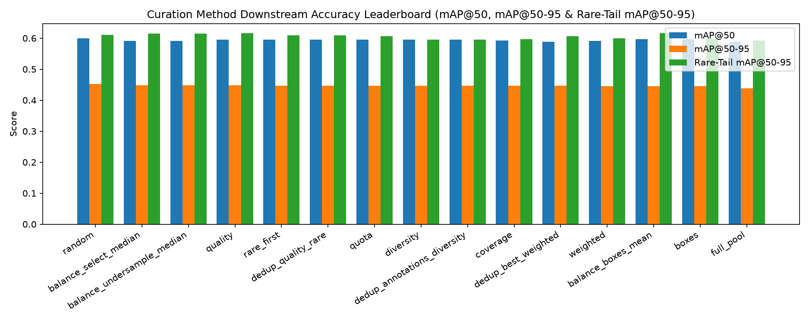
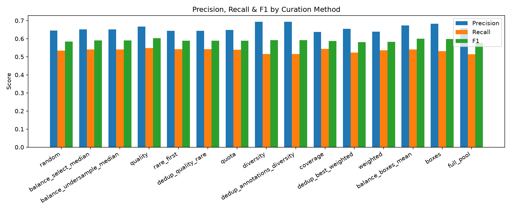
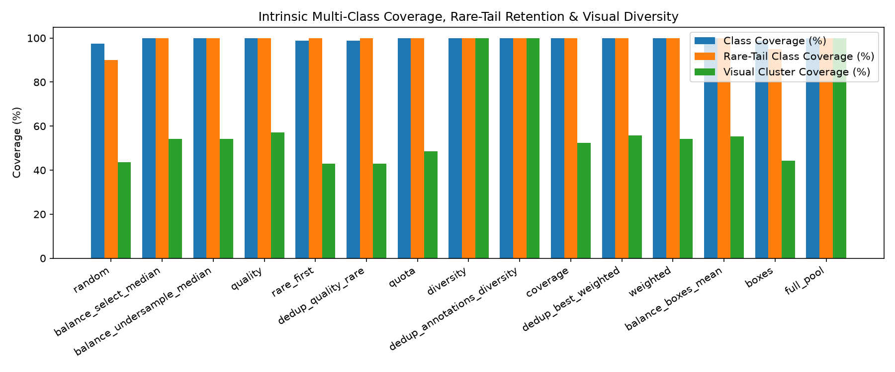

# Klygo Mining Full-Class Curation & Downstream Accuracy Report

- **GPU**: `NVIDIA L4` (22563.1 MB VRAM)
- **Dataset**: `/content/datasets/val2017_yolo` (`80` defined classes, `80` active in pool, train pool `1200` imgs, clean val `300` imgs, budget `420` imgs)
- **Duplicate Analysis (`mining.find_duplicates`)**: `0` duplicate groups (`0` redundant images at threshold `0.92`)
- **Model / Epochs**: `yolov8n.pt` / `12` epochs
- **Git**: `detection-evaluation` @ `c9f23990f8df8b737c4a7cea2670ad66ba4de4bb`

## Curation Method Leaderboard (Sorted by Downstream mAP@50-95)

| rank | method | images_selected | mAP50_95 | mAP50 | rare_tail_mAP50_95 | f1 | precision | recall | delta_map50_95_vs_random | active_classes | class_coverage_pct | rare_tail_coverage_pct | cluster_coverage_pct | class_entropy_norm | mean_quality_score |
| --- | --- | --- | --- | --- | --- | --- | --- | --- | --- | --- | --- | --- | --- | --- | --- |
| 1 | random | 420 | 0.4525 | 0.5997 | 0.6101 | 0.5844 | 0.6448 | 0.5343 | 0.0 | 78/80 | 97.5 | 90.0 | 43.57 | 0.783 | 0.5901 |
| 2 | balance_select_median | 420 | 0.4486 | 0.5907 | 0.6147 | 0.5905 | 0.6508 | 0.5405 | -0.0039 | 80/80 | 100.0 | 100.0 | 54.29 | 0.8148 | 0.6224 |
| 3 | balance_undersample_median | 420 | 0.4486 | 0.5907 | 0.6147 | 0.5905 | 0.6508 | 0.5405 | -0.0039 | 80/80 | 100.0 | 100.0 | 54.29 | 0.8148 | 0.6224 |
| 4 | quality | 420 | 0.4481 | 0.5953 | 0.6167 | 0.6021 | 0.6671 | 0.5486 | -0.0044 | 80/80 | 100.0 | 100.0 | 57.14 | 0.7862 | 0.6427 |
| 5 | rare_first | 420 | 0.4467 | 0.5961 | 0.6094 | 0.5882 | 0.644 | 0.5413 | -0.0058 | 79/80 | 98.75 | 100.0 | 42.86 | 0.8648 | 0.5913 |
| 6 | dedup_quality_rare | 420 | 0.4467 | 0.5961 | 0.6094 | 0.5882 | 0.644 | 0.5413 | -0.0058 | 79/80 | 98.75 | 100.0 | 42.86 | 0.8648 | 0.5913 |
| 7 | quota | 420 | 0.4467 | 0.5952 | 0.6068 | 0.5884 | 0.6479 | 0.5389 | -0.0058 | 80/80 | 100.0 | 100.0 | 48.57 | 0.8241 | 0.5983 |
| 8 | diversity | 420 | 0.4466 | 0.5952 | 0.5957 | 0.5916 | 0.694 | 0.5156 | -0.0059 | 80/80 | 100.0 | 100.0 | 100.0 | 0.8029 | 0.6046 |
| 9 | dedup_annotations_diversity | 420 | 0.4466 | 0.5952 | 0.5957 | 0.5916 | 0.694 | 0.5156 | -0.0059 | 80/80 | 100.0 | 100.0 | 100.0 | 0.8029 | 0.6046 |
| 10 | coverage | 420 | 0.4463 | 0.592 | 0.5962 | 0.5867 | 0.638 | 0.5431 | -0.0062 | 80/80 | 100.0 | 100.0 | 52.38 | 0.817 | 0.61 |
| 11 | dedup_best_weighted | 420 | 0.4463 | 0.5886 | 0.6062 | 0.5815 | 0.6547 | 0.523 | -0.0062 | 80/80 | 100.0 | 100.0 | 55.71 | 0.805 | 0.6242 |
| 12 | weighted | 420 | 0.446 | 0.591 | 0.6 | 0.5827 | 0.6389 | 0.5356 | -0.0065 | 80/80 | 100.0 | 100.0 | 54.29 | 0.8151 | 0.619 |
| 13 | balance_boxes_mean | 420 | 0.4459 | 0.5965 | 0.6164 | 0.599 | 0.6729 | 0.5397 | -0.0066 | 80/80 | 100.0 | 100.0 | 55.24 | 0.8054 | 0.6229 |
| 14 | boxes | 420 | 0.4453 | 0.5973 | 0.5978 | 0.5974 | 0.6819 | 0.5316 | -0.0072 | 79/80 | 98.75 | 95.0 | 44.29 | 0.7904 | 0.5861 |
| 15 | full_pool | 1200 | 0.4391 | 0.5879 | 0.5931 | 0.5763 | 0.6572 | 0.5131 | -0.0134 | 80/80 | 100.0 | 100.0 | 100.0 | 0.8022 | 0.5887 |

## Detailed Intrinsic & Downstream Evaluation Metrics

| method | mAP50_95 | mAP50 | rare_tail_mAP50_95 | precision | recall | f1 | images_selected | boxes_selected | boxes_per_image | multilabel_rate_pct | active_classes | pool_active_classes | class_coverage_pct | rare_tail_coverage_pct | class_entropy_norm | imbalance_ratio | cluster_coverage_pct | mean_quality_score | mean_composite_score | image_retention_pct | delta_map50_95_vs_random |
| --- | --- | --- | --- | --- | --- | --- | --- | --- | --- | --- | --- | --- | --- | --- | --- | --- | --- | --- | --- | --- | --- |
| full_pool | 0.4391 | 0.5879 | 0.5931 | 0.6572 | 0.5131 | 0.5763 | 1200 | 8577 | 7.15 | 77.33 | 80 | 80 | 100.0 | 100.0 | 0.8022 | 211.0 | 100.0 | 0.5887 | 0.2779 | 100.0 | -0.0134 |
| random | 0.4525 | 0.5997 | 0.6101 | 0.6448 | 0.5343 | 0.5844 | 420 | 3029 | 7.21 | 79.05 | 78 | 80 | 97.5 | 90.0 | 0.783 | 116.0 | 43.57 | 0.5901 | 0.2763 | 35.0 | 0.0 |
| weighted | 0.446 | 0.591 | 0.6 | 0.6389 | 0.5356 | 0.5827 | 420 | 4385 | 10.44 | 70.24 | 80 | 80 | 100.0 | 100.0 | 0.8151 | 91.0 | 54.29 | 0.619 | 0.3172 | 35.0 | -0.0065 |
| quality | 0.4481 | 0.5953 | 0.6167 | 0.6671 | 0.5486 | 0.6021 | 420 | 3282 | 7.81 | 80.48 | 80 | 80 | 100.0 | 100.0 | 0.7862 | 233.0 | 57.14 | 0.6427 | 0.2981 | 35.0 | -0.0044 |
| rare_first | 0.4467 | 0.5961 | 0.6094 | 0.644 | 0.5413 | 0.5882 | 420 | 2401 | 5.72 | 56.43 | 79 | 80 | 98.75 | 100.0 | 0.8648 | 89.0 | 42.86 | 0.5913 | 0.3061 | 35.0 | -0.0058 |
| diversity | 0.4466 | 0.5952 | 0.5957 | 0.694 | 0.5156 | 0.5916 | 420 | 3495 | 8.32 | 78.57 | 80 | 80 | 100.0 | 100.0 | 0.8029 | 222.0 | 100.0 | 0.6046 | 0.2869 | 35.0 | -0.0059 |
| coverage | 0.4463 | 0.592 | 0.5962 | 0.638 | 0.5431 | 0.5867 | 420 | 4352 | 10.36 | 71.9 | 80 | 80 | 100.0 | 100.0 | 0.817 | 65.0 | 52.38 | 0.61 | 0.3142 | 35.0 | -0.0062 |
| quota | 0.4467 | 0.5952 | 0.6068 | 0.6479 | 0.5389 | 0.5884 | 420 | 4152 | 9.89 | 75.24 | 80 | 80 | 100.0 | 100.0 | 0.8241 | 71.67 | 48.57 | 0.5983 | 0.3078 | 35.0 | -0.0058 |
| boxes | 0.4453 | 0.5973 | 0.5978 | 0.6819 | 0.5316 | 0.5974 | 420 | 3319 | 7.9 | 89.29 | 79 | 80 | 98.75 | 95.0 | 0.7904 | 124.0 | 44.29 | 0.5861 | 0.2754 | 35.0 | -0.0072 |
| balance_select_median | 0.4486 | 0.5907 | 0.6147 | 0.6508 | 0.5405 | 0.5905 | 420 | 4332 | 10.31 | 72.38 | 80 | 80 | 100.0 | 100.0 | 0.8148 | 95.0 | 54.29 | 0.6224 | 0.3163 | 35.0 | -0.0039 |
| balance_undersample_median | 0.4486 | 0.5907 | 0.6147 | 0.6508 | 0.5405 | 0.5905 | 420 | 4332 | 10.31 | 72.38 | 80 | 80 | 100.0 | 100.0 | 0.8148 | 95.0 | 54.29 | 0.6224 | 0.3163 | 35.0 | -0.0039 |
| balance_boxes_mean | 0.4459 | 0.5965 | 0.6164 | 0.6729 | 0.5397 | 0.599 | 420 | 4511 | 10.74 | 73.33 | 80 | 80 | 100.0 | 100.0 | 0.8054 | 66.0 | 55.24 | 0.6229 | 0.3168 | 35.0 | -0.0066 |
| dedup_best_weighted | 0.4463 | 0.5886 | 0.6062 | 0.6547 | 0.523 | 0.5815 | 420 | 4472 | 10.65 | 73.33 | 80 | 80 | 100.0 | 100.0 | 0.805 | 66.33 | 55.71 | 0.6242 | 0.3169 | 35.0 | -0.0062 |
| dedup_quality_rare | 0.4467 | 0.5961 | 0.6094 | 0.644 | 0.5413 | 0.5882 | 420 | 2401 | 5.72 | 56.43 | 79 | 80 | 98.75 | 100.0 | 0.8648 | 89.0 | 42.86 | 0.5913 | 0.3061 | 35.0 | -0.0058 |
| dedup_annotations_diversity | 0.4466 | 0.5952 | 0.5957 | 0.694 | 0.5156 | 0.5916 | 420 | 3495 | 8.32 | 78.57 | 80 | 80 | 100.0 | 100.0 | 0.8029 | 222.0 | 100.0 | 0.6046 | 0.2869 | 35.0 | -0.0059 |

## Charts

### Curation Method mAP Comparison

### Precision, Recall & F1 by Curation Method

### Intrinsic Class Coverage & Visual Diversity

