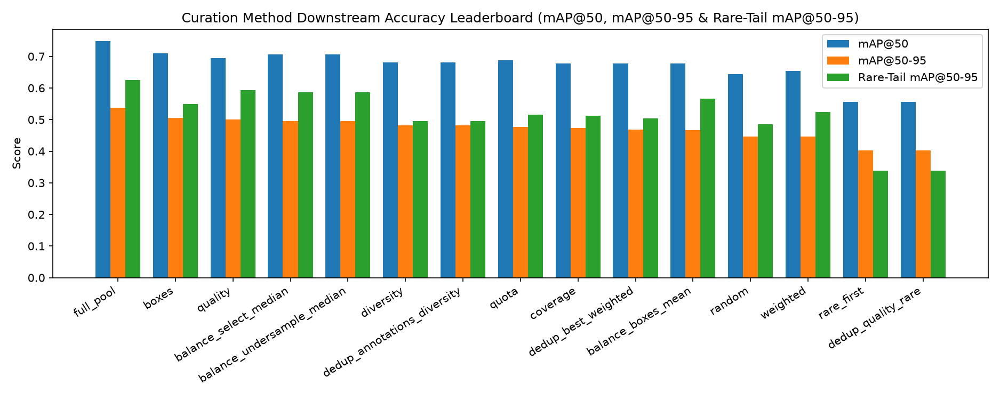
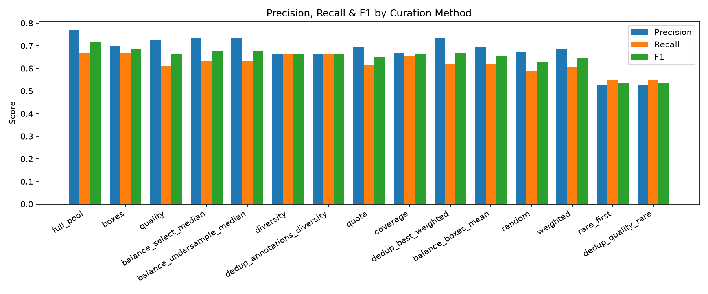
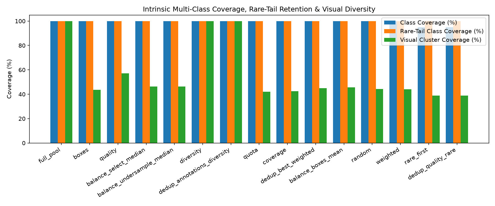

# Klygo Mining Full-Class Curation & Downstream Accuracy Report

- **GPU**: `NVIDIA L4` (22563.1 MB VRAM)
- **Dataset**: `/content/datasets/voc2007_yolo` (`20` defined classes, `20` active in pool, train pool `1000` imgs, clean val `300` imgs, budget `350` imgs)
- **Duplicate Analysis (`mining.find_duplicates`)**: `0` duplicate groups (`0` redundant images at threshold `0.92`)
- **Model / Epochs**: `yolov8n.pt` / `12` epochs
- **Git**: `detection-evaluation` @ `c9f23990f8df8b737c4a7cea2670ad66ba4de4bb`

## Curation Method Leaderboard (Sorted by Downstream mAP@50-95)

| rank | method | images_selected | mAP50_95 | mAP50 | rare_tail_mAP50_95 | f1 | precision | recall | delta_map50_95_vs_random | active_classes | class_coverage_pct | rare_tail_coverage_pct | cluster_coverage_pct | class_entropy_norm | mean_quality_score |
| --- | --- | --- | --- | --- | --- | --- | --- | --- | --- | --- | --- | --- | --- | --- | --- |
| 1 | full_pool | 1000 | 0.5369 | 0.749 | 0.6254 | 0.7168 | 0.7695 | 0.6709 | 0.0897 | 20/20 | 100.0 | 100.0 | 100.0 | 0.8109 | 0.5876 |
| 2 | boxes | 350 | 0.505 | 0.7097 | 0.5496 | 0.6834 | 0.6981 | 0.6693 | 0.0578 | 20/20 | 100.0 | 100.0 | 43.71 | 0.7817 | 0.591 |
| 3 | quality | 350 | 0.5009 | 0.6953 | 0.5929 | 0.6645 | 0.7281 | 0.6111 | 0.0537 | 20/20 | 100.0 | 100.0 | 57.14 | 0.7926 | 0.6474 |
| 4 | balance_select_median | 350 | 0.4953 | 0.7063 | 0.5871 | 0.6796 | 0.7343 | 0.6324 | 0.0481 | 20/20 | 100.0 | 100.0 | 46.29 | 0.9226 | 0.6139 |
| 5 | balance_undersample_median | 350 | 0.4953 | 0.7063 | 0.5871 | 0.6796 | 0.7343 | 0.6324 | 0.0481 | 20/20 | 100.0 | 100.0 | 46.29 | 0.9226 | 0.6139 |
| 6 | diversity | 350 | 0.4826 | 0.6818 | 0.4958 | 0.6625 | 0.6642 | 0.6608 | 0.0354 | 20/20 | 100.0 | 100.0 | 100.0 | 0.7548 | 0.6055 |
| 7 | dedup_annotations_diversity | 350 | 0.4826 | 0.6818 | 0.4958 | 0.6625 | 0.6642 | 0.6608 | 0.0354 | 20/20 | 100.0 | 100.0 | 100.0 | 0.7548 | 0.6055 |
| 8 | quota | 350 | 0.4776 | 0.6874 | 0.5154 | 0.6513 | 0.6922 | 0.6149 | 0.0304 | 20/20 | 100.0 | 100.0 | 42.0 | 0.8626 | 0.5952 |
| 9 | coverage | 350 | 0.4731 | 0.6783 | 0.5119 | 0.6631 | 0.671 | 0.6553 | 0.0259 | 20/20 | 100.0 | 100.0 | 42.57 | 0.8999 | 0.599 |
| 10 | dedup_best_weighted | 350 | 0.468 | 0.6773 | 0.504 | 0.67 | 0.7321 | 0.6176 | 0.0208 | 20/20 | 100.0 | 100.0 | 44.86 | 0.8911 | 0.612 |
| 11 | balance_boxes_mean | 350 | 0.4671 | 0.6779 | 0.5663 | 0.6563 | 0.6965 | 0.6206 | 0.0199 | 20/20 | 100.0 | 100.0 | 45.71 | 0.8848 | 0.6085 |
| 12 | random | 350 | 0.4472 | 0.6443 | 0.485 | 0.6291 | 0.6735 | 0.5902 | 0.0 | 20/20 | 100.0 | 100.0 | 44.29 | 0.7972 | 0.5882 |
| 13 | weighted | 350 | 0.4468 | 0.6546 | 0.5235 | 0.6452 | 0.6879 | 0.6074 | -0.0004 | 20/20 | 100.0 | 100.0 | 44.0 | 0.9026 | 0.6058 |
| 14 | rare_first | 350 | 0.4024 | 0.5569 | 0.3389 | 0.5358 | 0.5243 | 0.5479 | -0.0448 | 19/20 | 95.0 | 100.0 | 38.86 | 0.9166 | 0.5876 |
| 15 | dedup_quality_rare | 350 | 0.4024 | 0.5569 | 0.3389 | 0.5358 | 0.5243 | 0.5479 | -0.0448 | 19/20 | 95.0 | 100.0 | 38.86 | 0.9166 | 0.5876 |

## Detailed Intrinsic & Downstream Evaluation Metrics

| method | mAP50_95 | mAP50 | rare_tail_mAP50_95 | precision | recall | f1 | images_selected | boxes_selected | boxes_per_image | multilabel_rate_pct | active_classes | pool_active_classes | class_coverage_pct | rare_tail_coverage_pct | class_entropy_norm | imbalance_ratio | cluster_coverage_pct | mean_quality_score | mean_composite_score | image_retention_pct | delta_map50_95_vs_random |
| --- | --- | --- | --- | --- | --- | --- | --- | --- | --- | --- | --- | --- | --- | --- | --- | --- | --- | --- | --- | --- | --- |
| full_pool | 0.5369 | 0.749 | 0.6254 | 0.7695 | 0.6709 | 0.7168 | 1000 | 3084 | 3.08 | 40.6 | 20 | 20 | 100.0 | 100.0 | 0.8109 | 14.43 | 100.0 | 0.5876 | 0.3446 | 100.0 | 0.0897 |
| random | 0.4472 | 0.6443 | 0.485 | 0.6735 | 0.5902 | 0.6291 | 350 | 1122 | 3.21 | 41.43 | 20 | 20 | 100.0 | 100.0 | 0.7972 | 20.29 | 44.29 | 0.5882 | 0.347 | 35.0 | 0.0 |
| weighted | 0.4468 | 0.6546 | 0.5235 | 0.6879 | 0.6074 | 0.6452 | 350 | 1251 | 3.57 | 30.57 | 20 | 20 | 100.0 | 100.0 | 0.9026 | 23.5 | 44.0 | 0.6058 | 0.4294 | 35.0 | -0.0004 |
| quality | 0.5009 | 0.6953 | 0.5929 | 0.7281 | 0.6111 | 0.6645 | 350 | 1148 | 3.28 | 42.86 | 20 | 20 | 100.0 | 100.0 | 0.7926 | 15.67 | 57.14 | 0.6474 | 0.3661 | 35.0 | 0.0537 |
| rare_first | 0.4024 | 0.5569 | 0.3389 | 0.5243 | 0.5479 | 0.5358 | 350 | 941 | 2.69 | 19.43 | 19 | 20 | 95.0 | 100.0 | 0.9166 | 6.29 | 38.86 | 0.5876 | 0.4235 | 35.0 | -0.0448 |
| diversity | 0.4826 | 0.6818 | 0.4958 | 0.6642 | 0.6608 | 0.6625 | 350 | 1155 | 3.3 | 43.14 | 20 | 20 | 100.0 | 100.0 | 0.7548 | 37.75 | 100.0 | 0.6055 | 0.344 | 35.0 | 0.0354 |
| coverage | 0.4731 | 0.6783 | 0.5119 | 0.671 | 0.6553 | 0.6631 | 350 | 1275 | 3.64 | 39.71 | 20 | 20 | 100.0 | 100.0 | 0.8999 | 5.18 | 42.57 | 0.599 | 0.416 | 35.0 | 0.0259 |
| quota | 0.4776 | 0.6874 | 0.5154 | 0.6922 | 0.6149 | 0.6513 | 350 | 1236 | 3.53 | 56.0 | 20 | 20 | 100.0 | 100.0 | 0.8626 | 13.78 | 42.0 | 0.5952 | 0.377 | 35.0 | 0.0304 |
| boxes | 0.505 | 0.7097 | 0.5496 | 0.6981 | 0.6693 | 0.6834 | 350 | 1499 | 4.28 | 68.57 | 20 | 20 | 100.0 | 100.0 | 0.7817 | 23.22 | 43.71 | 0.591 | 0.3429 | 35.0 | 0.0578 |
| balance_select_median | 0.4953 | 0.7063 | 0.5871 | 0.7343 | 0.6324 | 0.6796 | 350 | 1169 | 3.34 | 30.86 | 20 | 20 | 100.0 | 100.0 | 0.9226 | 7.8 | 46.29 | 0.6139 | 0.4227 | 35.0 | 0.0481 |
| balance_undersample_median | 0.4953 | 0.7063 | 0.5871 | 0.7343 | 0.6324 | 0.6796 | 350 | 1169 | 3.34 | 30.86 | 20 | 20 | 100.0 | 100.0 | 0.9226 | 7.8 | 46.29 | 0.6139 | 0.4227 | 35.0 | 0.0481 |
| balance_boxes_mean | 0.4671 | 0.6779 | 0.5663 | 0.6965 | 0.6206 | 0.6563 | 350 | 1401 | 4.0 | 37.43 | 20 | 20 | 100.0 | 100.0 | 0.8848 | 18.67 | 45.71 | 0.6085 | 0.4255 | 35.0 | 0.0199 |
| dedup_best_weighted | 0.468 | 0.6773 | 0.504 | 0.7321 | 0.6176 | 0.67 | 350 | 1292 | 3.69 | 33.14 | 20 | 20 | 100.0 | 100.0 | 0.8911 | 19.0 | 44.86 | 0.612 | 0.4291 | 35.0 | 0.0208 |
| dedup_quality_rare | 0.4024 | 0.5569 | 0.3389 | 0.5243 | 0.5479 | 0.5358 | 350 | 941 | 2.69 | 19.43 | 19 | 20 | 95.0 | 100.0 | 0.9166 | 6.29 | 38.86 | 0.5876 | 0.4235 | 35.0 | -0.0448 |
| dedup_annotations_diversity | 0.4826 | 0.6818 | 0.4958 | 0.6642 | 0.6608 | 0.6625 | 350 | 1155 | 3.3 | 43.14 | 20 | 20 | 100.0 | 100.0 | 0.7548 | 37.75 | 100.0 | 0.6055 | 0.344 | 35.0 | 0.0354 |

## Charts

### Curation Method mAP Comparison

### Precision, Recall & F1 by Curation Method

### Intrinsic Class Coverage & Visual Diversity

