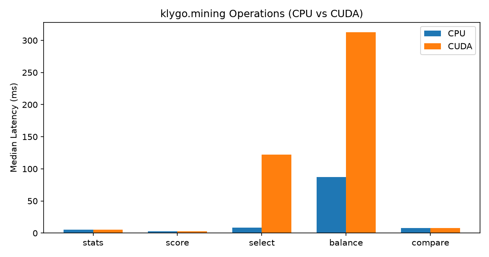

# klygo.mining Speed Benchmark (CPU vs CUDA & COCO val2017 5K)

- **GPU**: `NVIDIA L4` (22563.1 MB VRAM)
- **CUDA / CuPy**: `torch_cuda=True`, `cupy_cuda=True`, `cuda_runtime=13.0`
- **Git**: `` @ `00ba3cf09b3bc9a561ec0fdb58bf10d924bdc620`

## Mining Operations on Detections (CPU vs CUDA)

| scope | device | stats_ms | score_ms | select_ms | balance_ms | compare_ms | status |
| --- | --- | --- | --- | --- | --- | --- | --- |
| detections_200f | cpu | 5.2836 | 2.5123 | 8.3695 | 87.1716 | 8.0009 | passed |
| detections_200f | cuda | 5.3741 | 2.592 | 122.1587 | 312.6423 | 8.1692 | passed |

## Disk-Backed Mining on COCO val2017 (5,000 imgs)

| operation | median_ms | status |
| --- | --- | --- |
| mining.stats_quality (custom:/content/coco_val2017_yolo, 5000 imgs) | 22344.9408 | passed |
| mining.find_duplicates (custom:/content/coco_val2017_yolo, 5000 imgs) | 8611.8675 | passed |
| mining.cluster (custom:/content/coco_val2017_yolo, 5000 imgs, k=8) | 23105.5223 | passed |

## Charts

