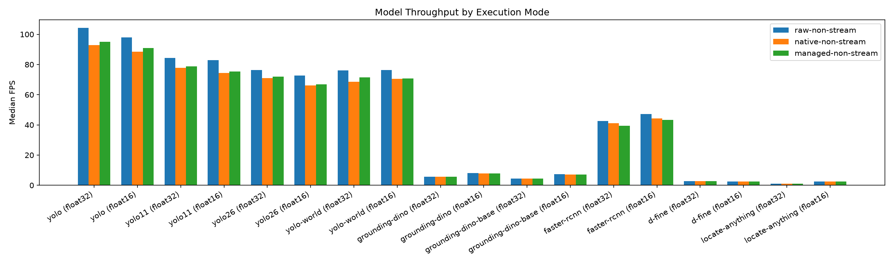
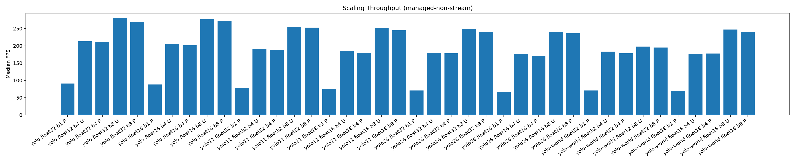

# Klygo Release Benchmark Report

- **GPU**: `NVIDIA L4` (22563.1 MB VRAM)
- **CUDA / CuPy**: `torch_cuda=True`, `cupy_cuda=True`, `cuda_runtime=13.0`
- **Git**: `` @ `a9a18bb7d0befc9c8b4d56ab8708af8962ef5355` (dirty: `yes`)
- **OS / Python**: `Linux-6.6.159+-x86_64-with-glibc2.39` / Python `3.13.16`

## Package Versions

| torch | torchvision | ultralytics | transformers | keras | keras_hub | numpy | cupy | pillow | opencv |
| --- | --- | --- | --- | --- | --- | --- | --- | --- | --- |
| 2.14.1+cu130 | 0.29.1+cu130 | 8.4.214 | 5.22.1 | 3.13.2 | 0.26.0 | 2.4.6 | 14.2.0 | 11.3.0 | 5.0.0.93 |

## Loaders / Preprocessing / Disk Mining

| operation | median_ms | status |
| --- | --- | --- |
| datasets.load (custom:voc2007_val_yolo, 2510 imgs) | 3136.556 | passed |
| media.load_eager (custom:voc2007_val_yolo, 2510 imgs) | 158.6343 | passed |
| media.load_stream (custom:voc2007_val_yolo, 2510 imgs) | 163.0562 | passed |
| preprocessing.compose (custom:voc2007_val_yolo, 32 imgs) | 0.2425 | passed |
| datasets.load_scaled (2510 imgs) | 3065.082 | passed |
| media.load_indexed (2510 imgs) | 93.2839 | passed |
| media.strided_decode (stride=32, 78 imgs) | 274.3223 | passed |
| media.random_jump_array (64/2510 imgs) | 137.3797 | passed |
| media.random_jump_pil (64/2510 imgs) | 129.1266 | passed |
| detections.random_jump_index (64/2510) | 0.0117 | passed |
| detections.random_jump_image_read (64/2510) | 13.9708 | passed |
| media.video_load_indexed (120 frames) | 4.4342 | passed |
| media.video_random_jump_array (32/120) | 976.1081 | passed |
| media.video_random_jump_pil (32/120) | 986.9421 | passed |
| detections.export_yolo (500 imgs) | 852.789 | passed |
| datasets.partition_yolo (500 imgs) | 889.7731 | passed |
| archive.compress_zip (500 imgs) | 654.4041 | passed |
| archive.extract_zip (500 imgs) | 302.2808 | passed |
| files.save_json (2510 frames) | 230.7103 | passed |
| files.load_json (2510 frames) | 46.1741 | passed |
| media.info | 0.1125 | passed |
| media.save_images_letterbox | 50.5194 | passed |
| visual.compare_images | 91.2456 | passed |
| utils.tabulate | 7.5743 | passed |

## 6-Mode Model Run Status

| model | dtype | returncode | status | output_dir | error |
| --- | --- | --- | --- | --- | --- |
| yolo | float32 | 0 | passed | artifacts/benchmarks/colab_l4_voc2007/inference/yolo_float32 |  |
| yolo | float16 | 0 | passed | artifacts/benchmarks/colab_l4_voc2007/inference/yolo_float16 |  |
| yolo11 | float32 | 0 | passed | artifacts/benchmarks/colab_l4_voc2007/inference/yolo11_float32 |  |
| yolo11 | float16 | 0 | passed | artifacts/benchmarks/colab_l4_voc2007/inference/yolo11_float16 |  |
| yolo26 | float32 | 0 | passed | artifacts/benchmarks/colab_l4_voc2007/inference/yolo26_float32 |  |
| yolo26 | float16 | 0 | passed | artifacts/benchmarks/colab_l4_voc2007/inference/yolo26_float16 |  |
| yolo-world | float32 | 0 | passed | artifacts/benchmarks/colab_l4_voc2007/inference/yolo-world_float32 |  |
| yolo-world | float16 | 0 | passed | artifacts/benchmarks/colab_l4_voc2007/inference/yolo-world_float16 |  |
| grounding-dino | float32 | 0 | passed | artifacts/benchmarks/colab_l4_voc2007/inference/grounding-dino_float32 |  |
| grounding-dino | float16 | 0 | passed | artifacts/benchmarks/colab_l4_voc2007/inference/grounding-dino_float16 |  |
| grounding-dino-base | float32 | 0 | passed | artifacts/benchmarks/colab_l4_voc2007/inference/grounding-dino-base_float32 |  |
| grounding-dino-base | float16 | 0 | passed | artifacts/benchmarks/colab_l4_voc2007/inference/grounding-dino-base_float16 |  |
| faster-rcnn | float32 | 0 | passed | artifacts/benchmarks/colab_l4_voc2007/inference/faster-rcnn_float32 |  |
| faster-rcnn | float16 | 0 | passed | artifacts/benchmarks/colab_l4_voc2007/inference/faster-rcnn_float16 |  |
| d-fine | float32 | 0 | passed | artifacts/benchmarks/colab_l4_voc2007/inference/d-fine_float32 |  |
| d-fine | float16 | 0 | passed | artifacts/benchmarks/colab_l4_voc2007/inference/d-fine_float16 |  |
| locate-anything | float32 | 0 | passed | artifacts/benchmarks/colab_l4_voc2007/inference/locate-anything_float32 |  |
| locate-anything | float16 | 0 | passed | artifacts/benchmarks/colab_l4_voc2007/inference/locate-anything_float16 |  |

## 6-Mode Model Inference Details

| model | dtype | actual_dtype | mode | status | fps_median | p50_ms | parity_pass |
| --- | --- | --- | --- | --- | --- | --- | --- |
| yolo | float32 | torch.float32 | raw-non-stream | ok | 104.27 | 9.33 | True |
| yolo | float32 | torch.float32 | raw-stream | ok | 104.97 | 9.56 | True |
| yolo | float32 | torch.float32 | native-non-stream | ok | 92.8 | 10.39 | True |
| yolo | float32 | torch.float32 | native-stream | ok | 94.96 | 10.32 | True |
| yolo | float32 | torch.float32 | managed-non-stream | ok | 95.12 | 10.25 | True |
| yolo | float32 | torch.float32 | managed-stream | ok | 95.05 | 10.15 | True |
| yolo | float16 | torch.float16 | raw-non-stream | ok | 98.06 | 9.93 | True |
| yolo | float16 | torch.float16 | raw-stream | ok | 98.75 | 9.84 | True |
| yolo | float16 | torch.float16 | native-non-stream | ok | 88.39 | 11.07 | True |
| yolo | float16 | torch.float16 | native-stream | ok | 89.57 | 11.9 | True |
| yolo | float16 | torch.float16 | managed-non-stream | ok | 91.02 | 10.9 | True |
| yolo | float16 | torch.float16 | managed-stream | ok | 90.71 | 11.01 | True |
| yolo11 | float32 | torch.float32 | raw-non-stream | ok | 84.37 | 13.01 | True |
| yolo11 | float32 | torch.float32 | raw-stream | ok | 85.81 | 11.52 | True |
| yolo11 | float32 | torch.float32 | native-non-stream | ok | 77.78 | 13.52 | True |
| yolo11 | float32 | torch.float32 | native-stream | ok | 78.0 | 12.55 | True |
| yolo11 | float32 | torch.float32 | managed-non-stream | ok | 78.83 | 13.48 | True |
| yolo11 | float32 | torch.float32 | managed-stream | ok | 78.48 | 12.13 | True |
| yolo11 | float16 | torch.float16 | raw-non-stream | ok | 82.89 | 11.81 | True |
| yolo11 | float16 | torch.float16 | raw-stream | ok | 82.87 | 12.93 | True |
| yolo11 | float16 | torch.float16 | native-non-stream | ok | 74.31 | 13.45 | True |
| yolo11 | float16 | torch.float16 | native-stream | ok | 74.75 | 13.34 | True |
| yolo11 | float16 | torch.float16 | managed-non-stream | ok | 75.35 | 13.19 | True |
| yolo11 | float16 | torch.float16 | managed-stream | ok | 75.22 | 13.13 | True |
| yolo26 | float32 | torch.float32 | raw-non-stream | ok | 76.43 | 12.73 | True |
| yolo26 | float32 | torch.float32 | raw-stream | ok | 76.98 | 13.01 | True |
| yolo26 | float32 | torch.float32 | native-non-stream | ok | 71.05 | 13.75 | True |
| yolo26 | float32 | torch.float32 | native-stream | ok | 71.91 | 13.68 | True |
| yolo26 | float32 | torch.float32 | managed-non-stream | ok | 72.06 | 13.76 | True |
| yolo26 | float32 | torch.float32 | managed-stream | ok | 72.53 | 13.6 | True |
| yolo26 | float16 | torch.float16 | raw-non-stream | ok | 72.76 | 13.94 | True |
| yolo26 | float16 | torch.float16 | raw-stream | ok | 74.18 | 13.45 | True |
| yolo26 | float16 | torch.float16 | native-non-stream | ok | 66.13 | 14.69 | True |
| yolo26 | float16 | torch.float16 | native-stream | ok | 65.11 | 14.96 | True |
| yolo26 | float16 | torch.float16 | managed-non-stream | ok | 66.87 | 14.73 | True |
| yolo26 | float16 | torch.float16 | managed-stream | ok | 67.74 | 14.81 | True |
| yolo-world | float32 | torch.float32 | raw-non-stream | ok | 76.07 | 12.85 | True |
| yolo-world | float32 | torch.float32 | raw-stream | ok | 77.16 | 13.34 | True |
| yolo-world | float32 | torch.float32 | native-non-stream | ok | 68.48 | 13.89 | True |
| yolo-world | float32 | torch.float32 | native-stream | ok | 69.16 | 13.7 | True |
| yolo-world | float32 | torch.float32 | managed-non-stream | ok | 71.36 | 13.48 | True |
| yolo-world | float32 | torch.float32 | managed-stream | ok | 70.99 | 13.77 | True |
| yolo-world | float16 | torch.float16 | raw-non-stream | ok | 76.22 | 13.36 | True |
| yolo-world | float16 | torch.float16 | raw-stream | ok | 76.45 | 12.83 | True |
| yolo-world | float16 | torch.float16 | native-non-stream | ok | 70.58 | 13.88 | True |
| yolo-world | float16 | torch.float16 | native-stream | ok | 69.41 | 14.03 | True |
| yolo-world | float16 | torch.float16 | managed-non-stream | ok | 70.78 | 14.03 | True |
| yolo-world | float16 | torch.float16 | managed-stream | ok | 70.79 | 14.31 | True |
| grounding-dino | float32 | torch.float32 | raw-stream | N/A | None | None | None |
| grounding-dino | float32 | torch.float32 | native-stream | N/A | None | None | None |
| grounding-dino | float32 | torch.float32 | raw-non-stream | ok | 5.59 | 179.74 | True |
| grounding-dino | float32 | torch.float32 | native-non-stream | ok | 5.57 | 180.81 | True |
| grounding-dino | float32 | torch.float32 | managed-non-stream | ok | 5.55 | 179.47 | True |
| grounding-dino | float32 | torch.float32 | managed-stream | ok | 5.56 | 180.74 | True |
| grounding-dino | float16 | torch.float16 | raw-stream | N/A | None | None | None |
| grounding-dino | float16 | torch.float16 | native-stream | N/A | None | None | None |
| grounding-dino | float16 | torch.float16 | raw-non-stream | ok | 7.99 | 124.54 | True |
| grounding-dino | float16 | torch.float16 | native-non-stream | ok | 7.9 | 127.34 | True |
| grounding-dino | float16 | torch.float16 | managed-non-stream | ok | 7.89 | 127.71 | True |
| grounding-dino | float16 | torch.float16 | managed-stream | ok | 7.86 | 127.56 | True |
| grounding-dino-base | float32 | torch.float32 | raw-stream | N/A | None | None | None |
| grounding-dino-base | float32 | torch.float32 | native-stream | N/A | None | None | None |
| grounding-dino-base | float32 | torch.float32 | raw-non-stream | ok | 4.44 | 223.71 | True |
| grounding-dino-base | float32 | torch.float32 | native-non-stream | ok | 4.39 | 226.25 | True |
| grounding-dino-base | float32 | torch.float32 | managed-non-stream | ok | 4.38 | 226.53 | True |
| grounding-dino-base | float32 | torch.float32 | managed-stream | ok | 4.4 | 225.86 | True |
| grounding-dino-base | float16 | torch.float16 | raw-stream | N/A | None | None | None |
| grounding-dino-base | float16 | torch.float16 | native-stream | N/A | None | None | None |
| grounding-dino-base | float16 | torch.float16 | raw-non-stream | ok | 7.27 | 137.39 | True |
| grounding-dino-base | float16 | torch.float16 | native-non-stream | ok | 7.17 | 142.77 | True |
| grounding-dino-base | float16 | torch.float16 | managed-non-stream | ok | 7.18 | 143.68 | True |
| grounding-dino-base | float16 | torch.float16 | managed-stream | ok | 7.16 | 141.04 | True |
| faster-rcnn | float32 | torch.float32 | raw-stream | N/A | None | None | None |
| faster-rcnn | float32 | torch.float32 | native-stream | N/A | None | None | None |
| faster-rcnn | float32 | torch.float32 | raw-non-stream | ok | 42.7 | 23.45 | True |
| faster-rcnn | float32 | torch.float32 | native-non-stream | ok | 41.06 | 24.41 | True |
| faster-rcnn | float32 | torch.float32 | managed-non-stream | ok | 39.41 | 24.97 | True |
| faster-rcnn | float32 | torch.float32 | managed-stream | ok | 39.8 | 25.35 | True |
| faster-rcnn | float16 | torch.float16 | raw-stream | N/A | None | None | None |
| faster-rcnn | float16 | torch.float16 | native-stream | N/A | None | None | None |
| faster-rcnn | float16 | torch.float16 | raw-non-stream | ok | 47.27 | 22.01 | True |
| faster-rcnn | float16 | torch.float16 | native-non-stream | ok | 44.26 | 22.43 | True |
| faster-rcnn | float16 | torch.float16 | managed-non-stream | ok | 43.22 | 22.99 | True |
| faster-rcnn | float16 | torch.float16 | managed-stream | ok | 42.56 | 23.04 | True |
| d-fine | float32 | float32 | raw-stream | N/A | None | None | None |
| d-fine | float32 | float32 | native-stream | N/A | None | None | None |
| d-fine | float32 | float32 | raw-non-stream | ok | 2.7 | 374.23 | True |
| d-fine | float32 | float32 | native-non-stream | ok | 2.68 | 372.02 | True |
| d-fine | float32 | float32 | managed-non-stream | ok | 2.68 | 371.97 | True |
| d-fine | float32 | float32 | managed-stream | ok | 2.69 | 383.68 | True |
| d-fine | float16 | float16 | raw-stream | N/A | None | None | None |
| d-fine | float16 | float16 | native-stream | N/A | None | None | None |
| d-fine | float16 | float16 | raw-non-stream | ok | 2.56 | 389.93 | True |
| d-fine | float16 | float16 | native-non-stream | ok | 2.55 | 390.68 | True |
| d-fine | float16 | float16 | managed-non-stream | ok | 2.54 | 403.13 | True |
| d-fine | float16 | float16 | managed-stream | ok | 2.55 | 391.03 | True |
| locate-anything | float32 | torch.float32 | raw-stream | N/A | None | None | None |
| locate-anything | float32 | torch.float32 | native-stream | N/A | None | None | None |
| locate-anything | float32 | torch.float32 | raw-non-stream | ok | 0.98 | 1021.84 | True |
| locate-anything | float32 | torch.float32 | native-non-stream | ok | 0.98 | 1021.76 | True |
| locate-anything | float32 | torch.float32 | managed-non-stream | ok | 0.98 | 1019.98 | True |
| locate-anything | float32 | torch.float32 | managed-stream | ok | 0.98 | 1020.94 | True |
| locate-anything | float16 | torch.float16 | raw-stream | N/A | None | None | None |
| locate-anything | float16 | torch.float16 | native-stream | N/A | None | None | None |
| locate-anything | float16 | torch.float16 | raw-non-stream | ok | 2.45 | 407.24 | True |
| locate-anything | float16 | torch.float16 | native-non-stream | ok | 2.44 | 409.47 | True |
| locate-anything | float16 | torch.float16 | managed-non-stream | ok | 2.44 | 412.91 | True |
| locate-anything | float16 | torch.float16 | managed-stream | ok | 2.43 | 408.88 | True |

## Batch / Workers / Prefetch / Packed Scaling

| model | dtype | batch | workers | prefetch | packed | mode | fps_median | p50_ms | parity |
| --- | --- | --- | --- | --- | --- | --- | --- | --- | --- |
| yolo | float32 | 1 | 1 | 1 | True | raw-non-stream | 102.98 | 9.48 | True |
| yolo | float32 | 1 | 1 | 1 | True | raw-stream | 103.4 | 9.37 | True |
| yolo | float32 | 1 | 1 | 1 | True | native-non-stream | 90.32 | 10.64 | True |
| yolo | float32 | 1 | 1 | 1 | True | native-stream | 92.38 | 10.54 | True |
| yolo | float32 | 1 | 1 | 1 | True | managed-non-stream | 90.91 | 10.53 | True |
| yolo | float32 | 1 | 1 | 1 | True | managed-stream | 93.53 | 10.19 | True |
| yolo | float32 | 4 | 2 | 2 | False | raw-non-stream | 204.36 | 0.01 | True |
| yolo | float32 | 4 | 2 | 2 | False | raw-stream | 202.0 | 0.02 | True |
| yolo | float32 | 4 | 2 | 2 | False | native-non-stream | 183.01 | 0.01 | True |
| yolo | float32 | 4 | 2 | 2 | False | native-stream | 186.26 | 0.49 | True |
| yolo | float32 | 4 | 2 | 2 | False | managed-non-stream | 213.06 | 0.01 | True |
| yolo | float32 | 4 | 2 | 2 | False | managed-stream | 215.59 | 0.03 | True |
| yolo | float32 | 4 | 2 | 2 | True | raw-non-stream | 204.27 | 0.01 | True |
| yolo | float32 | 4 | 2 | 2 | True | raw-stream | 204.91 | 0.02 | True |
| yolo | float32 | 4 | 2 | 2 | True | native-non-stream | 184.45 | 0.07 | True |
| yolo | float32 | 4 | 2 | 2 | True | native-stream | 188.79 | 0.48 | True |
| yolo | float32 | 4 | 2 | 2 | True | managed-non-stream | 211.54 | 0.08 | True |
| yolo | float32 | 4 | 2 | 2 | True | managed-stream | 215.61 | 0.03 | True |
| yolo | float32 | 8 | 4 | 4 | False | raw-non-stream | 259.15 | 0.01 | True |
| yolo | float32 | 8 | 4 | 4 | False | raw-stream | 260.52 | 0.01 | True |
| yolo | float32 | 8 | 4 | 4 | False | native-non-stream | 238.31 | 0.01 | True |
| yolo | float32 | 8 | 4 | 4 | False | native-stream | 239.77 | 0.47 | True |
| yolo | float32 | 8 | 4 | 4 | False | managed-non-stream | 280.6 | 0.01 | True |
| yolo | float32 | 8 | 4 | 4 | False | managed-stream | 282.34 | 0.03 | True |
| yolo | float32 | 8 | 4 | 4 | True | raw-non-stream | 257.88 | 0.01 | True |
| yolo | float32 | 8 | 4 | 4 | True | raw-stream | 256.05 | 0.01 | True |
| yolo | float32 | 8 | 4 | 4 | True | native-non-stream | 228.74 | 0.06 | True |
| yolo | float32 | 8 | 4 | 4 | True | native-stream | 236.84 | 0.47 | True |
| yolo | float32 | 8 | 4 | 4 | True | managed-non-stream | 269.18 | 0.07 | True |
| yolo | float32 | 8 | 4 | 4 | True | managed-stream | 275.45 | 0.03 | True |
| yolo | float16 | 1 | 1 | 1 | True | raw-non-stream | 97.38 | 9.95 | True |
| yolo | float16 | 1 | 1 | 1 | True | raw-stream | 97.66 | 9.89 | True |
| yolo | float16 | 1 | 1 | 1 | True | native-non-stream | 86.86 | 11.52 | True |
| yolo | float16 | 1 | 1 | 1 | True | native-stream | 89.83 | 10.95 | True |
| yolo | float16 | 1 | 1 | 1 | True | managed-non-stream | 88.37 | 11.2 | True |
| yolo | float16 | 1 | 1 | 1 | True | managed-stream | 89.4 | 10.99 | True |
| yolo | float16 | 4 | 2 | 2 | False | raw-non-stream | 195.53 | 0.01 | True |
| yolo | float16 | 4 | 2 | 2 | False | raw-stream | 196.82 | 0.02 | True |
| yolo | float16 | 4 | 2 | 2 | False | native-non-stream | 179.75 | 0.01 | True |
| yolo | float16 | 4 | 2 | 2 | False | native-stream | 178.87 | 0.49 | True |
| yolo | float16 | 4 | 2 | 2 | False | managed-non-stream | 205.02 | 0.01 | True |
| yolo | float16 | 4 | 2 | 2 | False | managed-stream | 207.57 | 0.03 | True |
| yolo | float16 | 4 | 2 | 2 | True | raw-non-stream | 198.88 | 0.01 | True |
| yolo | float16 | 4 | 2 | 2 | True | raw-stream | 199.51 | 0.02 | True |
| yolo | float16 | 4 | 2 | 2 | True | native-non-stream | 179.04 | 0.07 | True |
| yolo | float16 | 4 | 2 | 2 | True | native-stream | 180.48 | 0.48 | True |
| yolo | float16 | 4 | 2 | 2 | True | managed-non-stream | 201.54 | 0.08 | True |
| yolo | float16 | 4 | 2 | 2 | True | managed-stream | 213.43 | 0.03 | True |
| yolo | float16 | 8 | 4 | 4 | False | raw-non-stream | 251.89 | 0.01 | True |
| yolo | float16 | 8 | 4 | 4 | False | raw-stream | 257.23 | 0.01 | True |
| yolo | float16 | 8 | 4 | 4 | False | native-non-stream | 237.13 | 0.01 | True |
| yolo | float16 | 8 | 4 | 4 | False | native-stream | 235.46 | 0.46 | True |
| yolo | float16 | 8 | 4 | 4 | False | managed-non-stream | 276.77 | 0.01 | True |
| yolo | float16 | 8 | 4 | 4 | False | managed-stream | 278.89 | 0.03 | True |
| yolo | float16 | 8 | 4 | 4 | True | raw-non-stream | 257.26 | 0.01 | True |
| yolo | float16 | 8 | 4 | 4 | True | raw-stream | 254.09 | 0.01 | True |
| yolo | float16 | 8 | 4 | 4 | True | native-non-stream | 232.21 | 0.06 | True |
| yolo | float16 | 8 | 4 | 4 | True | native-stream | 241.66 | 0.47 | True |
| yolo | float16 | 8 | 4 | 4 | True | managed-non-stream | 271.21 | 0.06 | True |
| yolo | float16 | 8 | 4 | 4 | True | managed-stream | 278.38 | 0.03 | True |
| yolo11 | float32 | 1 | 1 | 1 | True | raw-non-stream | 86.78 | 10.94 | True |
| yolo11 | float32 | 1 | 1 | 1 | True | raw-stream | 86.75 | 11.37 | True |
| yolo11 | float32 | 1 | 1 | 1 | True | native-non-stream | 77.2 | 12.41 | True |
| yolo11 | float32 | 1 | 1 | 1 | True | native-stream | 79.41 | 12.23 | True |
| yolo11 | float32 | 1 | 1 | 1 | True | managed-non-stream | 78.21 | 12.69 | True |
| yolo11 | float32 | 1 | 1 | 1 | True | managed-stream | 80.05 | 12.44 | True |
| yolo11 | float32 | 4 | 2 | 2 | False | raw-non-stream | 184.32 | 0.01 | True |
| yolo11 | float32 | 4 | 2 | 2 | False | raw-stream | 182.59 | 0.02 | True |
| yolo11 | float32 | 4 | 2 | 2 | False | native-non-stream | 167.19 | 0.01 | True |
| yolo11 | float32 | 4 | 2 | 2 | False | native-stream | 169.46 | 0.48 | True |
| yolo11 | float32 | 4 | 2 | 2 | False | managed-non-stream | 191.03 | 0.01 | True |
| yolo11 | float32 | 4 | 2 | 2 | False | managed-stream | 193.99 | 0.03 | True |
| yolo11 | float32 | 4 | 2 | 2 | True | raw-non-stream | 182.04 | 0.01 | True |
| yolo11 | float32 | 4 | 2 | 2 | True | raw-stream | 181.22 | 0.02 | True |
| yolo11 | float32 | 4 | 2 | 2 | True | native-non-stream | 164.88 | 0.08 | True |
| yolo11 | float32 | 4 | 2 | 2 | True | native-stream | 168.66 | 0.48 | True |
| yolo11 | float32 | 4 | 2 | 2 | True | managed-non-stream | 187.41 | 0.08 | True |
| yolo11 | float32 | 4 | 2 | 2 | True | managed-stream | 194.68 | 0.03 | True |
| yolo11 | float32 | 8 | 4 | 4 | False | raw-non-stream | 242.85 | 0.01 | True |
| yolo11 | float32 | 8 | 4 | 4 | False | raw-stream | 241.63 | 0.01 | True |
| yolo11 | float32 | 8 | 4 | 4 | False | native-non-stream | 223.99 | 0.01 | True |
| yolo11 | float32 | 8 | 4 | 4 | False | native-stream | 222.77 | 0.47 | True |
| yolo11 | float32 | 8 | 4 | 4 | False | managed-non-stream | 255.68 | 0.01 | True |
| yolo11 | float32 | 8 | 4 | 4 | False | managed-stream | 263.48 | 0.03 | True |
| yolo11 | float32 | 8 | 4 | 4 | True | raw-non-stream | 242.16 | 0.01 | True |
| yolo11 | float32 | 8 | 4 | 4 | True | raw-stream | 242.82 | 0.01 | True |
| yolo11 | float32 | 8 | 4 | 4 | True | native-non-stream | 217.95 | 0.06 | True |
| yolo11 | float32 | 8 | 4 | 4 | True | native-stream | 220.59 | 0.46 | True |
| yolo11 | float32 | 8 | 4 | 4 | True | managed-non-stream | 252.7 | 0.07 | True |
| yolo11 | float32 | 8 | 4 | 4 | True | managed-stream | 264.44 | 0.03 | True |
| yolo11 | float16 | 1 | 1 | 1 | True | raw-non-stream | 85.5 | 11.56 | True |
| yolo11 | float16 | 1 | 1 | 1 | True | raw-stream | 85.56 | 11.49 | True |
| yolo11 | float16 | 1 | 1 | 1 | True | native-non-stream | 75.47 | 13.6 | True |
| yolo11 | float16 | 1 | 1 | 1 | True | native-stream | 76.53 | 12.82 | True |
| yolo11 | float16 | 1 | 1 | 1 | True | managed-non-stream | 75.84 | 13.36 | True |
| yolo11 | float16 | 1 | 1 | 1 | True | managed-stream | 77.04 | 13.02 | True |
| yolo11 | float16 | 4 | 2 | 2 | False | raw-non-stream | 196.63 | 0.01 | True |
| yolo11 | float16 | 4 | 2 | 2 | False | raw-stream | 195.51 | 0.02 | True |
| yolo11 | float16 | 4 | 2 | 2 | False | native-non-stream | 182.39 | 0.01 | True |
| yolo11 | float16 | 4 | 2 | 2 | False | native-stream | 184.11 | 0.49 | True |
| yolo11 | float16 | 4 | 2 | 2 | False | managed-non-stream | 185.45 | 0.01 | True |
| yolo11 | float16 | 4 | 2 | 2 | False | managed-stream | 183.24 | 0.04 | True |
| yolo11 | float16 | 4 | 2 | 2 | True | raw-non-stream | 193.7 | 0.01 | True |
| yolo11 | float16 | 4 | 2 | 2 | True | raw-stream | 194.52 | 0.02 | True |
| yolo11 | float16 | 4 | 2 | 2 | True | native-non-stream | 176.02 | 0.08 | True |
| yolo11 | float16 | 4 | 2 | 2 | True | native-stream | 180.7 | 0.49 | True |
| yolo11 | float16 | 4 | 2 | 2 | True | managed-non-stream | 179.09 | 0.08 | True |
| yolo11 | float16 | 4 | 2 | 2 | True | managed-stream | 184.28 | 0.04 | True |
| yolo11 | float16 | 8 | 4 | 4 | False | raw-non-stream | 234.9 | 0.01 | True |
| yolo11 | float16 | 8 | 4 | 4 | False | raw-stream | 233.99 | 0.01 | True |
| yolo11 | float16 | 8 | 4 | 4 | False | native-non-stream | 217.25 | 0.01 | True |
| yolo11 | float16 | 8 | 4 | 4 | False | native-stream | 216.17 | 0.47 | True |
| yolo11 | float16 | 8 | 4 | 4 | False | managed-non-stream | 251.72 | 0.01 | True |
| yolo11 | float16 | 8 | 4 | 4 | False | managed-stream | 252.34 | 0.03 | True |
| yolo11 | float16 | 8 | 4 | 4 | True | raw-non-stream | 233.87 | 0.01 | True |
| yolo11 | float16 | 8 | 4 | 4 | True | raw-stream | 233.13 | 0.01 | True |
| yolo11 | float16 | 8 | 4 | 4 | True | native-non-stream | 209.49 | 0.06 | True |
| yolo11 | float16 | 8 | 4 | 4 | True | native-stream | 216.4 | 0.46 | True |
| yolo11 | float16 | 8 | 4 | 4 | True | managed-non-stream | 244.98 | 0.07 | True |
| yolo11 | float16 | 8 | 4 | 4 | True | managed-stream | 252.55 | 0.03 | True |
| yolo26 | float32 | 1 | 1 | 1 | True | raw-non-stream | 77.49 | 12.58 | True |
| yolo26 | float32 | 1 | 1 | 1 | True | raw-stream | 78.74 | 12.78 | True |
| yolo26 | float32 | 1 | 1 | 1 | True | native-non-stream | 70.96 | 14.13 | True |
| yolo26 | float32 | 1 | 1 | 1 | True | native-stream | 72.11 | 14.03 | True |
| yolo26 | float32 | 1 | 1 | 1 | True | managed-non-stream | 70.8 | 14.33 | True |
| yolo26 | float32 | 1 | 1 | 1 | True | managed-stream | 72.34 | 14.46 | True |
| yolo26 | float32 | 4 | 2 | 2 | False | raw-non-stream | 174.39 | 0.01 | True |
| yolo26 | float32 | 4 | 2 | 2 | False | raw-stream | 172.37 | 0.02 | True |
| yolo26 | float32 | 4 | 2 | 2 | False | native-non-stream | 159.73 | 0.01 | True |
| yolo26 | float32 | 4 | 2 | 2 | False | native-stream | 161.36 | 0.5 | True |
| yolo26 | float32 | 4 | 2 | 2 | False | managed-non-stream | 179.51 | 0.01 | True |
| yolo26 | float32 | 4 | 2 | 2 | False | managed-stream | 182.5 | 0.03 | True |
| yolo26 | float32 | 4 | 2 | 2 | True | raw-non-stream | 173.4 | 0.01 | True |
| yolo26 | float32 | 4 | 2 | 2 | True | raw-stream | 173.91 | 0.02 | True |
| yolo26 | float32 | 4 | 2 | 2 | True | native-non-stream | 157.76 | 0.08 | True |
| yolo26 | float32 | 4 | 2 | 2 | True | native-stream | 164.74 | 0.5 | True |
| yolo26 | float32 | 4 | 2 | 2 | True | managed-non-stream | 178.2 | 0.08 | True |
| yolo26 | float32 | 4 | 2 | 2 | True | managed-stream | 180.21 | 0.03 | True |
| yolo26 | float32 | 8 | 4 | 4 | False | raw-non-stream | 229.15 | 0.01 | True |
| yolo26 | float32 | 8 | 4 | 4 | False | raw-stream | 232.12 | 0.01 | True |
| yolo26 | float32 | 8 | 4 | 4 | False | native-non-stream | 216.59 | 0.01 | True |
| yolo26 | float32 | 8 | 4 | 4 | False | native-stream | 217.29 | 0.48 | True |
| yolo26 | float32 | 8 | 4 | 4 | False | managed-non-stream | 248.3 | 0.01 | True |
| yolo26 | float32 | 8 | 4 | 4 | False | managed-stream | 251.02 | 0.03 | True |
| yolo26 | float32 | 8 | 4 | 4 | True | raw-non-stream | 231.39 | 0.01 | True |
| yolo26 | float32 | 8 | 4 | 4 | True | raw-stream | 228.4 | 0.01 | True |
| yolo26 | float32 | 8 | 4 | 4 | True | native-non-stream | 207.37 | 0.06 | True |
| yolo26 | float32 | 8 | 4 | 4 | True | native-stream | 215.09 | 0.46 | True |
| yolo26 | float32 | 8 | 4 | 4 | True | managed-non-stream | 239.5 | 0.07 | True |
| yolo26 | float32 | 8 | 4 | 4 | True | managed-stream | 248.16 | 0.03 | True |
| yolo26 | float16 | 1 | 1 | 1 | True | raw-non-stream | 73.96 | 13.14 | True |
| yolo26 | float16 | 1 | 1 | 1 | True | raw-stream | 74.47 | 13.56 | True |
| yolo26 | float16 | 1 | 1 | 1 | True | native-non-stream | 67.49 | 14.67 | True |
| yolo26 | float16 | 1 | 1 | 1 | True | native-stream | 68.12 | 14.54 | True |
| yolo26 | float16 | 1 | 1 | 1 | True | managed-non-stream | 67.57 | 14.68 | True |
| yolo26 | float16 | 1 | 1 | 1 | True | managed-stream | 68.36 | 14.64 | True |
| yolo26 | float16 | 4 | 2 | 2 | False | raw-non-stream | 183.81 | 0.01 | True |
| yolo26 | float16 | 4 | 2 | 2 | False | raw-stream | 183.79 | 0.02 | True |
| yolo26 | float16 | 4 | 2 | 2 | False | native-non-stream | 172.96 | 0.01 | True |
| yolo26 | float16 | 4 | 2 | 2 | False | native-stream | 173.13 | 0.49 | True |
| yolo26 | float16 | 4 | 2 | 2 | False | managed-non-stream | 176.58 | 0.01 | True |
| yolo26 | float16 | 4 | 2 | 2 | False | managed-stream | 176.63 | 0.03 | True |
| yolo26 | float16 | 4 | 2 | 2 | True | raw-non-stream | 179.25 | 0.01 | True |
| yolo26 | float16 | 4 | 2 | 2 | True | raw-stream | 182.26 | 0.02 | True |
| yolo26 | float16 | 4 | 2 | 2 | True | native-non-stream | 164.47 | 0.07 | True |
| yolo26 | float16 | 4 | 2 | 2 | True | native-stream | 170.98 | 0.47 | True |
| yolo26 | float16 | 4 | 2 | 2 | True | managed-non-stream | 170.02 | 0.08 | True |
| yolo26 | float16 | 4 | 2 | 2 | True | managed-stream | 174.59 | 0.03 | True |
| yolo26 | float16 | 8 | 4 | 4 | False | raw-non-stream | 229.25 | 0.01 | True |
| yolo26 | float16 | 8 | 4 | 4 | False | raw-stream | 230.26 | 0.01 | True |
| yolo26 | float16 | 8 | 4 | 4 | False | native-non-stream | 208.95 | 0.01 | True |
| yolo26 | float16 | 8 | 4 | 4 | False | native-stream | 211.71 | 0.47 | True |
| yolo26 | float16 | 8 | 4 | 4 | False | managed-non-stream | 239.77 | 0.01 | True |
| yolo26 | float16 | 8 | 4 | 4 | False | managed-stream | 243.39 | 0.03 | True |
| yolo26 | float16 | 8 | 4 | 4 | True | raw-non-stream | 225.53 | 0.01 | True |
| yolo26 | float16 | 8 | 4 | 4 | True | raw-stream | 224.81 | 0.01 | True |
| yolo26 | float16 | 8 | 4 | 4 | True | native-non-stream | 206.91 | 0.07 | True |
| yolo26 | float16 | 8 | 4 | 4 | True | native-stream | 208.35 | 0.47 | True |
| yolo26 | float16 | 8 | 4 | 4 | True | managed-non-stream | 236.05 | 0.06 | True |
| yolo26 | float16 | 8 | 4 | 4 | True | managed-stream | 244.1 | 0.03 | True |
| yolo-world | float32 | 1 | 1 | 1 | True | raw-non-stream | 77.96 | 12.57 | True |
| yolo-world | float32 | 1 | 1 | 1 | True | raw-stream | 77.58 | 12.63 | True |
| yolo-world | float32 | 1 | 1 | 1 | True | native-non-stream | 70.3 | 13.86 | True |
| yolo-world | float32 | 1 | 1 | 1 | True | native-stream | 70.23 | 13.75 | True |
| yolo-world | float32 | 1 | 1 | 1 | True | managed-non-stream | 70.65 | 14.41 | True |
| yolo-world | float32 | 1 | 1 | 1 | True | managed-stream | 71.53 | 13.74 | True |
| yolo-world | float32 | 4 | 2 | 2 | False | raw-non-stream | 186.96 | 0.01 | True |
| yolo-world | float32 | 4 | 2 | 2 | False | raw-stream | 189.15 | 0.02 | True |
| yolo-world | float32 | 4 | 2 | 2 | False | native-non-stream | 180.29 | 0.01 | True |
| yolo-world | float32 | 4 | 2 | 2 | False | native-stream | 181.06 | 0.43 | True |
| yolo-world | float32 | 4 | 2 | 2 | False | managed-non-stream | 183.12 | 0.01 | True |
| yolo-world | float32 | 4 | 2 | 2 | False | managed-stream | 181.58 | 0.03 | True |
| yolo-world | float32 | 4 | 2 | 2 | True | raw-non-stream | 189.46 | 0.01 | True |
| yolo-world | float32 | 4 | 2 | 2 | True | raw-stream | 189.48 | 0.02 | True |
| yolo-world | float32 | 4 | 2 | 2 | True | native-non-stream | 176.04 | 0.08 | True |
| yolo-world | float32 | 4 | 2 | 2 | True | native-stream | 182.25 | 0.43 | True |
| yolo-world | float32 | 4 | 2 | 2 | True | managed-non-stream | 178.34 | 0.08 | True |
| yolo-world | float32 | 4 | 2 | 2 | True | managed-stream | 181.72 | 0.03 | True |
| yolo-world | float32 | 8 | 4 | 4 | False | raw-non-stream | 205.99 | 0.01 | True |
| yolo-world | float32 | 8 | 4 | 4 | False | raw-stream | 205.6 | 0.01 | True |
| yolo-world | float32 | 8 | 4 | 4 | False | native-non-stream | 181.32 | 0.01 | True |
| yolo-world | float32 | 8 | 4 | 4 | False | native-stream | 180.9 | 0.42 | True |
| yolo-world | float32 | 8 | 4 | 4 | False | managed-non-stream | 197.8 | 0.01 | True |
| yolo-world | float32 | 8 | 4 | 4 | False | managed-stream | 197.17 | 0.03 | True |
| yolo-world | float32 | 8 | 4 | 4 | True | raw-non-stream | 206.39 | 0.01 | True |
| yolo-world | float32 | 8 | 4 | 4 | True | raw-stream | 206.9 | 0.01 | True |
| yolo-world | float32 | 8 | 4 | 4 | True | native-non-stream | 181.75 | 0.07 | True |
| yolo-world | float32 | 8 | 4 | 4 | True | native-stream | 181.87 | 0.42 | True |
| yolo-world | float32 | 8 | 4 | 4 | True | managed-non-stream | 195.03 | 0.07 | True |
| yolo-world | float32 | 8 | 4 | 4 | True | managed-stream | 198.71 | 0.03 | True |
| yolo-world | float16 | 1 | 1 | 1 | True | raw-non-stream | 75.77 | 13.18 | True |
| yolo-world | float16 | 1 | 1 | 1 | True | raw-stream | 74.95 | 12.97 | True |
| yolo-world | float16 | 1 | 1 | 1 | True | native-non-stream | 68.77 | 14.33 | True |
| yolo-world | float16 | 1 | 1 | 1 | True | native-stream | 69.5 | 14.08 | True |
| yolo-world | float16 | 1 | 1 | 1 | True | managed-non-stream | 69.37 | 14.1 | True |
| yolo-world | float16 | 1 | 1 | 1 | True | managed-stream | 69.83 | 14.1 | True |
| yolo-world | float16 | 4 | 2 | 2 | False | raw-non-stream | 180.81 | 0.01 | True |
| yolo-world | float16 | 4 | 2 | 2 | False | raw-stream | 182.22 | 0.02 | True |
| yolo-world | float16 | 4 | 2 | 2 | False | native-non-stream | 173.52 | 0.01 | True |
| yolo-world | float16 | 4 | 2 | 2 | False | native-stream | 176.61 | 0.44 | True |
| yolo-world | float16 | 4 | 2 | 2 | False | managed-non-stream | 176.62 | 0.01 | True |
| yolo-world | float16 | 4 | 2 | 2 | False | managed-stream | 177.64 | 0.03 | True |
| yolo-world | float16 | 4 | 2 | 2 | True | raw-non-stream | 186.19 | 0.01 | True |
| yolo-world | float16 | 4 | 2 | 2 | True | raw-stream | 187.64 | 0.02 | True |
| yolo-world | float16 | 4 | 2 | 2 | True | native-non-stream | 175.9 | 0.08 | True |
| yolo-world | float16 | 4 | 2 | 2 | True | native-stream | 179.66 | 0.43 | True |
| yolo-world | float16 | 4 | 2 | 2 | True | managed-non-stream | 177.64 | 0.08 | True |
| yolo-world | float16 | 4 | 2 | 2 | True | managed-stream | 184.17 | 0.03 | True |
| yolo-world | float16 | 8 | 4 | 4 | False | raw-non-stream | 260.23 | 0.01 | True |
| yolo-world | float16 | 8 | 4 | 4 | False | raw-stream | 260.56 | 0.01 | True |
| yolo-world | float16 | 8 | 4 | 4 | False | native-non-stream | 222.93 | 0.01 | True |
| yolo-world | float16 | 8 | 4 | 4 | False | native-stream | 222.42 | 0.43 | True |
| yolo-world | float16 | 8 | 4 | 4 | False | managed-non-stream | 247.17 | 0.01 | True |
| yolo-world | float16 | 8 | 4 | 4 | False | managed-stream | 246.53 | 0.02 | True |
| yolo-world | float16 | 8 | 4 | 4 | True | raw-non-stream | 257.08 | 0.01 | True |
| yolo-world | float16 | 8 | 4 | 4 | True | raw-stream | 260.81 | 0.01 | True |
| yolo-world | float16 | 8 | 4 | 4 | True | native-non-stream | 220.78 | 0.07 | True |
| yolo-world | float16 | 8 | 4 | 4 | True | native-stream | 225.09 | 0.41 | True |
| yolo-world | float16 | 8 | 4 | 4 | True | managed-non-stream | 239.36 | 0.07 | True |
| yolo-world | float16 | 8 | 4 | 4 | True | managed-stream | 246.52 | 0.02 | True |

## Charts

### Model FPS by Execution Mode

### Batch / Packed Scaling FPS

