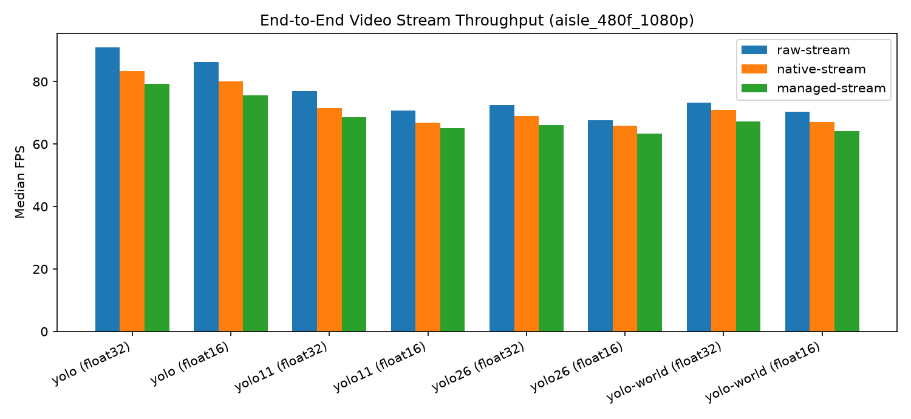
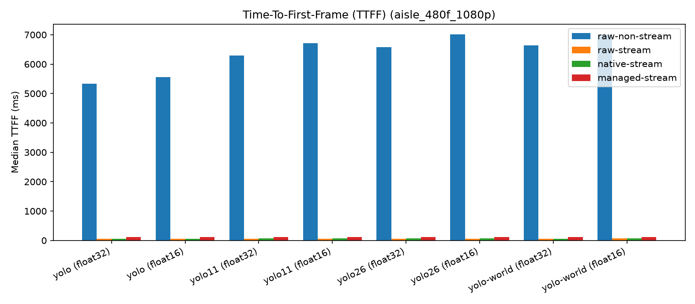

# Klygo Video Streaming Benchmark Report (aisle_480f_1080p)

- **GPU**: `NVIDIA L4` (22563.1 MB VRAM)
- **Video Tier**: `aisle_480f_1080p` (`1920x1080`, `480` H.264 frames, `repeats=3`)
- **Git**: `detection-evaluation` @ `6ab983356223eef08fc9c2fd93b980a58d3ad033`

## models.load Cold-Load Latency

| model | dtype | actual_dtype | load_seconds |
| --- | --- | --- | --- |
| yolo | float32 | torch.float32 | 0.107 |
| yolo | float16 | torch.float16 | 0.1036 |
| yolo11 | float32 | torch.float32 | 0.1164 |
| yolo11 | float16 | torch.float16 | 0.1155 |
| yolo26 | float32 | torch.float32 | 0.136 |
| yolo26 | float16 | torch.float16 | 0.1327 |
| yolo-world | float32 | torch.float32 | 5.9594 |
| yolo-world | float16 | torch.float16 | 5.975 |

## 6-Mode Video Run Status

| model | dtype | returncode | status | output_dir | error |
| --- | --- | --- | --- | --- | --- |
| yolo | float32 | 0 | passed | /content/klygo/artifacts/benchmarks/video/aisle_480f_1080p/inference/yolo_float32 |  |
| yolo | float16 | 0 | passed | /content/klygo/artifacts/benchmarks/video/aisle_480f_1080p/inference/yolo_float16 |  |
| yolo11 | float32 | 0 | passed | /content/klygo/artifacts/benchmarks/video/aisle_480f_1080p/inference/yolo11_float32 |  |
| yolo11 | float16 | 0 | passed | /content/klygo/artifacts/benchmarks/video/aisle_480f_1080p/inference/yolo11_float16 |  |
| yolo26 | float32 | 0 | passed | /content/klygo/artifacts/benchmarks/video/aisle_480f_1080p/inference/yolo26_float32 |  |
| yolo26 | float16 | 0 | passed | /content/klygo/artifacts/benchmarks/video/aisle_480f_1080p/inference/yolo26_float16 |  |
| yolo-world | float32 | 0 | passed | /content/klygo/artifacts/benchmarks/video/aisle_480f_1080p/inference/yolo-world_float32 |  |
| yolo-world | float16 | 0 | passed | /content/klygo/artifacts/benchmarks/video/aisle_480f_1080p/inference/yolo-world_float16 |  |

## 6-Mode End-to-End Video Streaming Details

| model | dtype | actual_dtype | mode | status | fps_median | ttff_ms | p50_ms | p95_ms | p99_ms | parity_pass |
| --- | --- | --- | --- | --- | --- | --- | --- | --- | --- | --- |
| yolo | float32 | torch.float32 | raw-non-stream | ok | 90 | 5333.23 | 0.01 | 0.01 | 0.01 | True |
| yolo | float32 | torch.float32 | raw-stream | ok | 91 | 59.56 | 10.79 | 12.79 | 13.15 | True |
| yolo | float32 | torch.float32 | native-non-stream | ok | 86.25 | 5564.91 | 0.01 | 0.01 | 0.02 | True |
| yolo | float32 | torch.float32 | native-stream | ok | 83.37 | 60.94 | 11.78 | 12.54 | 13.84 | True |
| yolo | float32 | torch.float32 | managed-non-stream | ok | 80.42 | 5968.75 | 0.01 | 0.01 | 0.01 | True |
| yolo | float32 | torch.float32 | managed-stream | ok | 79.28 | 111.37 | 12.29 | 14.08 | 14.49 | True |
| yolo | float16 | torch.float16 | raw-non-stream | ok | 86.36 | 5557.62 | 0.01 | 0.01 | 0.01 | True |
| yolo | float16 | torch.float16 | raw-stream | ok | 86.22 | 60.16 | 11.25 | 13.61 | 14.02 | True |
| yolo | float16 | torch.float16 | native-non-stream | ok | 81.06 | 5921.24 | 0.01 | 0.01 | 0.01 | True |
| yolo | float16 | torch.float16 | native-stream | ok | 80.04 | 62.44 | 12.18 | 12.86 | 14.24 | True |
| yolo | float16 | torch.float16 | managed-non-stream | ok | 77.56 | 6188.84 | 0.01 | 0.01 | 0.01 | True |
| yolo | float16 | torch.float16 | managed-stream | ok | 75.7 | 110.28 | 12.85 | 14.57 | 15.28 | True |
| yolo11 | float32 | torch.float32 | raw-non-stream | ok | 76.25 | 6294.68 | 0.01 | 0.01 | 0.02 | True |
| yolo11 | float32 | torch.float32 | raw-stream | ok | 76.89 | 61.66 | 12.83 | 14.92 | 15.38 | True |
| yolo11 | float32 | torch.float32 | native-non-stream | ok | 71.67 | 6696.67 | 0.01 | 0.01 | 0.01 | True |
| yolo11 | float32 | torch.float32 | native-stream | ok | 71.45 | 64.31 | 13.82 | 15.97 | 16.35 | True |
| yolo11 | float32 | torch.float32 | managed-non-stream | ok | 69.23 | 6933.66 | 0.01 | 0.01 | 0.02 | True |
| yolo11 | float32 | torch.float32 | managed-stream | ok | 68.69 | 110.87 | 14.22 | 14.91 | 16.44 | True |
| yolo11 | float16 | torch.float16 | raw-non-stream | ok | 71.47 | 6716.27 | 0.01 | 0.01 | 0.01 | True |
| yolo11 | float16 | torch.float16 | raw-stream | ok | 70.73 | 63.47 | 13.66 | 15.67 | 16.4 | True |
| yolo11 | float16 | torch.float16 | native-non-stream | ok | 68.4 | 7017.1 | 0.01 | 0.01 | 0.01 | True |
| yolo11 | float16 | torch.float16 | native-stream | ok | 66.93 | 65.27 | 14.65 | 16.74 | 17.68 | True |
| yolo11 | float16 | torch.float16 | managed-non-stream | ok | 64.87 | 7398.97 | 0.01 | 0.01 | 0.01 | True |
| yolo11 | float16 | torch.float16 | managed-stream | ok | 65.18 | 110.97 | 15 | 16.89 | 17.21 | True |
| yolo26 | float32 | torch.float32 | raw-non-stream | ok | 72.94 | 6580.68 | 0.01 | 0.01 | 0.02 | True |
| yolo26 | float32 | torch.float32 | raw-stream | ok | 72.43 | 62.45 | 13.51 | 15.77 | 16.67 | True |
| yolo26 | float32 | torch.float32 | native-non-stream | ok | 70.12 | 6845.42 | 0.01 | 0.01 | 0.01 | True |
| yolo26 | float32 | torch.float32 | native-stream | ok | 68.92 | 64.34 | 13.98 | 15.96 | 16.85 | True |
| yolo26 | float32 | torch.float32 | managed-non-stream | ok | 67.88 | 7071.19 | 0.01 | 0.01 | 0.01 | True |
| yolo26 | float32 | torch.float32 | managed-stream | ok | 66.01 | 112.95 | 14.65 | 16.51 | 17.81 | True |
| yolo26 | float16 | torch.float16 | raw-non-stream | ok | 68.43 | 7014.45 | 0.01 | 0.01 | 0.01 | True |
| yolo26 | float16 | torch.float16 | raw-stream | ok | 67.73 | 63.06 | 14.39 | 16.67 | 17.23 | True |
| yolo26 | float16 | torch.float16 | native-non-stream | ok | 66.42 | 7226.27 | 0.01 | 0.01 | 0.01 | True |
| yolo26 | float16 | torch.float16 | native-stream | ok | 65.89 | 65.27 | 14.89 | 16.34 | 17.41 | True |
| yolo26 | float16 | torch.float16 | managed-non-stream | ok | 63.87 | 7515.44 | 0.01 | 0.01 | 0.01 | True |
| yolo26 | float16 | torch.float16 | managed-stream | ok | 63.29 | 114.62 | 15.27 | 17.44 | 18.28 | True |
| yolo-world | float32 | torch.float32 | raw-non-stream | ok | 72.38 | 6631.03 | 0.01 | 0.02 | 0.03 | True |
| yolo-world | float32 | torch.float32 | raw-stream | ok | 73.32 | 62.96 | 13.28 | 15.99 | 17.02 | True |
| yolo-world | float32 | torch.float32 | native-non-stream | ok | 70.58 | 6800.73 | 0.01 | 0.01 | 0.01 | True |
| yolo-world | float32 | torch.float32 | native-stream | ok | 70.89 | 63.7 | 14.15 | 16.93 | 17.76 | True |
| yolo-world | float32 | torch.float32 | managed-non-stream | ok | 67.89 | 7069.78 | 0.01 | 0.01 | 0.01 | True |
| yolo-world | float32 | torch.float32 | managed-stream | ok | 67.18 | 111.7 | 14.46 | 16.14 | 17.1 | True |
| yolo-world | float16 | torch.float16 | raw-non-stream | ok | 68.62 | 6994.43 | 0.01 | 0.01 | 0.02 | True |
| yolo-world | float16 | torch.float16 | raw-stream | ok | 70.34 | 65.28 | 13.87 | 15.67 | 16.79 | True |
| yolo-world | float16 | torch.float16 | native-non-stream | ok | 69.41 | 6915.19 | 0.01 | 0.01 | 0.01 | True |
| yolo-world | float16 | torch.float16 | native-stream | ok | 67.01 | 65.67 | 14.44 | 16.23 | 17.17 | True |
| yolo-world | float16 | torch.float16 | managed-non-stream | ok | 64.84 | 7402.72 | 0.01 | 0.01 | 0.04 | True |
| yolo-world | float16 | torch.float16 | managed-stream | ok | 64.11 | 112.74 | 14.91 | 17.73 | 18.76 | True |

## Charts

### Video Stream FPS by Mode

### Video Time-To-First-Frame (TTFF ms)

