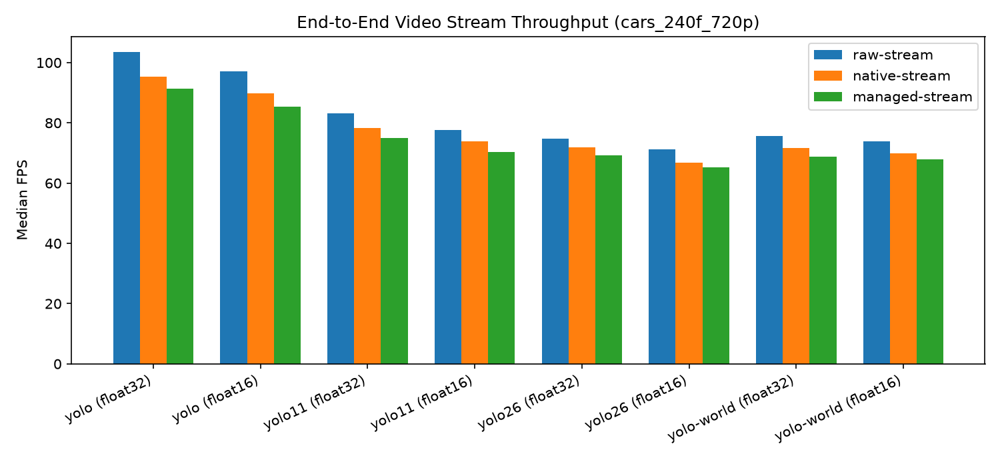
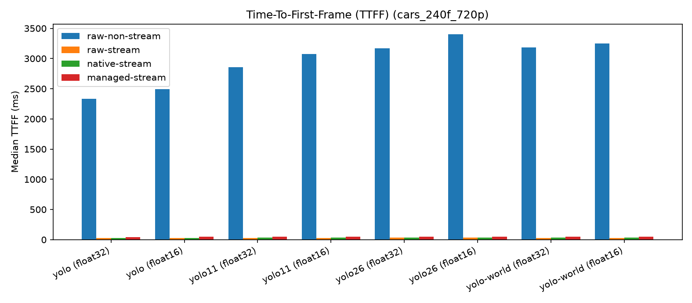

# Klygo Video Streaming Benchmark Report (cars_240f_720p)

- **GPU**: `NVIDIA L4` (22563.1 MB VRAM)
- **Video Tier**: `cars_240f_720p` (`1280x720`, `240` H.264 frames, `repeats=5`)
- **Git**: `detection-evaluation` @ `6ab983356223eef08fc9c2fd93b980a58d3ad033`

## models.load Cold-Load Latency

| model | dtype | actual_dtype | load_seconds |
| --- | --- | --- | --- |
| yolo | float32 | torch.float32 | 0.1043 |
| yolo | float16 | torch.float16 | 0.1061 |
| yolo11 | float32 | torch.float32 | 0.1172 |
| yolo11 | float16 | torch.float16 | 0.121 |
| yolo26 | float32 | torch.float32 | 0.1337 |
| yolo26 | float16 | torch.float16 | 0.1321 |
| yolo-world | float32 | torch.float32 | 5.9547 |
| yolo-world | float16 | torch.float16 | 5.9435 |

## 6-Mode Video Run Status

| model | dtype | returncode | status | output_dir | error |
| --- | --- | --- | --- | --- | --- |
| yolo | float32 | 0 | passed | /content/klygo/artifacts/benchmarks/video/cars_240f_720p/inference/yolo_float32 |  |
| yolo | float16 | 0 | passed | /content/klygo/artifacts/benchmarks/video/cars_240f_720p/inference/yolo_float16 |  |
| yolo11 | float32 | 0 | passed | /content/klygo/artifacts/benchmarks/video/cars_240f_720p/inference/yolo11_float32 |  |
| yolo11 | float16 | 0 | passed | /content/klygo/artifacts/benchmarks/video/cars_240f_720p/inference/yolo11_float16 |  |
| yolo26 | float32 | 0 | passed | /content/klygo/artifacts/benchmarks/video/cars_240f_720p/inference/yolo26_float32 |  |
| yolo26 | float16 | 0 | passed | /content/klygo/artifacts/benchmarks/video/cars_240f_720p/inference/yolo26_float16 |  |
| yolo-world | float32 | 0 | passed | /content/klygo/artifacts/benchmarks/video/cars_240f_720p/inference/yolo-world_float32 |  |
| yolo-world | float16 | 0 | passed | /content/klygo/artifacts/benchmarks/video/cars_240f_720p/inference/yolo-world_float16 |  |

## 6-Mode End-to-End Video Streaming Details

| model | dtype | actual_dtype | mode | status | fps_median | ttff_ms | p50_ms | p95_ms | p99_ms | parity_pass |
| --- | --- | --- | --- | --- | --- | --- | --- | --- | --- | --- |
| yolo | float32 | torch.float32 | raw-non-stream | ok | 102.92 | 2331.72 | 0.01 | 0.01 | 0.02 | True |
| yolo | float32 | torch.float32 | raw-stream | ok | 103.55 | 27.16 | 9.56 | 10.65 | 12.04 | True |
| yolo | float32 | torch.float32 | native-non-stream | ok | 99.55 | 2410.65 | 0.01 | 0.01 | 0.03 | True |
| yolo | float32 | torch.float32 | native-stream | ok | 95.35 | 29.35 | 10.55 | 12.62 | 13.55 | True |
| yolo | float32 | torch.float32 | managed-non-stream | ok | 91.38 | 2626.38 | 0.01 | 0.01 | 0.01 | True |
| yolo | float32 | torch.float32 | managed-stream | ok | 91.28 | 44.64 | 10.44 | 12.34 | 13.01 | True |
| yolo | float16 | torch.float16 | raw-non-stream | ok | 96.2 | 2494.8 | 0.01 | 0.01 | 0.01 | True |
| yolo | float16 | torch.float16 | raw-stream | ok | 97.17 | 28.32 | 10.21 | 11.25 | 11.72 | True |
| yolo | float16 | torch.float16 | native-non-stream | ok | 94.04 | 2551.88 | 0.01 | 0.01 | 0.02 | True |
| yolo | float16 | torch.float16 | native-stream | ok | 89.71 | 29.75 | 10.57 | 11.9 | 12.31 | True |
| yolo | float16 | torch.float16 | managed-non-stream | ok | 86.43 | 2776.65 | 0.01 | 0.01 | 0.01 | True |
| yolo | float16 | torch.float16 | managed-stream | ok | 85.46 | 45.74 | 11.9 | 13.94 | 14.42 | True |
| yolo11 | float32 | torch.float32 | raw-non-stream | ok | 83.94 | 2859.17 | 0.01 | 0.01 | 0.02 | True |
| yolo11 | float32 | torch.float32 | raw-stream | ok | 83.27 | 29.53 | 11.73 | 13.54 | 13.92 | True |
| yolo11 | float32 | torch.float32 | native-non-stream | ok | 81.2 | 2955.68 | 0.01 | 0.01 | 0.02 | True |
| yolo11 | float32 | torch.float32 | native-stream | ok | 78.33 | 31.87 | 12.09 | 14.16 | 14.89 | True |
| yolo11 | float32 | torch.float32 | managed-non-stream | ok | 75.29 | 3187.69 | 0.01 | 0.01 | 0.01 | True |
| yolo11 | float32 | torch.float32 | managed-stream | ok | 75.03 | 46.49 | 12.94 | 14.99 | 15.58 | True |
| yolo11 | float16 | torch.float16 | raw-non-stream | ok | 78.07 | 3073.91 | 0.01 | 0.01 | 0.02 | True |
| yolo11 | float16 | torch.float16 | raw-stream | ok | 77.72 | 29.91 | 12.43 | 13.48 | 14.23 | True |
| yolo11 | float16 | torch.float16 | native-non-stream | ok | 75.73 | 3169.1 | 0.01 | 0.01 | 0.02 | True |
| yolo11 | float16 | torch.float16 | native-stream | ok | 73.81 | 32.77 | 13.2 | 14.87 | 16.24 | True |
| yolo11 | float16 | torch.float16 | managed-non-stream | ok | 71.15 | 3372.97 | 0.01 | 0.01 | 0.02 | True |
| yolo11 | float16 | torch.float16 | managed-stream | ok | 70.34 | 48.03 | 13.91 | 15.2 | 16.56 | True |
| yolo26 | float32 | torch.float32 | raw-non-stream | ok | 75.78 | 3166.75 | 0.01 | 0.01 | 0.01 | True |
| yolo26 | float32 | torch.float32 | raw-stream | ok | 74.72 | 31.63 | 12.99 | 14.52 | 15.61 | True |
| yolo26 | float32 | torch.float32 | native-non-stream | ok | 73.49 | 3265.51 | 0.01 | 0.01 | 0.02 | True |
| yolo26 | float32 | torch.float32 | native-stream | ok | 71.85 | 33.76 | 13.84 | 15.98 | 20.95 | True |
| yolo26 | float32 | torch.float32 | managed-non-stream | ok | 68.61 | 3497.67 | 0.01 | 0.01 | 0.02 | True |
| yolo26 | float32 | torch.float32 | managed-stream | ok | 69.23 | 48.91 | 14.05 | 15.62 | 16.73 | True |
| yolo26 | float16 | torch.float16 | raw-non-stream | ok | 70.53 | 3402.72 | 0.01 | 0.01 | 0.02 | True |
| yolo26 | float16 | torch.float16 | raw-stream | ok | 71.19 | 31.25 | 13.69 | 15.59 | 16.28 | True |
| yolo26 | float16 | torch.float16 | native-non-stream | ok | 69.27 | 3464.39 | 0.01 | 0.01 | 0.02 | True |
| yolo26 | float16 | torch.float16 | native-stream | ok | 66.69 | 33.14 | 14.34 | 16.08 | 17.57 | True |
| yolo26 | float16 | torch.float16 | managed-non-stream | ok | 64.68 | 3710.64 | 0.01 | 0.01 | 0.02 | True |
| yolo26 | float16 | torch.float16 | managed-stream | ok | 65.19 | 49.28 | 15.14 | 17.49 | 18.16 | True |
| yolo-world | float32 | torch.float32 | raw-non-stream | ok | 75.35 | 3184.99 | 0.01 | 0.01 | 0.05 | True |
| yolo-world | float32 | torch.float32 | raw-stream | ok | 75.64 | 30.83 | 13.48 | 15.38 | 16.08 | True |
| yolo-world | float32 | torch.float32 | native-non-stream | ok | 73.95 | 3245.33 | 0.01 | 0.01 | 0.02 | True |
| yolo-world | float32 | torch.float32 | native-stream | ok | 71.72 | 31.94 | 13.31 | 14.61 | 14.84 | True |
| yolo-world | float32 | torch.float32 | managed-non-stream | ok | 69.29 | 3463.74 | 0.01 | 0.01 | 0.02 | True |
| yolo-world | float32 | torch.float32 | managed-stream | ok | 68.79 | 48.13 | 14.53 | 15.98 | 16.9 | True |
| yolo-world | float16 | torch.float16 | raw-non-stream | ok | 73.91 | 3247.21 | 0.01 | 0.01 | 0.01 | True |
| yolo-world | float16 | torch.float16 | raw-stream | ok | 73.94 | 31.17 | 13.47 | 14.97 | 15.92 | True |
| yolo-world | float16 | torch.float16 | native-non-stream | ok | 72.57 | 3307.1 | 0.01 | 0.01 | 0.02 | True |
| yolo-world | float16 | torch.float16 | native-stream | ok | 69.96 | 32.7 | 14.1 | 16.14 | 16.94 | True |
| yolo-world | float16 | torch.float16 | managed-non-stream | ok | 67.99 | 3529.77 | 0.01 | 0.01 | 0.02 | True |
| yolo-world | float16 | torch.float16 | managed-stream | ok | 67.88 | 47.53 | 14.46 | 16.49 | 17.31 | True |

## Charts

### Video Stream FPS by Mode

### Video Time-To-First-Frame (TTFF ms)

