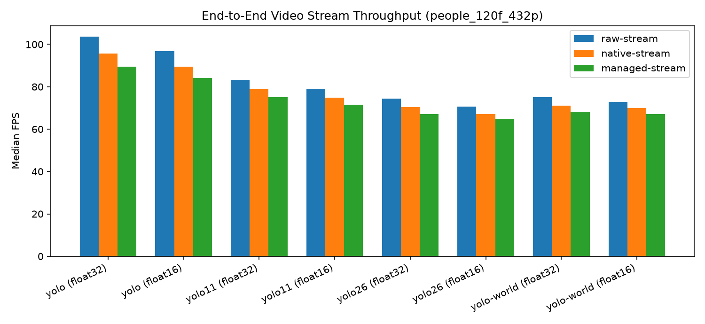
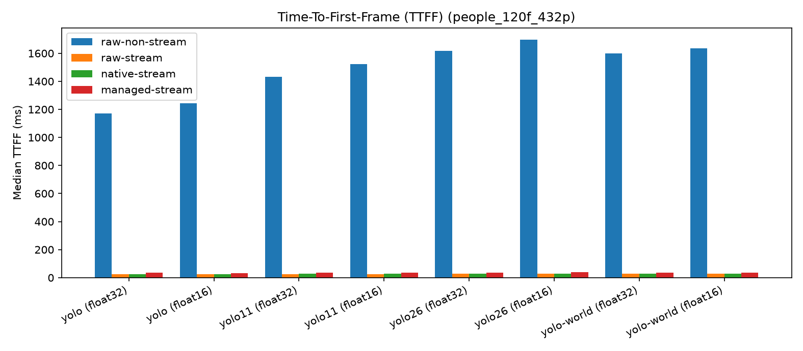

# Klygo Video Streaming Benchmark Report (people_120f_432p)

- **GPU**: `NVIDIA L4` (22563.1 MB VRAM)
- **Video Tier**: `people_120f_432p` (`768x432`, `120` H.264 frames, `repeats=7`)
- **Git**: `detection-evaluation` @ `6ab983356223eef08fc9c2fd93b980a58d3ad033`

## models.load Cold-Load Latency

| model | dtype | actual_dtype | load_seconds |
| --- | --- | --- | --- |
| yolo | float32 | torch.float32 | 0.6308 |
| yolo | float16 | torch.float16 | 0.1045 |
| yolo11 | float32 | torch.float32 | 0.5667 |
| yolo11 | float16 | torch.float16 | 0.1151 |
| yolo26 | float32 | torch.float32 | 0.2816 |
| yolo26 | float16 | torch.float16 | 0.1309 |
| yolo-world | float32 | torch.float32 | 11.2994 |
| yolo-world | float16 | torch.float16 | 5.9754 |

## 6-Mode Video Run Status

| model | dtype | returncode | status | output_dir | error |
| --- | --- | --- | --- | --- | --- |
| yolo | float32 | 0 | passed | /content/klygo/artifacts/benchmarks/video/people_120f_432p/inference/yolo_float32 |  |
| yolo | float16 | 0 | passed | /content/klygo/artifacts/benchmarks/video/people_120f_432p/inference/yolo_float16 |  |
| yolo11 | float32 | 0 | passed | /content/klygo/artifacts/benchmarks/video/people_120f_432p/inference/yolo11_float32 |  |
| yolo11 | float16 | 0 | passed | /content/klygo/artifacts/benchmarks/video/people_120f_432p/inference/yolo11_float16 |  |
| yolo26 | float32 | 0 | passed | /content/klygo/artifacts/benchmarks/video/people_120f_432p/inference/yolo26_float32 |  |
| yolo26 | float16 | 0 | passed | /content/klygo/artifacts/benchmarks/video/people_120f_432p/inference/yolo26_float16 |  |
| yolo-world | float32 | 0 | passed | /content/klygo/artifacts/benchmarks/video/people_120f_432p/inference/yolo-world_float32 |  |
| yolo-world | float16 | 0 | passed | /content/klygo/artifacts/benchmarks/video/people_120f_432p/inference/yolo-world_float16 |  |

## 6-Mode End-to-End Video Streaming Details

| model | dtype | actual_dtype | mode | status | fps_median | ttff_ms | p50_ms | p95_ms | p99_ms | parity_pass |
| --- | --- | --- | --- | --- | --- | --- | --- | --- | --- | --- |
| yolo | float32 | torch.float32 | raw-non-stream | ok | 102.38 | 1171.98 | 0.01 | 0.01 | 0.01 | True |
| yolo | float32 | torch.float32 | raw-stream | ok | 103.67 | 23.21 | 9.77 | 10.39 | 11.03 | True |
| yolo | float32 | torch.float32 | native-non-stream | ok | 98.58 | 1217.17 | 0.01 | 0.01 | 0.01 | True |
| yolo | float32 | torch.float32 | native-stream | ok | 95.67 | 24.3 | 10.86 | 11.49 | 11.86 | True |
| yolo | float32 | torch.float32 | managed-non-stream | ok | 90 | 1333.19 | 0.01 | 0.01 | 0.03 | True |
| yolo | float32 | torch.float32 | managed-stream | ok | 89.54 | 33.73 | 11.22 | 11.79 | 12.57 | True |
| yolo | float16 | torch.float16 | raw-non-stream | ok | 96.59 | 1242.22 | 0.01 | 0.01 | 0.01 | True |
| yolo | float16 | torch.float16 | raw-stream | ok | 96.82 | 23.93 | 10.35 | 11.23 | 11.52 | True |
| yolo | float16 | torch.float16 | native-non-stream | ok | 93.2 | 1287.39 | 0.01 | 0.01 | 0.02 | True |
| yolo | float16 | torch.float16 | native-stream | ok | 89.37 | 25.1 | 10.76 | 11.43 | 11.63 | True |
| yolo | float16 | torch.float16 | managed-non-stream | ok | 85.48 | 1403.74 | 0.01 | 0.01 | 0.03 | True |
| yolo | float16 | torch.float16 | managed-stream | ok | 84.09 | 33.52 | 11.59 | 12.36 | 12.72 | True |
| yolo11 | float32 | torch.float32 | raw-non-stream | ok | 83.78 | 1432.16 | 0.01 | 0.01 | 0.03 | True |
| yolo11 | float32 | torch.float32 | raw-stream | ok | 83.3 | 25.6 | 12.07 | 12.7 | 13.28 | True |
| yolo11 | float32 | torch.float32 | native-non-stream | ok | 81.58 | 1470.9 | 0.01 | 0.01 | 0.02 | True |
| yolo11 | float32 | torch.float32 | native-stream | ok | 78.92 | 26.65 | 12.82 | 13.62 | 13.97 | True |
| yolo11 | float32 | torch.float32 | managed-non-stream | ok | 75.8 | 1583.08 | 0.01 | 0.01 | 0.02 | True |
| yolo11 | float32 | torch.float32 | managed-stream | ok | 75.01 | 36.21 | 13.38 | 14.22 | 14.68 | True |
| yolo11 | float16 | torch.float16 | raw-non-stream | ok | 78.73 | 1524.1 | 0.01 | 0.01 | 0.02 | True |
| yolo11 | float16 | torch.float16 | raw-stream | ok | 79.04 | 26.12 | 12.67 | 13.71 | 13.98 | True |
| yolo11 | float16 | torch.float16 | native-non-stream | ok | 76.89 | 1560.46 | 0.01 | 0.01 | 0.02 | True |
| yolo11 | float16 | torch.float16 | native-stream | ok | 74.85 | 27.56 | 13.25 | 13.93 | 14.26 | True |
| yolo11 | float16 | torch.float16 | managed-non-stream | ok | 71.78 | 1671.77 | 0.01 | 0.01 | 0.02 | True |
| yolo11 | float16 | torch.float16 | managed-stream | ok | 71.51 | 36.27 | 14.01 | 14.86 | 15.31 | True |
| yolo26 | float32 | torch.float32 | raw-non-stream | ok | 74.12 | 1618.99 | 0.01 | 0.01 | 0.02 | True |
| yolo26 | float32 | torch.float32 | raw-stream | ok | 74.43 | 27.02 | 13.37 | 14.36 | 14.72 | True |
| yolo26 | float32 | torch.float32 | native-non-stream | ok | 72.14 | 1663.31 | 0.01 | 0.01 | 0.02 | True |
| yolo26 | float32 | torch.float32 | native-stream | ok | 70.45 | 27.66 | 14.16 | 15.06 | 15.59 | True |
| yolo26 | float32 | torch.float32 | managed-non-stream | ok | 68.01 | 1764.42 | 0.01 | 0.01 | 0.02 | True |
| yolo26 | float32 | torch.float32 | managed-stream | ok | 67.17 | 37.24 | 14.85 | 15.68 | 16.95 | True |
| yolo26 | float16 | torch.float16 | raw-non-stream | ok | 70.69 | 1697.39 | 0.01 | 0.01 | 0.03 | True |
| yolo26 | float16 | torch.float16 | raw-stream | ok | 70.54 | 27.49 | 14.06 | 14.87 | 16 | True |
| yolo26 | float16 | torch.float16 | native-non-stream | ok | 69.2 | 1733.97 | 0.01 | 0.01 | 0.02 | True |
| yolo26 | float16 | torch.float16 | native-stream | ok | 67.1 | 29.16 | 14.74 | 15.53 | 16.39 | True |
| yolo26 | float16 | torch.float16 | managed-non-stream | ok | 65.38 | 1835.33 | 0.01 | 0.01 | 0.02 | True |
| yolo26 | float16 | torch.float16 | managed-stream | ok | 64.82 | 37.74 | 15.34 | 16.43 | 16.74 | True |
| yolo-world | float32 | torch.float32 | raw-non-stream | ok | 75.06 | 1598.72 | 0.01 | 0.01 | 0.03 | True |
| yolo-world | float32 | torch.float32 | raw-stream | ok | 74.96 | 26.59 | 13.25 | 14.27 | 15.15 | True |
| yolo-world | float32 | torch.float32 | native-non-stream | ok | 72.98 | 1644.23 | 0.01 | 0.01 | 0.02 | True |
| yolo-world | float32 | torch.float32 | native-stream | ok | 70.97 | 27.76 | 14.09 | 14.95 | 15.77 | True |
| yolo-world | float32 | torch.float32 | managed-non-stream | ok | 68.66 | 1747.52 | 0.01 | 0.01 | 0.02 | True |
| yolo-world | float32 | torch.float32 | managed-stream | ok | 68.25 | 36.54 | 14.73 | 15.71 | 16.19 | True |
| yolo-world | float16 | torch.float16 | raw-non-stream | ok | 73.44 | 1633.96 | 0.01 | 0.01 | 0.03 | True |
| yolo-world | float16 | torch.float16 | raw-stream | ok | 72.86 | 27.06 | 13.51 | 14.19 | 14.65 | True |
| yolo-world | float16 | torch.float16 | native-non-stream | ok | 71.44 | 1679.5 | 0.01 | 0.01 | 0.02 | True |
| yolo-world | float16 | torch.float16 | native-stream | ok | 70.03 | 27.96 | 14.38 | 15.36 | 15.64 | True |
| yolo-world | float16 | torch.float16 | managed-non-stream | ok | 67.32 | 1782.51 | 0.01 | 0.01 | 0.01 | True |
| yolo-world | float16 | torch.float16 | managed-stream | ok | 67 | 36.95 | 14.92 | 15.98 | 17.46 | True |

## Charts

### Video Stream FPS by Mode

### Video Time-To-First-Frame (TTFF ms)

